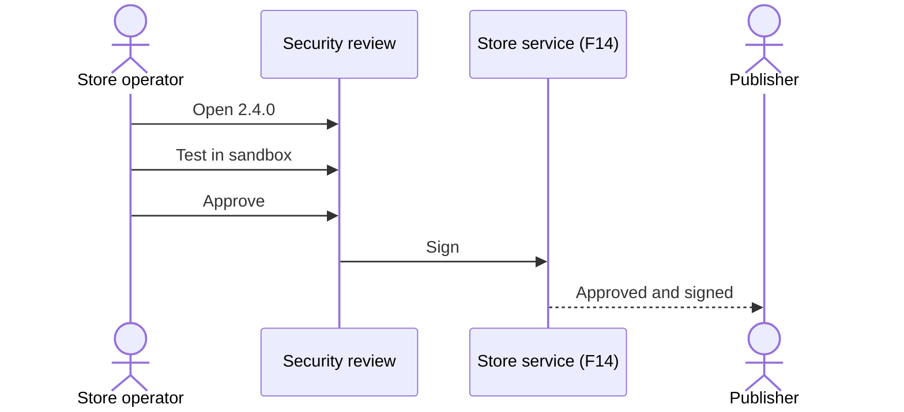

🏠 [Specs](../../../../README.md) › 🧩 [Functional capabilities](../../../README.md) ›
🧰 [F14 Plugin store](../../README.md) › 📝 [Use cases](../README.md) › 📝 [Use cases: FL-F14-03 Publish](README.md) ›
📝 UC-F14-10 Pass the security review and sign

# 📝 UC-F14-10 Pass the security review and sign

**Status:** ✅ specified

## Summary

The store operator reviews a version's code, reports and declared calls, approves or asks for changes, and signs
approved versions.

## Personas

- [U11 IT provider administrator](../../../../01-users/personas/u11-provider-admin.md)
- [U46 Plugin publisher](../../../../01-users/personas/u46-plugin-publisher.md)

## Goal

Only reviewed, signed versions install.

## Trigger

A version passed the checks.

## Frequency

Each submission.

## Preconditions

- Checks passed.

## Postconditions

- Success: signed version.
- Failure: changes asked or rejected.

## Main flow

1. The store operator opens the review queue (S-F14-10).
2. They read the check report, the bill of materials and the declared outside calls.
3. They test the plugin in a sandbox company.
4. They approve; simple-ERP signs the version (BR-F14-07).

## Alternative flows

- 4a. Changes asked: the publisher gets the comments.

## Error flows

- 3e. An undeclared outside call: rejected.
- Any step: a service does not answer; the call is retried first (BR-F3-32), then the message follows the error pattern
  (D122) and what was typed stays on the screen.

## Business rules

- [BR-F14-07 Releases signed](../../business-rules/br-f14-07-releases-signed.md)

## Entities

- [E-F14-03 Plugin version](../../data/e-f14-03-plugin-version.md)
- [E-F14-07 Plugin check report](../../data/e-f14-07-plugin-check-report.md)
- [E-F14-21 Plugin security review](../../data/e-f14-21-plugin-security-review.md)

## Permissions

Store operator.

## Notifications

- The publisher with the decision.

## Audit events

Review decision, comments, signature.

## AI involvement

The AI assistant may summarise the code changes.

## API, MCP and A2A exposure

Through T5 and T6 with the caller's rights (BR-F3-34).

## Screens

- [S-F14-10 Security review](../../screens/03-publish/s-f14-10-security-review.md)

## Flowchart

See [FL-F14-03 Publish](../../flows/fl-f14-03-publish.md#flowchart).

## Sequence diagram

## Acceptance criteria

1. **Given** a clean version **when** approved **then** it is signed.
2. **Given** an undeclared outside call **when** found **then** it is rejected.
3. **Given** changes asked **when** sent **then** the publisher sees the comments.

## Non-functional notes

D408's targets ([Performance](../../../../05-non-functional/performance.md)): 95 % of screens within 1 second; lists
paged on the server, the first page within 1 second; reports within 5 seconds or in the background.

## Regulatory references

Store rules of the France country pack:
[CR-FR-188 Reporting sellers' income (DAC7)](../../../../10-country-packs/france/digital/cr-fr-188-dac7-seller-reporting.md),
[CR-FR-189 Platform-to-business terms](../../../../10-country-packs/france/digital/cr-fr-189-p2b-platform-terms.md),
[CR-FR-190 Traceability of traders on a marketplace](../../../../10-country-packs/france/digital/cr-fr-190-marketplace-trader-traceability.md),
[CR-FR-191 Marketplace information to buyers](../../../../10-country-packs/france/consumer/cr-fr-191-marketplace-consumer-information.md),
[CR-FR-168 Cyber Resilience Act reporting](../../../../10-country-packs/france/digital/cr-fr-168-cyber-resilience-reporting.md),
[CR-FR-071 VAT on distance sales in the EU](../../../../10-country-packs/france/tax-and-vat/cr-fr-071-distance-sales-vat-oss.md),
[CR-FR-100 VAT on services to clients abroad](../../../../10-country-packs/france/tax-and-vat/cr-fr-100-vat-on-services-abroad.md),
[CR-FR-049 Processors and transfers outside the EU](../../../../10-country-packs/france/data-protection/cr-fr-049-processors-and-transfers.md),
[CR-FR-016 Electronic invoicing](../../../../10-country-packs/france/invoicing/cr-fr-016-electronic-invoicing.md).

## Related use cases

- [UC-F14-09 Pass automated checks](uc-f14-09-pass-automated-checks.md)
- [UC-F14-11 Publish versions and release notes](uc-f14-11-publish-versions-and-release-notes.md)
- [UC-F14-23 Take over an abandoned plugin](../07-plugin-end-of-life/uc-f14-23-take-over-an-abandoned-plugin.md)

## Open questions

None.

---

⬅️ [UC-F14-09 Pass automated checks](uc-f14-09-pass-automated-checks.md) · ⬆️ [Up](README.md) ·
➡️ [UC-F14-11 Publish versions and release notes](uc-f14-11-publish-versions-and-release-notes.md)
