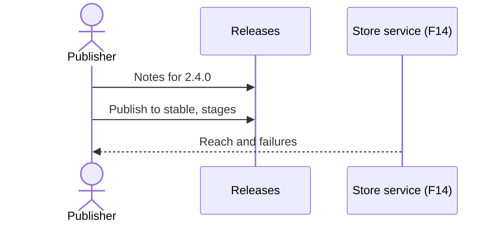

🏠 [Specs](../../../../README.md) › 🧩 [Functional capabilities](../../../README.md) ›
🧰 [F14 Plugin store](../../README.md) › 📝 [Use cases](../README.md) › 📝 [Use cases: FL-F14-03 Publish](README.md) ›
📝 UC-F14-11 Publish versions and release notes

# 📝 UC-F14-11 Publish versions and release notes

**Status:** ✅ specified

## Summary

The publisher publishes a signed version with its release notes, to the beta channel or to stable with a staged rollout,
and follows its reach.

## Personas

- [U46 Plugin publisher](../../../../01-users/personas/u46-plugin-publisher.md)

## Goal

Installers get the version and know what changed.

## Trigger

A version signed.

## Frequency

Each release.

## Preconditions

- The version is signed.

## Postconditions

- Success: version published.
- Failure: version held.

## Main flow

1. The publisher opens Releases (S-F14-11) and writes the notes.
2. They choose the channel: beta (UC-F14-24) or stable.
3. For stable, they start the staged rollout (UC-F14-25).
4. Installers are told; the publisher follows reach and failures.

## Alternative flows

- 2a. Staged rollout: see UC-F14-25.

## Error flows

- 4e. Many failures: the rollout pauses; installers can roll back (UC-F14-28).
- Any step: a service does not answer; the call is retried first (BR-F3-32), then the message follows the error pattern
  (D122) and what was typed stays on the screen.

## Business rules

- [BR-F14-03 Updates only when compatible](../../business-rules/br-f14-03-updates-only-when-compatible.md)

## Entities

- [E-F14-03 Plugin version](../../data/e-f14-03-plugin-version.md)

## Permissions

Publisher.

## Notifications

- Installing administrators when the update reaches them.

## Audit events

Release published, notes.

## AI involvement

The AI assistant may draft notes from the changes.

## API, MCP and A2A exposure

Through T5 and T6 with the caller's rights (BR-F3-34).

## Screens

- [S-F14-11 Releases](../../screens/03-publish/s-f14-11-releases.md)

## Flowchart

See [FL-F14-03 Publish](../../flows/fl-f14-03-publish.md#flowchart).

## Sequence diagram

## Acceptance criteria

1. **Given** 2.4.0 signed **when** published with notes **then** installers reached see the notes.
2. **Given** stable with stages **when** published **then** the rollout starts at the first stage.
3. **Given** failures above the limit **when** measured **then** the rollout pauses.

## Non-functional notes

D408's targets ([Performance](../../../../05-non-functional/performance.md)): 95 % of screens within 1 second; lists
paged on the server, the first page within 1 second; reports within 5 seconds or in the background.

## Regulatory references

Store rules of the France country pack:
[CR-FR-188 Reporting sellers' income (DAC7)](../../../../10-country-packs/france/digital/cr-fr-188-dac7-seller-reporting.md),
[CR-FR-189 Platform-to-business terms](../../../../10-country-packs/france/digital/cr-fr-189-p2b-platform-terms.md),
[CR-FR-190 Traceability of traders on a marketplace](../../../../10-country-packs/france/digital/cr-fr-190-marketplace-trader-traceability.md),
[CR-FR-191 Marketplace information to buyers](../../../../10-country-packs/france/consumer/cr-fr-191-marketplace-consumer-information.md),
[CR-FR-168 Cyber Resilience Act reporting](../../../../10-country-packs/france/digital/cr-fr-168-cyber-resilience-reporting.md),
[CR-FR-071 VAT on distance sales in the EU](../../../../10-country-packs/france/tax-and-vat/cr-fr-071-distance-sales-vat-oss.md),
[CR-FR-100 VAT on services to clients abroad](../../../../10-country-packs/france/tax-and-vat/cr-fr-100-vat-on-services-abroad.md),
[CR-FR-049 Processors and transfers outside the EU](../../../../10-country-packs/france/data-protection/cr-fr-049-processors-and-transfers.md),
[CR-FR-016 Electronic invoicing](../../../../10-country-packs/france/invoicing/cr-fr-016-electronic-invoicing.md).

## Related use cases

- [UC-F14-24 Publish to the beta channel](../06-release-channels-and-rollback/uc-f14-24-publish-to-the-beta-channel.md)
- [UC-F14-25 Roll out a release in stages](../06-release-channels-and-rollback/uc-f14-25-roll-out-a-release-in-stages.md)
- [UC-F14-28 Roll back to the previous version](../06-release-channels-and-rollback/uc-f14-28-roll-back-to-the-previous-version.md)

## Open questions

None.

---

⬅️ [UC-F14-10 Pass the security review and sign](uc-f14-10-pass-the-security-review-and-sign.md) · ⬆️ [Up](README.md) ·
➡️ [UC-F14-12 Set prices and plans](../04-money-and-taxes/uc-f14-12-set-prices-and-plans.md)
