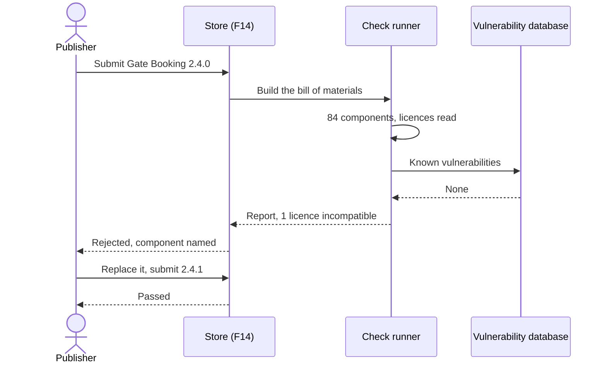

🏠 [Specs](../../../../README.md) › 🧩 [Functional capabilities](../../../README.md) ›
🧰 [F14 Plugin store](../../README.md) › 📝 [Use cases](../README.md) › 📝 [Use cases: FL-F14-03 Publish](README.md) ›
📝 UC-F14-21 Check a plugin's bill of materials and licences

# 📝 UC-F14-21 Check a plugin's bill of materials and licences

**Status:** 🔄 waiting for the owner

## Summary

At each submission, the store builds or reads the plugin's bill of materials, checks every dependency's licence against
the AGPL-3.0 and its known vulnerabilities, and rejects the version or tells the publisher what to change.

## Personas

- [U46 Plugin publisher](../../../../01-users/personas/u46-plugin-publisher.md)
- [U11 IT provider administrator](../../../../01-users/personas/u11-provider-admin.md), who reads the report in the
  security review

## Goal

No plugin ships a dependency that breaks its licence or carries a known vulnerability.

## Trigger

A version submitted (UC-F14-08); a vulnerability database update for published versions.

## Frequency

At each submission; nightly rescans of published versions (Proposed).

## Preconditions

- The version is uploaded with its manifest.

## Postconditions

- Success: a bill of materials attached to the version, all licences compatible, no blocking vulnerability.
- Failure: the version is rejected with each faulty dependency named.

## Main flow

1. The publisher submits a version; the automated checks (UC-F14-09) start the dependency check (S-F14-21).
2. simple-ERP reads the bill of materials from the package or generates it from the lock files.
3. simple-ERP checks each licence against the AGPL-3.0 (BR-F14-16) and each component against the vulnerability
   database.
4. The publisher reads the report: components, licences, compatibility, vulnerabilities.
5. A clean report passes to the security review (UC-F14-10), where the store operator sees it.

## Alternative flows

- 3a. A vulnerability is found later in a published version: the publisher and the store operator are told; it follows
  BR-F14-08 and, if exploited, UC-F14-16.
- 2a. The publisher provides a bill of materials in another accepted format: it is read as given and compared with the
  lock files.

## Error flows

- 3e. A dependency's licence is incompatible: the version is rejected with the dependency and licence named.
- 2e. A dependency declares no licence: rejected until declared.
- 2e2. The bill of materials differs from the lock files: rejected as inconsistent.
- Any step: a service does not answer; the call is retried first (BR-F3-32), then the message follows the error pattern
  (D122) and what was typed stays on the screen.

## Business rules

- [BR-F14-16 Dependencies listed and licence-compatible](../../business-rules/br-f14-16-dependencies-listed-and-licence-compatible.md)
- [BR-F14-06 Automated checks before review](../../business-rules/br-f14-06-automated-checks-before-review.md)
- [BR-F14-08 Vulnerabilities handled by publishers](../../business-rules/br-f14-08-vulnerabilities-handled-by-publishers.md)

## Entities

- [E-F14-14 Software bill of materials](../../data/e-f14-14-software-bill-of-materials.md)
- [E-F14-07 Plugin check report](../../data/e-f14-07-plugin-check-report.md)

## Permissions

Publisher: reads its own reports. Store operator: reads every report. Nobody can accept an incompatible licence.

## Notifications

- The publisher when the check fails or passes; the publisher and the store operator when a rescan finds a
  vulnerability.

## Audit events

Each check run with its result, the components flagged and the rescans.

## AI involvement

The AI assistant may suggest a compatible replacement for a rejected dependency to the publisher; it never overrides the
check.

## API, MCP and A2A exposure

The check report is available to the publisher through the publisher API (T5).

## Screens

- [S-F14-21 Dependency report](../../screens/03-publish/s-f14-21-dependency-report.md)

## Flowchart

See [FL-F14-03 Publish](../../flows/fl-f14-03-publish.md#flowchart).

## Sequence diagram

## Acceptance criteria

1. **Given** Gate Booking 2.4.0 with 84 dependencies all under MIT or Apache-2.0 **when** it is submitted **then** the
   report lists 84 compatible components and the version goes to review.
2. **Given** one dependency under a licence with no redistribution right **when** checked **then** the version is
   rejected naming the dependency and its licence.
3. **Given** a dependency with no licence **when** checked **then** the version is rejected until it is declared.
4. **Given** a published version and a new vulnerability in one of its components **when** the rescan runs **then** the
   publisher and the store operator are told.

## Non-functional notes

D408's targets ([Performance](../../../../05-non-functional/performance.md)): 95 % of screens within 1 second; lists
paged on the server, the first page within 1 second; reports within 5 seconds or in the background.

## Regulatory references

[CR-FR-168 Cyber Resilience Act reporting](../../../../10-country-packs/france/digital/cr-fr-168-cyber-resilience-reporting.md);
the bill-of-materials duty itself: (Proposed) to read.

## Related use cases

- [UC-F14-09 Pass automated checks](uc-f14-09-pass-automated-checks.md)
- [UC-F14-10 Pass the security review and sign](uc-f14-10-pass-the-security-review-and-sign.md)
- [UC-F14-16 Withdraw a vulnerable or harmful plugin](../05-store-operations/uc-f14-16-withdraw-a-vulnerable-or-harmful-plugin.md)

## Open questions

None.

---

⬅️ [UC-F14-20](../01-find-and-install/uc-f14-20-ask-the-assistant-to-find-or-set-up-a-plugin.md) · ⬆️ [Up](README.md) ·
➡️ [UC-F14-22](../07-plugin-end-of-life/uc-f14-22-deprecate-a-plugin-and-announce-its-end-of-life.md)
