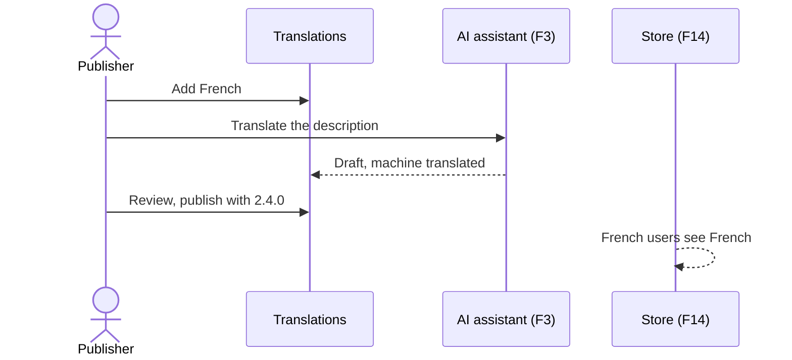

🏠 [Specs](../../../../README.md) › 🧩 [Functional capabilities](../../../README.md) ›
🧰 [F14 Plugin store](../../README.md) › 📝 [Use cases](../README.md) › 📝 [Use cases: FL-F14-03 Publish](README.md) ›
📝 UC-F14-26 Translate a listing and a plugin

# 📝 UC-F14-26 Translate a listing and a plugin

**Status:** ✅ specified

## Summary

A publisher adds the listing's and the plugin's texts in other languages, by hand or by machine translation marked as
such; users see them in their language with English as the fallback.

## Personas

- [U46 Plugin publisher](../../../../01-users/personas/u46-plugin-publisher.md)

## Goal

Users read the listing and the plugin in their language.

## Trigger

A new language wanted, or the source text changed.

## Frequency

At each release for multi-language plugins.

## Preconditions

- The listing exists.

## Postconditions

- Success: translations published with the next version.
- Failure: the translation stays a draft.

## Main flow

1. The publisher opens Translations (S-F14-24) and adds a language.
2. The publisher types the texts or imports a file, or asks for a machine translation.
3. SimpleERP marks machine translations as such (BR-F14-21) and flags texts that changed in the source.
4. The publisher reviews and publishes them with the next version.
5. Users of that language see the listing and the plugin in it.

## Alternative flows

- 2a. Machine translation by the AI assistant: marked "machine translated" on the listing.

## Error flows

- 4e. A required text is missing in the language: the listing falls back to English for that text.
- 2e. The import file has unknown keys: they are listed and ignored.
- Any step: a service does not answer; the call is retried first (BR-F3-32), then the message follows the error pattern
  (D122) and what was typed stays on the screen.

## Business rules

- [BR-F14-21 Listings and plugins in the user's language](../../business-rules/br-f14-21-listings-and-plugins-in-the-users-language.md)

## Entities

- [E-F14-18 Listing translation](../../data/e-f14-18-listing-translation.md)

## Permissions

Publisher only, for its listings.

## Notifications

- The publisher when a source text changes and translations become outdated.

## Audit events

Translation added, changed, published, with its source.

## AI involvement

The AI assistant may translate the texts; the result is marked as a machine translation.

## API, MCP and A2A exposure

Through the API (T5) and as AI assistant tools (T6), with the caller's rights (BR-F3-34).

## Screens

- [S-F14-24 Translations](../../screens/03-publish/s-f14-24-translations.md)

## Flowchart

See [FL-F14-03 Publish](../../flows/fl-f14-03-publish.md#flowchart).

## Sequence diagram

## Acceptance criteria

1. **Given** Gate Booking with French added **when** a French user opens the listing **then** it is in French.
2. **Given** only English provided **when** a German user opens it **then** it is in English with "available in
   English".
3. **Given** a machine translation **when** published **then** the listing shows "machine translated".
4. **Given** the English description changed **when** saved **then** the French one is flagged outdated.

## Non-functional notes

D408's targets ([Performance](../../../../05-non-functional/performance.md)): 95 % of screens within 1 second; lists
paged on the server, the first page within 1 second; reports within 5 seconds or in the background.

## Regulatory references

None.

## Related use cases

- [UC-F14-08 Submit a plugin](uc-f14-08-submit-a-plugin.md)
- [UC-F14-11 Publish versions and release notes](uc-f14-11-publish-versions-and-release-notes.md)

## Open questions

None.

---

⬅️ [UC-F14-25](../06-release-channels-and-rollback/uc-f14-25-roll-out-a-release-in-stages.md) · ⬆️ [Up](README.md) ·
➡️ [UC-F14-27](../02-buy-and-licence/uc-f14-27-set-and-honour-support-terms-of-a-paid-plan.md)
