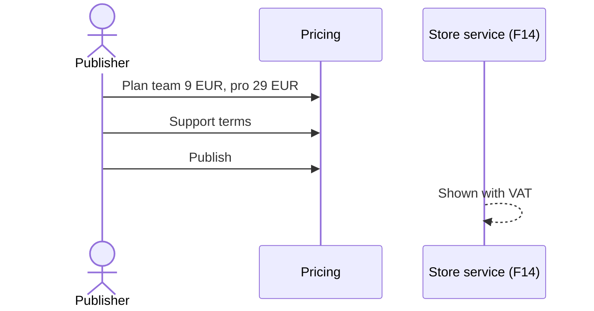

🏠 [Specs](../../../../README.md) › 🧩 [Functional capabilities](../../../README.md) ›
🧰 [F14 Plugin store](../../README.md) › 📝 [Use cases](../README.md) ›
📝 [Use cases: FL-F14-04 Money and taxes](README.md) › 📝 UC-F14-12 Set prices and plans

# 📝 UC-F14-12 Set prices and plans

**Status:** 🔄 waiting for the owner

## Summary

The publisher sets the plans, prices, trials and support terms of a plugin; price changes are announced to buyers before
they apply.

## Personas

- [U46 Plugin publisher](../../../../01-users/personas/u46-plugin-publisher.md)

## Goal

Clear plans buyers can compare.

## Trigger

A plugin ready to sell, or a price change.

## Frequency

Rare.

## Preconditions

- The listing exists.

## Postconditions

- Success: plans published.
- Failure: plans stay drafts.

## Main flow

1. The publisher opens Pricing (S-F14-12).
2. They set the plans and what each includes.
3. They set prices, trial periods and support terms (UC-F14-27).
4. They publish; the store shows the price with VAT by country.

## Alternative flows

- 3a. Discount codes for a period.

## Error flows

- 4e. A price change: buyers are told in advance (Proposed) 30 days ahead.
- Any step: a service does not answer; the call is retried first (BR-F3-32), then the message follows the error pattern
  (D122) and what was typed stays on the screen.

## Business rules

- [BR-F14-15 VAT on store sales](../../business-rules/br-f14-15-vat-on-store-sales.md)
- [BR-F14-22 Support terms shown before purchase and measured](../../business-rules/br-f14-22-support-terms-shown-before-purchase-and-measured.md)

## Entities

- [E-F14-04 Plugin price plan](../../data/e-f14-04-plugin-price-plan.md)

## Permissions

Publisher.

## Notifications

- Buyers of the plan before a price change.

## Audit events

Plans and prices changed.

## AI involvement

None.

## API, MCP and A2A exposure

Through T5 and T6 with the caller's rights (BR-F3-34).

## Screens

- [S-F14-12 Pricing](../../screens/04-money-and-taxes/s-f14-12-pricing.md)

## Flowchart

See [FL-F14-04 Money and taxes](../../flows/fl-f14-04-money-and-taxes.md#flowchart).

## Sequence diagram

## Acceptance criteria

1. **Given** plans team and pro **when** published **then** the store shows both with VAT.
2. **Given** a price rise **when** published **then** buyers are told before it applies.
3. **Given** a plan without support terms **when** published **then** it is refused.

## Non-functional notes

D408's targets ([Performance](../../../../05-non-functional/performance.md)): 95 % of screens within 1 second; lists
paged on the server, the first page within 1 second; reports within 5 seconds or in the background.

## Regulatory references

Store rules of the France country pack:
[CR-FR-188 Reporting sellers' income (DAC7)](../../../../10-country-packs/france/digital/cr-fr-188-dac7-seller-reporting.md),
[CR-FR-189 Platform-to-business terms](../../../../10-country-packs/france/digital/cr-fr-189-p2b-platform-terms.md),
[CR-FR-190 Traceability of traders on a marketplace](../../../../10-country-packs/france/digital/cr-fr-190-marketplace-trader-traceability.md),
[CR-FR-191 Marketplace information to buyers](../../../../10-country-packs/france/consumer/cr-fr-191-marketplace-consumer-information.md),
[CR-FR-168 Cyber Resilience Act reporting](../../../../10-country-packs/france/digital/cr-fr-168-cyber-resilience-reporting.md),
[CR-FR-071 VAT on distance sales in the EU](../../../../10-country-packs/france/tax-and-vat/cr-fr-071-distance-sales-vat-oss.md),
[CR-FR-100 VAT on services to clients abroad](../../../../10-country-packs/france/tax-and-vat/cr-fr-100-vat-on-services-abroad.md),
[CR-FR-049 Processors and transfers outside the EU](../../../../10-country-packs/france/data-protection/cr-fr-049-processors-and-transfers.md),
[CR-FR-016 Electronic invoicing](../../../../10-country-packs/france/invoicing/cr-fr-016-electronic-invoicing.md).

## Related use cases

- [UC-F14-27 Set and honour support terms of a paid plan](../02-buy-and-licence/uc-f14-27-set-and-honour-support-terms-of-a-paid-plan.md)
- [UC-F14-13 Receive payouts and statements](uc-f14-13-receive-payouts-and-statements.md)

## Open questions

None.

---

⬅️ [UC-F14-11 Publish versions and release notes](../03-publish/uc-f14-11-publish-versions-and-release-notes.md) ·
⬆️ [Up](README.md) · ➡️ [UC-F14-13 Receive payouts and statements](uc-f14-13-receive-payouts-and-statements.md)
