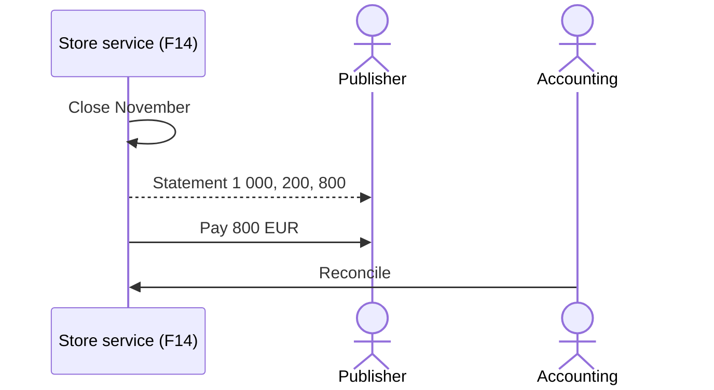

🏠 [Specs](../../../../README.md) › 🧩 [Functional capabilities](../../../README.md) ›
🧰 [F14 Plugin store](../../README.md) › 📝 [Use cases](../README.md) ›
📝 [Use cases: FL-F14-04 Money and taxes](README.md) › 📝 UC-F14-13 Receive payouts and statements

# 📝 UC-F14-13 Receive payouts and statements

**Status:** ✅ specified

## Summary

At each period's close, the store computes each publisher's payout (sales minus refunds, commission and taxes), sends
the statement and pays it out.

## Personas

- [U46 Plugin publisher](../../../../01-users/personas/u46-plugin-publisher.md)
- [U05 Accounting](../../../../01-users/personas/u05-accounting.md)

## Goal

Publishers paid exactly, with a statement.

## Trigger

The period closes.

## Frequency

Monthly.

## Preconditions

- The publisher's tax and bank data are complete.

## Postconditions

- Success: payout sent.
- Failure: payout held.

## Main flow

1. The store closes the period.
2. simple-ERP computes each payout (BR-F14-13).
3. The publisher reads the statement on Payouts (S-F14-13).
4. simple-ERP pays out; accounting reconciles.

## Alternative flows

- 4a. Another currency: converted at the period's rate.

## Error flows

- 2e. Tax data missing: held.
- Any step: a service does not answer; the call is retried first (BR-F3-32), then the message follows the error pattern
  (D122) and what was typed stays on the screen.

## Business rules

- [BR-F14-13 Payouts reconciled](../../business-rules/br-f14-13-payouts-reconciled.md)

## Entities

- [E-F14-08 Payout](../../data/e-f14-08-payout.md)

## Permissions

Publisher reads its own; accounting reads all.

## Notifications

- The publisher when paid.

## Audit events

Payout computed and paid.

## AI involvement

None.

## API, MCP and A2A exposure

Through T5 and T6 with the caller's rights (BR-F3-34).

## Screens

- [S-F14-13 Payouts](../../screens/04-money-and-taxes/s-f14-13-payouts.md)

## Flowchart

See [FL-F14-04 Money and taxes](../../flows/fl-f14-04-money-and-taxes.md#flowchart).

## Sequence diagram

## Acceptance criteria

1. **Given** 1 000.00 EUR of sales and 20 % commission **when** paid out **then** 800.00 EUR is sent with a statement.
2. **Given** missing tax data **when** the period closes **then** the payout is held.
3. **Given** a refund of 50.00 EUR **when** computed **then** it is deducted.

## Non-functional notes

D408's targets ([Performance](../../../../05-non-functional/performance.md)): 95 % of screens within 1 second; lists
paged on the server, the first page within 1 second; reports within 5 seconds or in the background.

## Regulatory references

Store rules of the France country pack:
[CR-FR-188 Reporting sellers' income (DAC7)](../../../../10-country-packs/france/digital/cr-fr-188-dac7-seller-reporting.md),
[CR-FR-189 Platform-to-business terms](../../../../10-country-packs/france/digital/cr-fr-189-p2b-platform-terms.md),
[CR-FR-190 Traceability of traders on a marketplace](../../../../10-country-packs/france/digital/cr-fr-190-marketplace-trader-traceability.md),
[CR-FR-191 Marketplace information to buyers](../../../../10-country-packs/france/consumer/cr-fr-191-marketplace-consumer-information.md),
[CR-FR-168 Cyber Resilience Act reporting](../../../../10-country-packs/france/digital/cr-fr-168-cyber-resilience-reporting.md),
[CR-FR-071 VAT on distance sales in the EU](../../../../10-country-packs/france/tax-and-vat/cr-fr-071-distance-sales-vat-oss.md),
[CR-FR-100 VAT on services to clients abroad](../../../../10-country-packs/france/tax-and-vat/cr-fr-100-vat-on-services-abroad.md),
[CR-FR-049 Processors and transfers outside the EU](../../../../10-country-packs/france/data-protection/cr-fr-049-processors-and-transfers.md),
[CR-FR-016 Electronic invoicing](../../../../10-country-packs/france/invoicing/cr-fr-016-electronic-invoicing.md).

## Related use cases

- [UC-F14-14 Report sellers to the tax office](uc-f14-14-report-sellers-to-the-tax-office.md)
- [UC-F14-18 Follow usage and revenue](uc-f14-18-follow-usage-and-revenue.md)

## Open questions

None.

---

⬅️ [UC-F14-12 Set prices and plans](uc-f14-12-set-prices-and-plans.md) · ⬆️ [Up](README.md) ·
➡️ [UC-F14-14 Report sellers to the tax office](uc-f14-14-report-sellers-to-the-tax-office.md)
