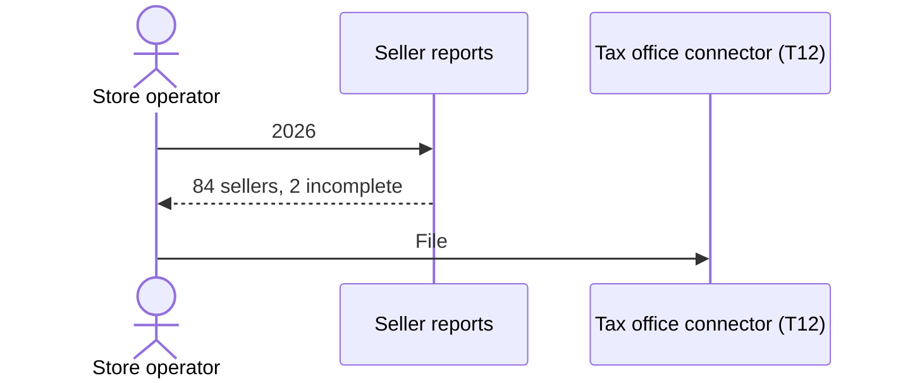

🏠 [Specs](../../../../README.md) › 🧩 [Functional capabilities](../../../README.md) ›
🧰 [F14 Plugin store](../../README.md) › 📝 [Use cases](../README.md) ›
📝 [Use cases: FL-F14-04 Money and taxes](README.md) › 📝 UC-F14-14 Report sellers to the tax office

# 📝 UC-F14-14 Report sellers to the tax office

**Status:** ✅ specified

## Summary

Each year the store collects its sellers' tax data and files the report of their income to the tax office.

## Personas

- [U11 IT provider administrator](../../../../01-users/personas/u11-provider-admin.md)
- [U05 Accounting](../../../../01-users/personas/u05-accounting.md)

## Goal

The yearly seller report filed on time.

## Trigger

The year's end.

## Frequency

Yearly.

## Preconditions

- Sales are recorded.

## Postconditions

- Success: report filed.
- Failure: missing sellers listed.

## Main flow

1. The store operator opens Seller reports (S-F14-14).
2. SimpleERP lists sellers and their income.
3. Sellers with missing data are reminded.
4. The report is built and filed (BR-F14-14).

## Alternative flows

- 4a. A correction after filing: a corrected report.

## Error flows

- 3e. Data still missing: payouts held.
- Any step: a service does not answer; the call is retried first (BR-F3-32), then the message follows the error pattern
  (D122) and what was typed stays on the screen.

## Business rules

- [BR-F14-14 Sellers reported yearly](../../business-rules/br-f14-14-sellers-reported-yearly.md)
- [BR-F14-01 The store follows the country pack](../../business-rules/br-f14-01-store-follows-the-country-pack.md)

## Entities

- [E-F14-09 Seller report](../../data/e-f14-09-seller-report.md)

## Permissions

Store operator and accounting.

## Notifications

- Sellers with missing data.

## Audit events

Report built and filed.

## AI involvement

None.

## API, MCP and A2A exposure

Through T5 and T6 with the caller's rights (BR-F3-34).

## Screens

- [S-F14-14 Seller reports](../../screens/04-money-and-taxes/s-f14-14-seller-reports.md)

## Flowchart

See [FL-F14-04 Money and taxes](../../flows/fl-f14-04-money-and-taxes.md#flowchart).

## Sequence diagram

## Acceptance criteria

1. **Given** 84 sellers in 2026 **when** filed **then** the report holds 84 sellers.
2. **Given** 2 incomplete **when** reminded **then** their payouts are held.
3. **Given** a correction **when** filed **then** a corrected report is sent.

## Non-functional notes

D408's targets ([Performance](../../../../05-non-functional/performance.md)): 95 % of screens within 1 second; lists
paged on the server, the first page within 1 second; reports within 5 seconds or in the background.

## Regulatory references

Store rules of the France country pack:
[CR-FR-188 Reporting sellers' income (DAC7)](../../../../10-country-packs/france/digital/cr-fr-188-dac7-seller-reporting.md),
[CR-FR-189 Platform-to-business terms](../../../../10-country-packs/france/digital/cr-fr-189-p2b-platform-terms.md),
[CR-FR-190 Traceability of traders on a marketplace](../../../../10-country-packs/france/digital/cr-fr-190-marketplace-trader-traceability.md),
[CR-FR-191 Marketplace information to buyers](../../../../10-country-packs/france/consumer/cr-fr-191-marketplace-consumer-information.md),
[CR-FR-168 Cyber Resilience Act reporting](../../../../10-country-packs/france/digital/cr-fr-168-cyber-resilience-reporting.md),
[CR-FR-071 VAT on distance sales in the EU](../../../../10-country-packs/france/tax-and-vat/cr-fr-071-distance-sales-vat-oss.md),
[CR-FR-100 VAT on services to clients abroad](../../../../10-country-packs/france/tax-and-vat/cr-fr-100-vat-on-services-abroad.md),
[CR-FR-049 Processors and transfers outside the EU](../../../../10-country-packs/france/data-protection/cr-fr-049-processors-and-transfers.md),
[CR-FR-016 Electronic invoicing](../../../../10-country-packs/france/invoicing/cr-fr-016-electronic-invoicing.md).

## Related use cases

- [UC-F14-13 Receive payouts and statements](uc-f14-13-receive-payouts-and-statements.md)

## Open questions

None.

---

⬅️ [UC-F14-13 Receive payouts and statements](uc-f14-13-receive-payouts-and-statements.md) · ⬆️ [Up](README.md) ·
➡️ [UC-F14-15 Run a private store](../05-store-operations/uc-f14-15-run-a-private-store.md)
