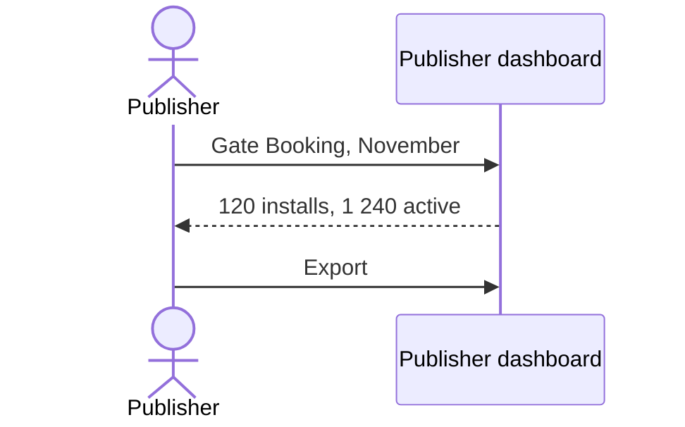

🏠 [Specs](../../../../README.md) › 🧩 [Functional capabilities](../../../README.md) ›
🧰 [F14 Plugin store](../../README.md) › 📝 [Use cases](../README.md) ›
📝 [Use cases: FL-F14-04 Money and taxes](README.md) › 📝 UC-F14-18 Follow usage and revenue

# 📝 UC-F14-18 Follow usage and revenue

**Status:** ✅ specified

## Summary

The publisher follows its plugins' installs, active companies, revenue, reviews, rollout failures and support record
over time.

## Personas

- [U46 Plugin publisher](../../../../01-users/personas/u46-plugin-publisher.md)

## Goal

Know how its plugins do.

## Trigger

Any time.

## Frequency

Weekly.

## Preconditions

- The publisher has listings.

## Postconditions

- Success: figures seen or exported.
- Failure: no data yet.

## Main flow

1. The publisher opens the dashboard (S-F14-18).
2. They choose a plugin and a period.
3. They compare versions and periods.
4. They export the figures.

## Alternative flows

- 3a. Per version.

## Error flows

- 1e. No data yet: shown.
- Any step: a service does not answer; the call is retried first (BR-F3-32), then the message follows the error pattern
  (D122) and what was typed stays on the screen.

## Business rules

- [BR-F14-13 Payouts reconciled](../../business-rules/br-f14-13-payouts-reconciled.md)

## Entities

- [E-F14-08 Payout](../../data/e-f14-08-payout.md)
- [E-F14-13 Usage metric](../../data/e-f14-13-usage-metric.md)

## Permissions

Publisher, its own plugins.

## Notifications

- None.

## Audit events

Exports.

## AI involvement

The AI assistant may explain a change.

## API, MCP and A2A exposure

Through T5 and T6 with the caller's rights (BR-F3-34).

## Screens

- [S-F14-18 Publisher dashboard](../../screens/04-money-and-taxes/s-f14-18-publisher-dashboard.md)

## Flowchart

See [FL-F14-04 Money and taxes](../../flows/fl-f14-04-money-and-taxes.md#flowchart).

## Sequence diagram

## Acceptance criteria

1. **Given** Gate Booking in November **when** opened **then** installs, active companies and revenue are shown.
2. **Given** a new plugin **when** opened **then** "no data yet" shows.
3. **Given** an export **when** asked **then** a CSV is produced.

## Non-functional notes

D408's targets ([Performance](../../../../05-non-functional/performance.md)): 95 % of screens within 1 second; lists
paged on the server, the first page within 1 second; reports within 5 seconds or in the background.

## Regulatory references

Store rules of the France country pack:
[CR-FR-188 Reporting sellers' income (DAC7)](../../../../10-country-packs/france/digital/cr-fr-188-dac7-seller-reporting.md),
[CR-FR-189 Platform-to-business terms](../../../../10-country-packs/france/digital/cr-fr-189-p2b-platform-terms.md),
[CR-FR-190 Traceability of traders on a marketplace](../../../../10-country-packs/france/digital/cr-fr-190-marketplace-trader-traceability.md),
[CR-FR-191 Marketplace information to buyers](../../../../10-country-packs/france/consumer/cr-fr-191-marketplace-consumer-information.md),
[CR-FR-168 Cyber Resilience Act reporting](../../../../10-country-packs/france/digital/cr-fr-168-cyber-resilience-reporting.md),
[CR-FR-071 VAT on distance sales in the EU](../../../../10-country-packs/france/tax-and-vat/cr-fr-071-distance-sales-vat-oss.md),
[CR-FR-100 VAT on services to clients abroad](../../../../10-country-packs/france/tax-and-vat/cr-fr-100-vat-on-services-abroad.md),
[CR-FR-049 Processors and transfers outside the EU](../../../../10-country-packs/france/data-protection/cr-fr-049-processors-and-transfers.md),
[CR-FR-016 Electronic invoicing](../../../../10-country-packs/france/invoicing/cr-fr-016-electronic-invoicing.md).

## Related use cases

- [UC-F14-13 Receive payouts and statements](uc-f14-13-receive-payouts-and-statements.md)
- [UC-F14-25 Roll out a release in stages](../06-release-channels-and-rollback/uc-f14-25-roll-out-a-release-in-stages.md)

## Open questions

None.

---

⬅️ [UC-F14-17 Handle refunds and disputes](../02-buy-and-licence/uc-f14-17-handle-refunds-and-disputes.md) ·
⬆️ [Up](README.md) · ➡️ [UC-F14-19](../05-store-operations/uc-f14-19-moderate-the-store-with-transparent-ranking.md)
