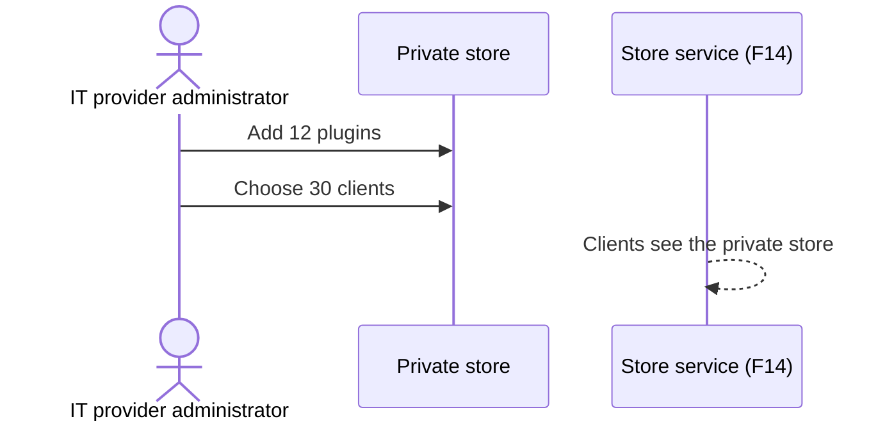

🏠 [Specs](../../../../README.md) › 🧩 [Functional capabilities](../../../README.md) ›
🧰 [F14 Plugin store](../../README.md) › 📝 [Use cases](../README.md) ›
📝 [Use cases: FL-F14-05 Store operations](README.md) › 📝 UC-F14-15 Run a private store

# 📝 UC-F14-15 Run a private store

**Status:** ✅ specified

## Summary

An IT provider runs its own private store for its client companies, with only signed plugins it chose.

## Personas

- [U11 IT provider administrator](../../../../01-users/personas/u11-provider-admin.md)

## Goal

Clients see only the plugins their provider supports.

## Trigger

An IT provider's decision.

## Frequency

Once, then changes.

## Preconditions

- The IT provider administrator manages client companies.

## Postconditions

- Success: a private store for the chosen clients.
- Failure: the store is not published.

## Main flow

1. The IT provider administrator opens Private store (S-F14-15).
2. They add plugins from the public store or their own.
3. They choose client companies.
4. Clients' administrators see only the private store.

## Alternative flows

- 2a. Mirror the public store and remove some.

## Error flows

- 2e. Unsigned plugin: refused.
- Any step: a service does not answer; the call is retried first (BR-F3-32), then the message follows the error pattern
  (D122) and what was typed stays on the screen.

## Business rules

- [BR-F14-07 Releases signed](../../business-rules/br-f14-07-releases-signed.md)

## Entities

- [E-F14-10 Private store](../../data/e-f14-10-private-store.md)

## Permissions

IT provider administrator.

## Notifications

- Client administrators when the store changes.

## Audit events

Store changes.

## AI involvement

None.

## API, MCP and A2A exposure

Through T5 and T6 with the caller's rights (BR-F3-34).

## Screens

- [S-F14-15 Private store](../../screens/05-store-operations/s-f14-15-private-store.md)

## Flowchart

See [FL-F14-05 Store operations](../../flows/fl-f14-05-store-operations.md#flowchart).

## Sequence diagram

## Acceptance criteria

1. **Given** 12 plugins and 30 clients **when** published **then** the 30 see only those 12.
2. **Given** an unsigned plugin **when** added **then** it is refused.
3. **Given** a mirror **when** a plugin is removed **then** clients no longer see it.

## Non-functional notes

D408's targets ([Performance](../../../../05-non-functional/performance.md)): 95 % of screens within 1 second; lists
paged on the server, the first page within 1 second; reports within 5 seconds or in the background.

## Regulatory references

Store rules of the France country pack:
[CR-FR-188 Reporting sellers' income (DAC7)](../../../../10-country-packs/france/digital/cr-fr-188-dac7-seller-reporting.md),
[CR-FR-189 Platform-to-business terms](../../../../10-country-packs/france/digital/cr-fr-189-p2b-platform-terms.md),
[CR-FR-190 Traceability of traders on a marketplace](../../../../10-country-packs/france/digital/cr-fr-190-marketplace-trader-traceability.md),
[CR-FR-191 Marketplace information to buyers](../../../../10-country-packs/france/consumer/cr-fr-191-marketplace-consumer-information.md),
[CR-FR-168 Cyber Resilience Act reporting](../../../../10-country-packs/france/digital/cr-fr-168-cyber-resilience-reporting.md),
[CR-FR-071 VAT on distance sales in the EU](../../../../10-country-packs/france/tax-and-vat/cr-fr-071-distance-sales-vat-oss.md),
[CR-FR-100 VAT on services to clients abroad](../../../../10-country-packs/france/tax-and-vat/cr-fr-100-vat-on-services-abroad.md),
[CR-FR-049 Processors and transfers outside the EU](../../../../10-country-packs/france/data-protection/cr-fr-049-processors-and-transfers.md),
[CR-FR-016 Electronic invoicing](../../../../10-country-packs/france/invoicing/cr-fr-016-electronic-invoicing.md).

## Related use cases

- [UC-F14-02 Install a plugin or sector pack](../01-find-and-install/uc-f14-02-install-a-plugin-or-sector-pack.md)

## Open questions

None.

---

⬅️ [UC-F14-14 Report sellers to the tax office](../04-money-and-taxes/uc-f14-14-report-sellers-to-the-tax-office.md) ·
⬆️ [Up](README.md) ·
➡️ [UC-F14-16 Withdraw a vulnerable or harmful plugin](uc-f14-16-withdraw-a-vulnerable-or-harmful-plugin.md)
