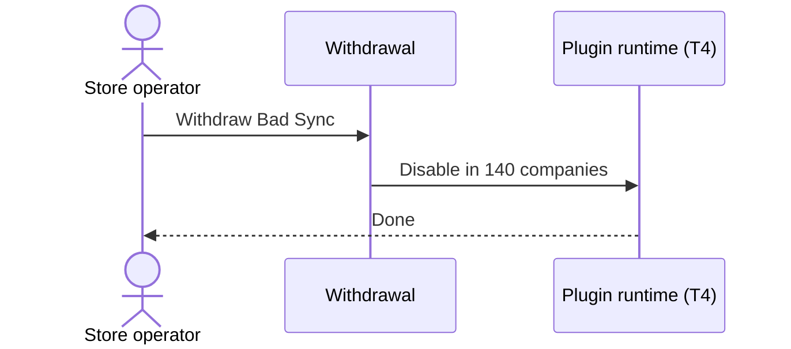

🏠 [Specs](../../../../README.md) › 🧩 [Functional capabilities](../../../README.md) ›
🧰 [F14 Plugin store](../../README.md) › 📝 [Use cases](../README.md) ›
📝 [Use cases: FL-F14-05 Store operations](README.md) › 📝 UC-F14-16 Withdraw a vulnerable or harmful plugin

# 📝 UC-F14-16 Withdraw a vulnerable or harmful plugin

**Status:** ✅ specified

## Summary

The store operator withdraws a plugin with an exploited vulnerability or harmful behaviour at once, disables or patches
installed copies, and tells administrators and the publisher.

## Personas

- [U11 IT provider administrator](../../../../01-users/personas/u11-provider-admin.md)

## Goal

Harm stopped in every company at once.

## Trigger

An exploited vulnerability or harmful behaviour found.

## Frequency

Rare.

## Preconditions

- Evidence of the harm.

## Postconditions

- Success: listing withdrawn, copies disabled or patched.
- Failure: none acceptable; the incident is escalated.

## Main flow

1. The store operator opens Withdrawal (S-F14-16) with the evidence.
2. They withdraw the listing (BR-F14-12).
3. simple-ERP disables or patches installed copies.
4. Administrators and the publisher are told; the vulnerability is reported (CR-FR-168).

## Alternative flows

- 3a. A patch is pushed instead of disabling.

## Error flows

- 2e. Not urgent: notice first (BR-F14-11).
- Any step: a service does not answer; the call is retried first (BR-F3-32), then the message follows the error pattern
  (D122) and what was typed stays on the screen.

## Business rules

- [BR-F14-12 Emergency withdrawal](../../business-rules/br-f14-12-emergency-withdrawal.md)
- [BR-F14-11 Notice before restriction](../../business-rules/br-f14-11-notice-before-restriction.md)
- [BR-F14-08 Vulnerabilities handled by publishers](../../business-rules/br-f14-08-vulnerabilities-handled-by-publishers.md)

## Entities

- [E-F14-11 Plugin withdrawal](../../data/e-f14-11-plugin-withdrawal.md)

## Permissions

Store operator.

## Notifications

- Administrators using it and the publisher at once.

## Audit events

Withdrawal, copies disabled, notices.

## AI involvement

None.

## API, MCP and A2A exposure

Through T5 and T6 with the caller's rights (BR-F3-34).

## Screens

- [S-F14-16 Withdrawal](../../screens/05-store-operations/s-f14-16-withdrawal.md)

## Flowchart

See [FL-F14-05 Store operations](../../flows/fl-f14-05-store-operations.md#flowchart).

## Sequence diagram

## Acceptance criteria

1. **Given** Bad Sync exfiltrating data **when** withdrawn **then** the 140 copies are disabled and administrators told.
2. **Given** a non-urgent issue **when** found **then** notice is given first.
3. **Given** a patch **when** pushed **then** copies update without disabling.

## Non-functional notes

D408's targets ([Performance](../../../../05-non-functional/performance.md)): 95 % of screens within 1 second; lists
paged on the server, the first page within 1 second; reports within 5 seconds or in the background.

## Regulatory references

Store rules of the France country pack:
[CR-FR-188 Reporting sellers' income (DAC7)](../../../../10-country-packs/france/digital/cr-fr-188-dac7-seller-reporting.md),
[CR-FR-189 Platform-to-business terms](../../../../10-country-packs/france/digital/cr-fr-189-p2b-platform-terms.md),
[CR-FR-190 Traceability of traders on a marketplace](../../../../10-country-packs/france/digital/cr-fr-190-marketplace-trader-traceability.md),
[CR-FR-191 Marketplace information to buyers](../../../../10-country-packs/france/consumer/cr-fr-191-marketplace-consumer-information.md),
[CR-FR-168 Cyber Resilience Act reporting](../../../../10-country-packs/france/digital/cr-fr-168-cyber-resilience-reporting.md),
[CR-FR-071 VAT on distance sales in the EU](../../../../10-country-packs/france/tax-and-vat/cr-fr-071-distance-sales-vat-oss.md),
[CR-FR-100 VAT on services to clients abroad](../../../../10-country-packs/france/tax-and-vat/cr-fr-100-vat-on-services-abroad.md),
[CR-FR-049 Processors and transfers outside the EU](../../../../10-country-packs/france/data-protection/cr-fr-049-processors-and-transfers.md),
[CR-FR-016 Electronic invoicing](../../../../10-country-packs/france/invoicing/cr-fr-016-electronic-invoicing.md).

## Related use cases

- [UC-F14-21 Check a plugin's bill of materials and licences](../03-publish/uc-f14-21-check-a-plugins-bill-of-materials-and-licences.md)
- [UC-F14-23 Take over an abandoned plugin](../07-plugin-end-of-life/uc-f14-23-take-over-an-abandoned-plugin.md)

## Open questions

None.

---

⬅️ [UC-F14-15 Run a private store](uc-f14-15-run-a-private-store.md) · ⬆️ [Up](README.md) ·
➡️ [UC-F14-17 Handle refunds and disputes](../02-buy-and-licence/uc-f14-17-handle-refunds-and-disputes.md)
