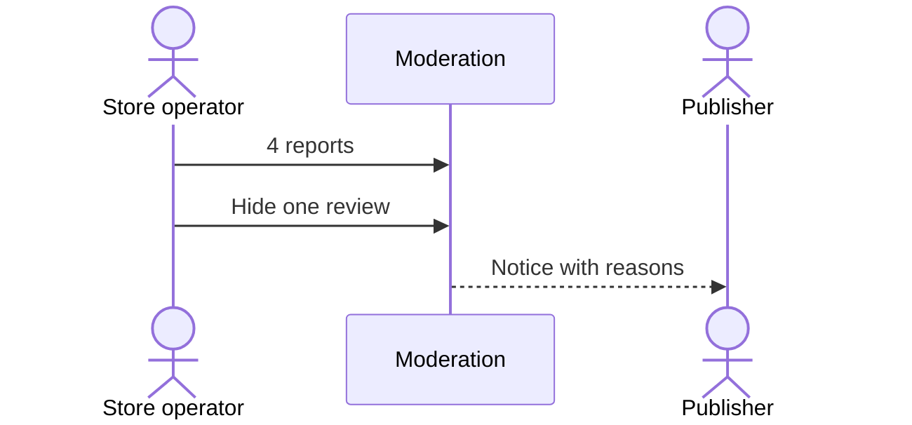

🏠 [Specs](../../../../README.md) › 🧩 [Functional capabilities](../../../README.md) ›
🧰 [F14 Plugin store](../../README.md) › 📝 [Use cases](../README.md) ›
📝 [Use cases: FL-F14-05 Store operations](README.md) › 📝 UC-F14-19 Moderate the store with transparent ranking

# 📝 UC-F14-19 Moderate the store with transparent ranking

**Status:** ✅ specified

## Summary

The store operator checks reported listings and reviews, acts with notice and reasons, and publishes how ranking works.

## Personas

- [U11 IT provider administrator](../../../../01-users/personas/u11-provider-admin.md)

## Goal

A fair store with ranking explained.

## Trigger

A report or a periodic review.

## Frequency

Weekly.

## Preconditions

- Reports exist.

## Postconditions

- Success: acted with reasons.
- Failure: escalated.

## Main flow

1. The store operator opens Moderation (S-F14-19).
2. They check each report.
3. They act: keep, hide, restrict with notice (BR-F14-11).
4. They publish the ranking rules (BR-F14-10).

## Alternative flows

- 4a. Featured plugins are marked as such.

## Error flows

- 3e. Restriction: notice first, except emergencies.
- Any step: a service does not answer; the call is retried first (BR-F3-32), then the message follows the error pattern
  (D122) and what was typed stays on the screen.

## Business rules

- [BR-F14-10 Ranking explained](../../business-rules/br-f14-10-ranking-explained.md)
- [BR-F14-11 Notice before restriction](../../business-rules/br-f14-11-notice-before-restriction.md)

## Entities

- [E-F14-06 Plugin review](../../data/e-f14-06-plugin-review.md)
- [E-F14-01 Store listing](../../data/e-f14-01-store-listing.md)

## Permissions

Store operator.

## Notifications

- The publisher of any action.

## Audit events

Actions and reasons.

## AI involvement

The AI assistant may group similar reports.

## API, MCP and A2A exposure

Through T5 and T6 with the caller's rights (BR-F3-34).

## Screens

- [S-F14-19 Moderation](../../screens/05-store-operations/s-f14-19-moderation.md)

## Flowchart

See [FL-F14-05 Store operations](../../flows/fl-f14-05-store-operations.md#flowchart).

## Sequence diagram

## Acceptance criteria

1. **Given** a fake review **when** hidden **then** the publisher gets the reasons.
2. **Given** a restriction **when** decided **then** notice comes first.
3. **Given** featured plugins **when** listed **then** they are marked.

## Non-functional notes

D408's targets ([Performance](../../../../05-non-functional/performance.md)): 95 % of screens within 1 second; lists
paged on the server, the first page within 1 second; reports within 5 seconds or in the background.

## Regulatory references

Store rules of the France country pack:
[CR-FR-188 Reporting sellers' income (DAC7)](../../../../10-country-packs/france/digital/cr-fr-188-dac7-seller-reporting.md),
[CR-FR-189 Platform-to-business terms](../../../../10-country-packs/france/digital/cr-fr-189-p2b-platform-terms.md),
[CR-FR-190 Traceability of traders on a marketplace](../../../../10-country-packs/france/digital/cr-fr-190-marketplace-trader-traceability.md),
[CR-FR-191 Marketplace information to buyers](../../../../10-country-packs/france/consumer/cr-fr-191-marketplace-consumer-information.md),
[CR-FR-168 Cyber Resilience Act reporting](../../../../10-country-packs/france/digital/cr-fr-168-cyber-resilience-reporting.md),
[CR-FR-071 VAT on distance sales in the EU](../../../../10-country-packs/france/tax-and-vat/cr-fr-071-distance-sales-vat-oss.md),
[CR-FR-100 VAT on services to clients abroad](../../../../10-country-packs/france/tax-and-vat/cr-fr-100-vat-on-services-abroad.md),
[CR-FR-049 Processors and transfers outside the EU](../../../../10-country-packs/france/data-protection/cr-fr-049-processors-and-transfers.md),
[CR-FR-016 Electronic invoicing](../../../../10-country-packs/france/invoicing/cr-fr-016-electronic-invoicing.md).

## Related use cases

- [UC-F14-07 Rate and review](../02-buy-and-licence/uc-f14-07-rate-and-review.md)
- [UC-F14-23 Take over an abandoned plugin](../07-plugin-end-of-life/uc-f14-23-take-over-an-abandoned-plugin.md)

## Open questions

None.

---

⬅️ [UC-F14-18 Follow usage and revenue](../04-money-and-taxes/uc-f14-18-follow-usage-and-revenue.md) ·
⬆️ [Up](README.md) · ➡️ [UC-F14-20](../01-find-and-install/uc-f14-20-ask-the-assistant-to-find-or-set-up-a-plugin.md)
