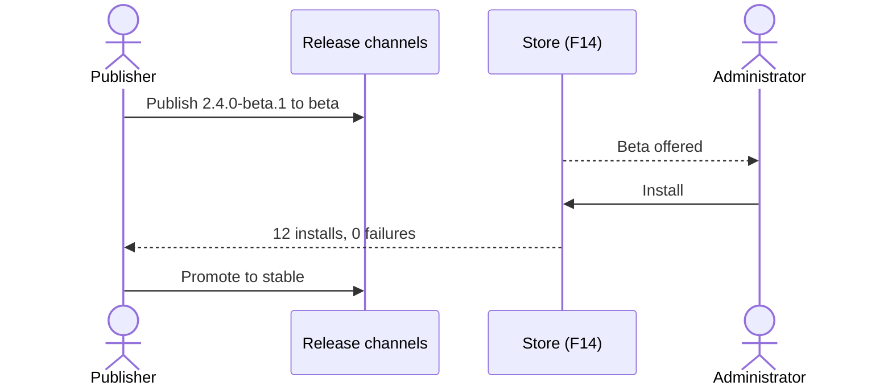

🏠 [Specs](../../../../README.md) › 🧩 [Functional capabilities](../../../README.md) ›
🧰 [F14 Plugin store](../../README.md) › 📝 [Use cases](../README.md) ›
📝 [Use cases: FL-F14-06 Release channels and rollback](README.md) › 📝 UC-F14-24 Publish to the beta channel

# 📝 UC-F14-24 Publish to the beta channel

**Status:** ✅ specified

## Summary

A publisher ships a signed version to the companies that opted into the plugin's beta channel, collects their install
reports and feedback, then promotes it to stable or replaces it.

## Personas

- [U46 Plugin publisher](../../../../01-users/personas/u46-plugin-publisher.md)
- [U07 Administrator](../../../../01-users/personas/u07-administrator.md), who opts the company in and installs betas

## Goal

Early feedback from willing companies before a release reaches everyone.

## Trigger

A version signed with the "beta" label.

## Frequency

Before most releases of active plugins.

## Preconditions

- The version passed checks and review and is signed (BR-F14-07).

## Postconditions

- Success: the beta installed by opted-in companies; promoted to stable or replaced.
- Failure: the beta is withdrawn from the channel.

## Main flow

1. The publisher opens Release channels (S-F14-23) and publishes the signed version to "beta".
2. Administrators who opted in see the beta offered with its notes and the "beta" mark.
3. An administrator installs it; the runtime sends an install report.
4. The publisher reads the reports and feedback on the channel page.
5. The publisher promotes the version to stable, which starts the rollout (UC-F14-25).

## Alternative flows

- 2a. An administrator opts in for the first time from the listing: the company joins the channel for that plugin.
- 5a. The publisher replaces the beta with a fixed one.

## Error flows

- 1e. The version is not signed: refused (BR-F14-07).
- 3e. The beta install fails: the report goes to the publisher; the company stays on its version.
- Any step: a service does not answer; the call is retried first (BR-F3-32), then the message follows the error pattern
  (D122) and what was typed stays on the screen.

## Business rules

- [BR-F14-19 Beta versions only where companies opt in](../../business-rules/br-f14-19-beta-versions-only-where-companies-opt-in.md)
- [BR-F14-07 Releases signed](../../business-rules/br-f14-07-releases-signed.md)

## Entities

- [E-F14-17 Rollout](../../data/e-f14-17-rollout.md)
- [E-F14-02 Plugin installation](../../data/e-f14-02-plugin-installation.md)

## Permissions

Publisher: its plugins' channels. Administrator: opts in and installs.

## Notifications

- Opted-in administrators when a beta is published; the publisher on each failed install.

## Audit events

Beta published, opt-ins, installs, reports, promotion, with who and when.

## AI involvement

The AI assistant may summarise beta feedback for the publisher.

## API, MCP and A2A exposure

Through the API (T5) and as AI assistant tools (T6), with the caller's rights (BR-F3-34).

## Screens

- [S-F14-23 Release channels](../../screens/06-release-channels-and-rollback/s-f14-23-release-channels.md)

## Flowchart

See [FL-F14-06 Release channels and rollback](../../flows/fl-f14-06-release-channels-and-rollback.md#flowchart).

## Sequence diagram

## Acceptance criteria

1. **Given** 12 companies opted into Gate Booking's beta **when** 2.4.0-beta.1 is published **then** only those 12 are
   offered it.
2. **Given** a company not opted in **when** it opens updates **then** the beta is not shown.
3. **Given** a failed beta install **when** the report arrives **then** the publisher sees it and the company keeps
   2.3.1.
4. **Given** the beta promoted **when** promoted **then** the staged rollout starts.

## Non-functional notes

D408's targets ([Performance](../../../../05-non-functional/performance.md)): 95 % of screens within 1 second; lists
paged on the server, the first page within 1 second; reports within 5 seconds or in the background.

## Regulatory references

None.

## Related use cases

- [UC-F14-25 Roll out a release in stages](uc-f14-25-roll-out-a-release-in-stages.md)
- [UC-F14-11 Publish versions and release notes](../03-publish/uc-f14-11-publish-versions-and-release-notes.md)

## Open questions

None.

---

⬅️ [UC-F14-23 Take over an abandoned plugin](../07-plugin-end-of-life/uc-f14-23-take-over-an-abandoned-plugin.md) ·
⬆️ [Up](README.md) · ➡️ [UC-F14-25 Roll out a release in stages](uc-f14-25-roll-out-a-release-in-stages.md)
