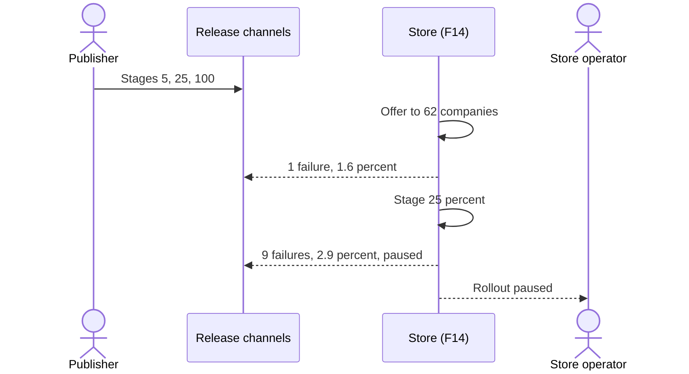

🏠 [Specs](../../../../README.md) › 🧩 [Functional capabilities](../../../README.md) ›
🧰 [F14 Plugin store](../../README.md) › 📝 [Use cases](../README.md) ›
📝 [Use cases: FL-F14-06 Release channels and rollback](README.md) › 📝 UC-F14-25 Roll out a release in stages

# 📝 UC-F14-25 Roll out a release in stages

**Status:** 🔄 waiting for the owner

## Summary

A publisher releases a stable version to a growing share of installing companies, stage by stage; the store pauses the
rollout when the failure rate rises above the limit.

## Personas

- [U46 Plugin publisher](../../../../01-users/personas/u46-plugin-publisher.md)
- [U11 IT provider administrator](../../../../01-users/personas/u11-provider-admin.md), who can stop any rollout

## Goal

A faulty release reaches few companies before it is stopped.

## Trigger

A version promoted to stable.

## Frequency

At each release of plugins with many installs.

## Preconditions

- The version is signed and stable.

## Postconditions

- Success: the version offered to every company.
- Failure: the rollout is paused or stopped; companies not reached keep the old version.

## Main flow

1. The publisher chooses the stages on Release channels (S-F14-23).
2. simple-ERP offers the update to the first stage's share of companies, chosen at random.
3. simple-ERP computes the failure rate from install reports.
4. Under the limit, the next stage starts after (Proposed) 48 hours; above it, the rollout pauses (BR-F14-20).
5. At 100 %, every company is offered the update.

## Alternative flows

- 1a. A security fix: the publisher may skip stages with the store operator's approval.

## Error flows

- 4e. The rollout pauses: the publisher is told with the failures; the next stage cannot be forced.
- 4e2. The store operator stops the rollout: no more companies are offered it.
- Any step: a service does not answer; the call is retried first (BR-F3-32), then the message follows the error pattern
  (D122) and what was typed stays on the screen.

## Business rules

- [BR-F14-20 Staged rollout pauses on failures](../../business-rules/br-f14-20-staged-rollout-pauses-on-failures.md)
- [BR-F14-03 Updates only when compatible](../../business-rules/br-f14-03-updates-only-when-compatible.md)

## Entities

- [E-F14-17 Rollout](../../data/e-f14-17-rollout.md)

## Permissions

Publisher: stages and resume; store operator: stop.

## Notifications

- The publisher at each stage and when paused; the store operator when paused.

## Audit events

Stages, rates, pauses, stops, with who and when.

## AI involvement

The AI assistant may group failure reports by cause for the publisher.

## API, MCP and A2A exposure

Through the API (T5) and as AI assistant tools (T6), with the caller's rights (BR-F3-34).

## Screens

- [S-F14-23 Release channels](../../screens/06-release-channels-and-rollback/s-f14-23-release-channels.md)

## Flowchart

See [FL-F14-06 Release channels and rollback](../../flows/fl-f14-06-release-channels-and-rollback.md#flowchart).

## Sequence diagram

## Acceptance criteria

1. **Given** Gate Booking 2.4.0 installed in 1 240 companies **when** stage 5 % starts **then** 62 companies are offered
   the update.
2. **Given** 1 failure in 62 **when** the stage ends **then** the 25 % stage starts.
3. **Given** 9 failures in 310 **when** computed **then** the rollout pauses and the publisher is told.
4. **Given** a paused rollout **when** the publisher forces the next stage **then** it is refused.

## Non-functional notes

D408's targets ([Performance](../../../../05-non-functional/performance.md)): 95 % of screens within 1 second; lists
paged on the server, the first page within 1 second; reports within 5 seconds or in the background.

## Regulatory references

None.

## Related use cases

- [UC-F14-24 Publish to the beta channel](uc-f14-24-publish-to-the-beta-channel.md)
- [UC-F14-28 Roll back to the previous version](uc-f14-28-roll-back-to-the-previous-version.md)
- [UC-F14-11 Publish versions and release notes](../03-publish/uc-f14-11-publish-versions-and-release-notes.md)

## Open questions

None.

---

⬅️ [UC-F14-24 Publish to the beta channel](uc-f14-24-publish-to-the-beta-channel.md) · ⬆️ [Up](README.md) ·
➡️ [UC-F14-26 Translate a listing and a plugin](../03-publish/uc-f14-26-translate-a-listing-and-a-plugin.md)
