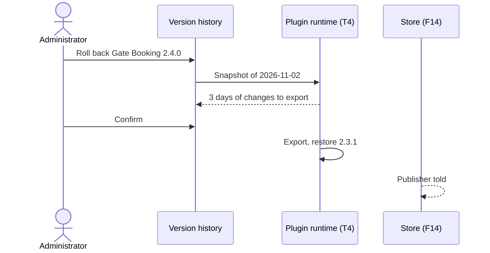

🏠 [Specs](../../../../README.md) › 🧩 [Functional capabilities](../../../README.md) ›
🧰 [F14 Plugin store](../../README.md) › 📝 [Use cases](../README.md) ›
📝 [Use cases: FL-F14-06 Release channels and rollback](README.md) › 📝 UC-F14-28 Roll back to the previous version

# 📝 UC-F14-28 Roll back to the previous version

**Status:** ✅ specified

## Summary

An administrator whose company meets a problem after an update rolls the plugin back to its previous version with the
data snapshot taken before the update; what was entered since is exported first.

## Personas

- [U07 Administrator](../../../../01-users/personas/u07-administrator.md)

## Goal

Work goes on as before the update, without losing data.

## Trigger

A problem after an update.

## Frequency

Rare.

## Preconditions

- A rollback point exists and has not expired (BR-F14-23).

## Postconditions

- Success: the previous version and its data restored; the changes since the update exported.
- Failure: the plugin stays on the new version.

## Main flow

1. The administrator opens Version history (S-F14-26) on the installed plugin.
2. SimpleERP shows the previous version, the snapshot date and what will be exported.
3. The administrator confirms the rollback.
4. SimpleERP exports the changes since the update, restores the version and snapshot, and logs it.
5. The publisher is told with the administrator's reason.

## Alternative flows

- 2a. A sector pack: all its plugins roll back together.

## Error flows

- 2e. The snapshot has expired: refused, the administrator is offered support.
- 3e. The previous version was withdrawn for security: refused (BR-F14-12).
- Any step: a service does not answer; the call is retried first (BR-F3-32), then the message follows the error pattern
  (D122) and what was typed stays on the screen.

## Business rules

- [BR-F14-23 Rollback restores the previous version and data](../../business-rules/br-f14-23-rollback-restores-the-previous-version-and-data.md)
- [BR-F14-03 Updates only when compatible](../../business-rules/br-f14-03-updates-only-when-compatible.md)

## Entities

- [E-F14-20 Rollback point](../../data/e-f14-20-rollback-point.md)
- [E-F14-02 Plugin installation](../../data/e-f14-02-plugin-installation.md)

## Permissions

Administrator.

## Notifications

- The publisher and the company's users of the plugin when a rollback happens.

## Audit events

Rollback with versions, snapshot, export, who, when and reason.

## AI involvement

The AI assistant may explain what a rollback will undo.

## API, MCP and A2A exposure

Through the API (T5) and as AI assistant tools (T6), with the caller's rights (BR-F3-34).

## Screens

- [S-F14-26 Version history](../../screens/06-release-channels-and-rollback/s-f14-26-version-history.md)

## Flowchart

See [FL-F14-06 Release channels and rollback](../../flows/fl-f14-06-release-channels-and-rollback.md#flowchart).

## Sequence diagram

## Acceptance criteria

1. **Given** Gate Booking updated to 2.4.0 on 2026-11-02 **when** the administrator rolls back on 2026-11-05 **then**
   2.3.1 and its data of 2026-11-02 are restored and the 3 days' changes exported.
2. **Given** a rollback point of 45 days **when** the administrator tries **then** it is refused.
3. **Given** 2.3.1 withdrawn for security **when** the administrator tries **then** it is refused.
4. **Given** a rollback **when** done **then** the publisher receives the reason.

## Non-functional notes

D408's targets ([Performance](../../../../05-non-functional/performance.md)): 95 % of screens within 1 second; lists
paged on the server, the first page within 1 second; reports within 5 seconds or in the background.

## Regulatory references

None.

## Related use cases

- [UC-F14-03 Update with compatibility checks](../01-find-and-install/uc-f14-03-update-with-compatibility-checks.md)
- [UC-F14-25 Roll out a release in stages](uc-f14-25-roll-out-a-release-in-stages.md)

## Open questions

None.

---

⬅️ [UC-F14-27](../02-buy-and-licence/uc-f14-27-set-and-honour-support-terms-of-a-paid-plan.md) · ⬆️ [Up](README.md) ·
➡️ [UC-F14-29](../08-trials-instances-and-partners/uc-f14-29-get-a-publisher-test-instance.md)
