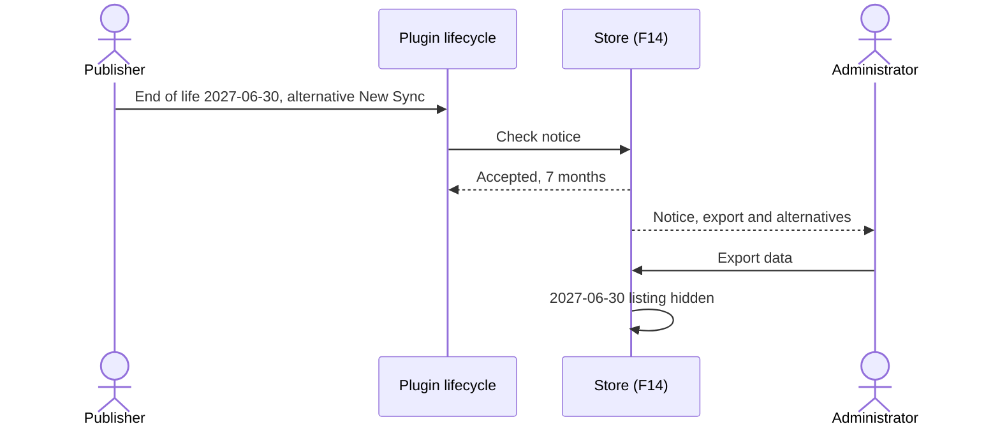

🏠 [Specs](../../../../README.md) › 🧩 [Functional capabilities](../../../README.md) ›
🧰 [F14 Plugin store](../../README.md) › 📝 [Use cases](../README.md) ›
📝 [Use cases: FL-F14-07 Plugin end of life](README.md) › 📝 UC-F14-22 Deprecate a plugin and announce its end of life

# 📝 UC-F14-22 Deprecate a plugin and announce its end of life

**Status:** 🔄 waiting for the owner

## Summary

A publisher who stops a plugin announces its end-of-life date with the reason, the data export and the alternatives;
installers are warned and the listing is hidden after the date while installs keep running.

## Personas

- [U46 Plugin publisher](../../../../01-users/personas/u46-plugin-publisher.md)
- [U07 Administrator](../../../../01-users/personas/u07-administrator.md), who is warned and plans the move

## Goal

Installers have time and a path to move before the plugin stops being maintained.

## Trigger

The publisher's decision to stop the plugin.

## Frequency

Rare: a few plugins a year.

## Preconditions

- The publisher owns the listing.

## Postconditions

- Success: an end-of-life notice; installers warned; after the end date the listing is hidden and no update ships.
- Failure: the notice is refused and the plugin stays maintained.

## Main flow

1. The publisher opens Plugin lifecycle (S-F14-22) and chooses "Announce end of life".
2. The publisher enters the end date, the reason and the alternatives; simple-ERP checks the minimum notice (BR-F14-17).
3. simple-ERP publishes the notice on the listing and warns every installing administrator.
4. Administrators see the notice on their installed plugins with "Export data" and the alternatives.
5. On the end date the listing is hidden from searches; installed copies keep running without updates.

## Alternative flows

- 2a. Another publisher wants to continue it: the take-over follows UC-F14-23.
- 4a. The administrator uninstalls before the date with the export (UC-F14-04).

## Error flows

- 2e. The end date is earlier than the minimum notice: refused with the earliest date allowed.
- 5e. A vulnerability is found after the end date: the withdrawal rules apply (UC-F14-16).
- Any step: a service does not answer; the call is retried first (BR-F3-32), then the message follows the error pattern
  (D122) and what was typed stays on the screen.

## Business rules

- [BR-F14-17 End of life announced in advance](../../business-rules/br-f14-17-end-of-life-announced-in-advance.md)
- [BR-F14-04 Uninstall keeps an export](../../business-rules/br-f14-04-uninstall-keeps-an-export.md)

## Entities

- [E-F14-15 End-of-life notice](../../data/e-f14-15-end-of-life-notice.md)
- [E-F14-01 Store listing](../../data/e-f14-01-store-listing.md)

## Permissions

Publisher: its own listings. Administrator: reads notices and exports. Store operator: reads all notices.

## Notifications

- Every installing administrator when the notice is published, and (Proposed) 30 days and 7 days before the end date.

## Audit events

Notice published, changed, end date reached, with who and when.

## AI involvement

The AI assistant may list an administrator's plugins near their end of life and suggest alternatives.

## API, MCP and A2A exposure

Through the API (T5) and as AI assistant tools (T6), with the caller's rights (BR-F3-34).

## Screens

- [S-F14-22 Plugin lifecycle](../../screens/07-plugin-end-of-life/s-f14-22-plugin-lifecycle.md)

## Flowchart

See [FL-F14-07 Plugin end of life](../../flows/fl-f14-07-plugin-end-of-life.md#flowchart).

## Sequence diagram

## Acceptance criteria

1. **Given** Old Sync installed in 52 companies **when** its publisher announces an end on 2027-06-30 on 2026-12-01
   **then** 52 administrators are warned with the export and the alternative.
2. **Given** an end date 6 weeks away **when** announced **then** it is refused with the earliest date allowed.
3. **Given** the end date passed **when** a user searches the store **then** Old Sync is not listed and installed copies
   still run.
4. **Given** an administrator of the retail example company **when** they open the notice **then** "Export data"
   produces the export of UC-F14-04.

## Non-functional notes

D408's targets ([Performance](../../../../05-non-functional/performance.md)): 95 % of screens within 1 second; lists
paged on the server, the first page within 1 second; reports within 5 seconds or in the background.

## Regulatory references

None.

## Related use cases

- [UC-F14-23 Take over an abandoned plugin](uc-f14-23-take-over-an-abandoned-plugin.md)
- [UC-F14-04 Uninstall and export the plugin's data](../01-find-and-install/uc-f14-04-uninstall-and-export-the-plugin-s-data.md)
- [UC-F14-16 Withdraw a vulnerable or harmful plugin](../05-store-operations/uc-f14-16-withdraw-a-vulnerable-or-harmful-plugin.md)

## Open questions

None.

---

⬅️ [UC-F14-21](../03-publish/uc-f14-21-check-a-plugins-bill-of-materials-and-licences.md) · ⬆️ [Up](README.md) ·
➡️ [UC-F14-23 Take over an abandoned plugin](uc-f14-23-take-over-an-abandoned-plugin.md)
