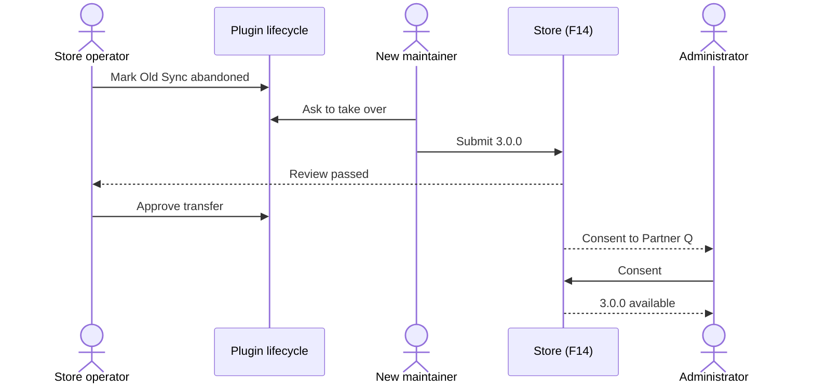

🏠 [Specs](../../../../README.md) › 🧩 [Functional capabilities](../../../README.md) ›
🧰 [F14 Plugin store](../../README.md) › 📝 [Use cases](../README.md) ›
📝 [Use cases: FL-F14-07 Plugin end of life](README.md) › 📝 UC-F14-23 Take over an abandoned plugin

# 📝 UC-F14-23 Take over an abandoned plugin

**Status:** ✅ specified

## Summary

When a plugin is abandoned, another verified publisher asks to take it over; after the security review the store
operator moves the listing, and each installing company consents before receiving the new maintainer's versions.

## Personas

- [U46 Plugin publisher](../../../../01-users/personas/u46-plugin-publisher.md), the new maintainer
- [U11 IT provider administrator](../../../../01-users/personas/u11-provider-admin.md), who approves the transfer
- [U07 Administrator](../../../../01-users/personas/u07-administrator.md), who consents for their company

## Goal

Useful plugins keep being maintained by someone the installers trust.

## Trigger

A plugin marked abandoned (BR-F14-18) or past its end of life.

## Frequency

Rare.

## Preconditions

- The plugin is marked abandoned or ended.
- The candidate is a verified publisher (BR-F14-09).

## Postconditions

- Success: the listing belongs to the new maintainer; consenting companies receive their versions.
- Failure: the plugin stays abandoned.

## Main flow

1. The store operator marks the plugin abandoned on Plugin lifecycle (S-F14-22); the listing shows "looking for a
   maintainer".
2. A verified publisher asks to take it over with their plan for it.
3. The publisher submits a first version, which passes the checks and the security review (UC-F14-09, UC-F14-10).
4. The store operator approves the transfer; every installing administrator is asked to consent.
5. Companies that consent receive the new versions; the others stay on the last old version.

## Alternative flows

- 1a. The original publisher objects within the period and resumes maintenance: the mark is lifted.

## Error flows

- 2e. The candidate is not verified: refused (BR-F14-09).
- 3e. The first version fails the review: the transfer is refused and the offer reopens.
- Any step: a service does not answer; the call is retried first (BR-F3-32), then the message follows the error pattern
  (D122) and what was typed stays on the screen.

## Business rules

- [BR-F14-18 Abandoned plugins can be taken over](../../business-rules/br-f14-18-abandoned-plugins-can-be-taken-over.md)
- [BR-F14-09 Traders verified](../../business-rules/br-f14-09-traders-verified.md)
- [BR-F14-07 Releases signed](../../business-rules/br-f14-07-releases-signed.md)

## Entities

- [E-F14-16 Maintainer transfer](../../data/e-f14-16-maintainer-transfer.md)
- [E-F14-01 Store listing](../../data/e-f14-01-store-listing.md)
- [E-F14-21 Plugin security review](../../data/e-f14-21-plugin-security-review.md)

## Permissions

Store operator approves; verified publishers ask; administrators consent for their company.

## Notifications

- The original publisher when the plugin is marked abandoned; administrators when asked to consent; the new maintainer
  when approved.

## Audit events

Mark, request, review, approval, each consent, with who and when.

## AI involvement

The AI assistant may summarise the plugin's open issues for the candidate.

## API, MCP and A2A exposure

Through the API (T5) and as AI assistant tools (T6), with the caller's rights (BR-F3-34).

## Screens

- [S-F14-22 Plugin lifecycle](../../screens/07-plugin-end-of-life/s-f14-22-plugin-lifecycle.md)

## Flowchart

See [FL-F14-07 Plugin end of life](../../flows/fl-f14-07-plugin-end-of-life.md#flowchart).

## Sequence diagram

## Acceptance criteria

1. **Given** Old Sync with no release since 2025-10-01 **when** the store operator marks it abandoned **then** the
   listing shows "looking for a maintainer" and its publisher is told.
2. **Given** Partner Q, verified, whose 3.0.0 passes the review **when** the transfer is approved **then** 52
   administrators are asked to consent.
3. **Given** an administrator who does not consent **when** 3.0.0 ships **then** their company stays on the last version
   of the old maintainer.
4. **Given** an unverified candidate **when** they ask **then** the request is refused.

## Non-functional notes

D408's targets ([Performance](../../../../05-non-functional/performance.md)): 95 % of screens within 1 second; lists
paged on the server, the first page within 1 second; reports within 5 seconds or in the background.

## Regulatory references

None.

## Related use cases

- [UC-F14-22 Deprecate a plugin and announce its end of life](uc-f14-22-deprecate-a-plugin-and-announce-its-end-of-life.md)
- [UC-F14-10 Pass the security review and sign](../03-publish/uc-f14-10-pass-the-security-review-and-sign.md)

## Open questions

None.

---

⬅️ [UC-F14-22](uc-f14-22-deprecate-a-plugin-and-announce-its-end-of-life.md) · ⬆️ [Up](README.md) ·
➡️ [UC-F14-24](../06-release-channels-and-rollback/uc-f14-24-publish-to-the-beta-channel.md)
