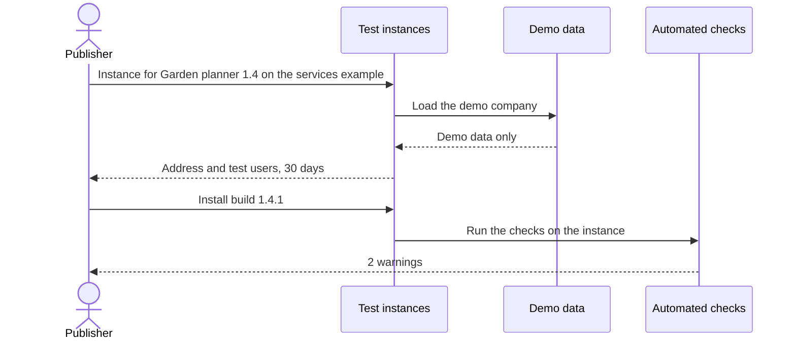

🏠 [Specs](../../../../README.md) › 🧩 [Functional capabilities](../../../README.md) ›
🧰 [F14 Plugin store](../../README.md) › 📝 [Use cases](../README.md) ›
📝 [Use cases: FL-F14-08 Trials, test instances, partners and themes](README.md) ›
📝 UC-F14-29 Get a publisher test instance

# 📝 UC-F14-29 Get a publisher test instance

**Status:** ✅ specified

## Summary

A plugin publisher asks the store for a test instance: a separate SimpleERP company filled with demo data, on which the
publisher installs their plugin at a chosen version and tries it before submitting. The instance has a life of its own,
lasts a set number of days and is deleted with everything in it.

## Personas

- [U46 Plugin publisher](../../../../01-users/personas/u46-plugin-publisher.md)

## Goal

Publishers test their plugin on a real SimpleERP without touching any customer's data and without running their own
servers.

## Trigger

A publisher starts a plugin or a new version and wants to try it
([UC-F14-08](../03-publish/uc-f14-08-submit-a-plugin.md),
[UC-F14-11](../03-publish/uc-f14-11-publish-versions-and-release-notes.md)).

## Frequency

A few instances a month per active publisher.

## Preconditions

- The publisher has an account and at least one plugin draft in the publisher portal
  ([E-F14-01 Store listing](../../data/e-f14-01-store-listing.md)).
- The publisher has not reached their limit of running instances.

## Postconditions

- **Succeeded:** the instance is saved ([E-F14-22 Test instance](../../data/e-f14-22-test-instance.md)) with its
  address, its demo dataset, the plugin version installed and its end date; the publisher can open it and install builds
  on it.
- **Failed:** no instance is created; the publisher sees why (limit reached, plugin not found) and the draft is
  unchanged.

## Main flow

1. The publisher opens the test instances screen
   ([S-F14-27](../../screens/08-trials-instances-and-partners/s-f14-27-test-instances.md)) and chooses the plugin, the
   version to install, the SimpleERP version and a demo dataset (a sector example company).
2. SimpleERP checks the publisher's limit of instances and creates the instance with demo data only
   ([BR-F14-24](../../business-rules/br-f14-24-test-instances-hold-demo-data-only.md)).
3. The publisher receives the address and a test user for each persona of the demo company.
4. The publisher installs new builds of the plugin on the instance and sees the automated checks run against it
   ([UC-F14-09](../03-publish/uc-f14-09-pass-automated-checks.md)).
5. The publisher extends the instance once if more time is needed, within the limit.
6. At the end date, or when the publisher deletes it, the instance and its data are removed.

## Alternative flows

- 1a. The publisher asks for an instance with the next SimpleERP version in preview to test compatibility
  ([BR-F14-03](../../business-rules/br-f14-03-updates-only-when-compatible.md)).
- 5a. The publisher resets the instance to its demo data without waiting for the end date.
- 6a. The publisher exports the plugin's own test logs before the instance is removed.

## Error flows

- 2e. The publisher has reached the limit of instances: the request is refused and the oldest idle instance is offered
  for deletion.
- 4e. The publisher tries to import a file that holds personal data of real people: the import is refused
  ([BR-F14-24](../../business-rules/br-f14-24-test-instances-hold-demo-data-only.md)).
- 5e. The extension is refused because the instance was already extended once.
- Any step: a service does not answer; the call is retried first
  ([BR-F3-32](../../../f03-assistant/business-rules/br-f03-32-retry-before-an-error.md)), then the message follows the
  error pattern ([D122](../../../../06-decisions/ux/d122-error-message-standard.md)) and what the user typed stays on
  the screen.

## Business rules

- [BR-F14-24](../../business-rules/br-f14-24-test-instances-hold-demo-data-only.md)
- [BR-F14-06](../../business-rules/br-f14-06-automated-checks-before-review.md)

## Entities

- [E-F14-22 Test instance](../../data/e-f14-22-test-instance.md): created, changed
- [E-F14-01 Store listing](../../data/e-f14-01-store-listing.md): read, the plugin to test
- [E-F14-03 Plugin version](../../data/e-f14-03-plugin-version.md): read, the version installed

## Permissions

Plugin publisher: their own instances only. The SimpleERP maintainer team reads every instance's state,
never its demo content as customer data.

## Notifications

The publisher, in the portal and by email: the instance is ready, ends in 3 days, was removed.

## Audit events

Each instance created, extended, reset and removed; each plugin build installed on it; each import refused and why.

## AI involvement

No AI step of its own. The AI assistant may open the screen and prefill it from the user's words; the user checks and
confirms ([BR-F3-07](../../../f03-assistant/business-rules/br-f03-07-no-deletes-no-irreversible-acts.md)).

## API, MCP and A2A exposure

T5 operations of the capability for the personas above: create, read, update and list. The MCP tool of the
capability may read and propose, never confirm alone. No A2A skill.

## Screens

- [S-F14-27](../../screens/08-trials-instances-and-partners/s-f14-27-test-instances.md)

## Flowchart

See
[FL-F14-08 Trials, test instances, partners and themes](../../flows/fl-f14-08-trials-instances-and-partners.md#flowchart).

## Sequence diagram

## Acceptance criteria

1. **Given** a publisher with 2 of 3 instances **when** they ask for another **then** it is created with a demo company
   and an end date 30 days away.
2. **Given** a file that holds real customer records **when** the publisher imports it **then** the import is refused
   and logged.
3. **Given** an instance whose end date has passed **when** the day ends **then** the instance and its data are removed
   and the publisher is told.
4. **Given** an instance extended once **when** the publisher extends again **then** the request is refused.

## Non-functional notes

The screen answers within 2 seconds for 10,000 records; every change is audited.

## Regulatory references

Real people's data must not be put in a test environment:
[CR-FR-050](../../../../10-country-packs/france/data-protection/cr-fr-050-privacy-by-design.md). The demo companies hold
invented people only ([BR-F14-24](../../business-rules/br-f14-24-test-instances-hold-demo-data-only.md)).

## Related use cases

- [UC-F14-30 Try a paid plugin free](uc-f14-30-try-a-paid-plugin-free.md)
- [UC-F14-08 Submit a plugin](../03-publish/uc-f14-08-submit-a-plugin.md)
- [UC-F14-09 Pass automated checks](../03-publish/uc-f14-09-pass-automated-checks.md)
- [UC-F14-30 Try a paid plugin free](uc-f14-30-try-a-paid-plugin-free.md)
- [UC-F14-11](../03-publish/uc-f14-11-publish-versions-and-release-notes.md)

## Open questions

None.

---

⬅️ [UC-F14-28](../06-release-channels-and-rollback/uc-f14-28-roll-back-to-the-previous-version.md) ·
⬆️ [Up](README.md) · ➡️ [UC-F14-30 Try a paid plugin free](uc-f14-30-try-a-paid-plugin-free.md)
