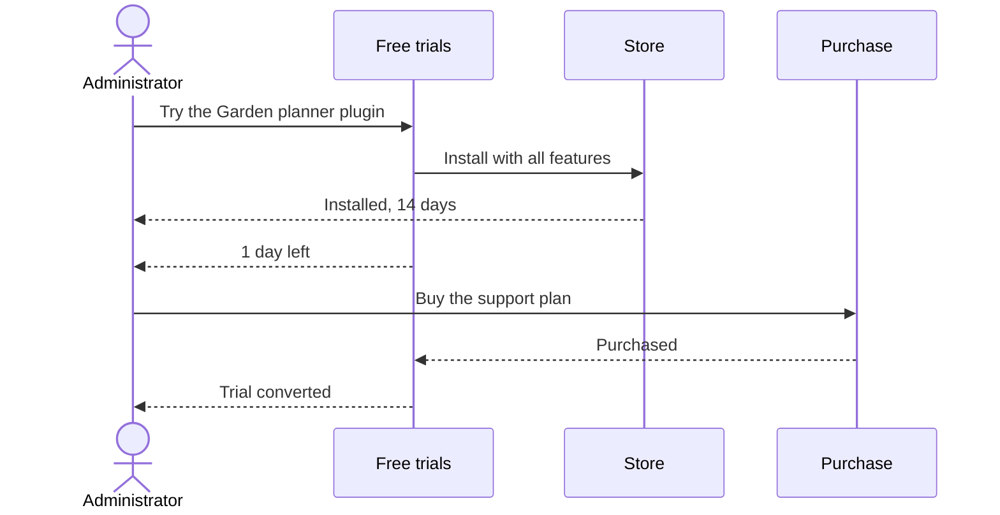

🏠 [Specs](../../../../README.md) › 🧩 [Functional capabilities](../../../README.md) ›
🧰 [F14 Plugin store](../../README.md) › 📝 [Use cases](../README.md) ›
📝 [Use cases: FL-F14-08 Trials, test instances, partners and themes](README.md) › 📝 UC-F14-30 Try a paid plugin free

# 📝 UC-F14-30 Try a paid plugin free

**Status:** ✅ specified

## Summary

An administrator tries a paid plugin free for a limited time with all its features, on the company's own data. Before
the trial ends the store reminds them; the trial ends with a purchase or with a clean uninstall that exports what the
plugin created and removes the rest.

## Personas

- [U07 Administrator](../../../../01-users/personas/u07-administrator.md)

## Goal

The company learns whether a paid plugin suits it before paying, and is never billed or locked in by a trial.

## Trigger

The administrator opens a paid plugin's listing and chooses Try free
([UC-F14-02](../01-find-and-install/uc-f14-02-install-a-plugin-or-sector-pack.md)).

## Frequency

A few trials a year per company.

## Preconditions

- The plugin's price plan offers a trial ([E-F14-04 Plugin price plan](../../data/e-f14-04-plugin-price-plan.md)).
- The company has not already tried the same plugin (one trial per plugin and company).
- The administrator has the right to install plugins
  ([BR-F14-02](../../business-rules/br-f14-02-permissions-shown-before-install.md)).

## Postconditions

- **Succeeded:** the trial is saved ([E-F14-23 Trial](../../data/e-f14-23-trial.md)) with its dates; the plugin is
  installed with all its features; the trial ends as Converted by a purchase or Removed by a clean uninstall.
- **Failed:** no trial starts; the listing shows why (already tried, not offered).

## Main flow

1. The administrator opens the free trials screen
   ([S-F14-28 Free trials](../../screens/08-trials-instances-and-partners/s-f14-28-free-trials.md)) or the plugin's
   listing and starts a trial.
2. simple-ERP shows the permissions the plugin asks for and the length of the trial and installs it
   ([BR-F14-02](../../business-rules/br-f14-02-permissions-shown-before-install.md)).
3. The administrator and the company's users use the plugin with all its features; the screen shows the days left.
4. 7 days and 1 day before the end, simple-ERP reminds the administrator with the price and the choice.
5. The administrator buys the plugin ([UC-F14-05](../02-buy-and-licence/uc-f14-05-buy-a-paid-plugin-or-subscription.md))
   and the trial becomes Converted, or lets it end.
6. At the end, an unbought plugin is switched off, its export is offered and its data is removed after a grace period
   ([BR-F14-25](../../business-rules/br-f14-25-a-trial-ends-with-a-purchase-or-a-clean-uninstall.md)).

## Alternative flows

- 5a. The administrator asks to extend the trial: the publisher may allow one extension of the trial, shown on the
  screen.
- 5b. The administrator uninstalls the plugin before the end: the uninstall exports the plugin's data first
  ([BR-F14-04](../../business-rules/br-f14-04-uninstall-keeps-an-export.md)).
- 6a. The administrator buys during the grace period: the plugin is switched on again with its data.

## Error flows

- 1e. The company already tried this plugin: the trial is refused and the purchase is offered.
- 2e. The plugin is not compatible with the company's version: the install is refused with the reason
  ([BR-F14-03](../../business-rules/br-f14-03-updates-only-when-compatible.md)).
- 6e. The export fails at the end: the removal is delayed and the administrator is told.
- Any step: a service does not answer; the call is retried first
  ([BR-F3-32](../../../f03-assistant/business-rules/br-f03-32-retry-before-an-error.md)), then the message follows the
  error pattern ([D122](../../../../06-decisions/ux/d122-error-message-standard.md)) and what the user typed stays on
  the screen.

## Business rules

- [BR-F14-25](../../business-rules/br-f14-25-a-trial-ends-with-a-purchase-or-a-clean-uninstall.md)
- [BR-F14-04](../../business-rules/br-f14-04-uninstall-keeps-an-export.md)
- [BR-F14-22](../../business-rules/br-f14-22-support-terms-shown-before-purchase-and-measured.md)

## Entities

- [E-F14-23 Trial](../../data/e-f14-23-trial.md): created, changed
- [E-F14-02 Plugin installation](../../data/e-f14-02-plugin-installation.md): created, the installation
- [E-F14-04 Plugin price plan](../../data/e-f14-04-plugin-price-plan.md): read, the trial rules of the plan

## Permissions

Administrator. The owner reads the trials of the company.

## Notifications

The administrator, in the app and by email: 7 days and 1 day before the end, the trial ended, the data will be removed
on a date.

## Audit events

Each trial started, extended, converted, ended and removed; each reminder; each export before removal.

## AI involvement

No AI step of its own. The AI assistant may open the screen and prefill it from the user's words; the user checks and
confirms ([BR-F3-07](../../../f03-assistant/business-rules/br-f03-07-no-deletes-no-irreversible-acts.md)).

## API, MCP and A2A exposure

T5 operations of the capability for the personas above: create, read, update and list. The MCP tool of the
capability may read and propose, never confirm alone. No A2A skill.

## Screens

- [S-F14-28 Free trials](../../screens/08-trials-instances-and-partners/s-f14-28-free-trials.md)

## Flowchart

See
[FL-F14-08 Trials, test instances, partners and themes](../../flows/fl-f14-08-trials-instances-and-partners.md#flowchart).

## Sequence diagram

## Acceptance criteria

1. **Given** a plugin with a 14-day trial **when** the administrator starts it **then** the plugin is installed with all
   features and the end date is 14 days away.
2. **Given** a trial ending tomorrow **when** the day ends **then** the administrator receives the reminder with the
   price.
3. **Given** a trial that ended without a purchase **when** 30 days pass **then** the plugin's data is exported and
   removed.
4. **Given** a company that already tried the plugin **when** it asks for a second trial **then** the request is
   refused.

## Non-functional notes

The screen answers within 2 seconds for 10,000 records; every change is audited.

## Regulatory references

A trial offered to a consumer or a small business follows the same information duties as a sale: price after
the trial, what happens to the data, how to stop. See
[CR-FR-036](../../../../10-country-packs/france/consumer/cr-fr-036-withdrawal-right.md) for the consumer's withdrawal
right and [CR-FR-065](../../../../10-country-packs/france/consumer/cr-fr-065-online-pre-contract-information.md) for the
information before an online order; the France-pack rule on trials is written later.

## Related use cases

- [UC-F14-29 Get a publisher test instance](uc-f14-29-get-a-publisher-test-instance.md)
- [UC-F14-31 Find an implementation partner](uc-f14-31-find-an-implementation-partner.md)
- [UC-F14-29 Get a publisher test instance](uc-f14-29-get-a-publisher-test-instance.md)
- [UC-F14-31 Find an implementation partner](uc-f14-31-find-an-implementation-partner.md)
- [UC-F14-05](../02-buy-and-licence/uc-f14-05-buy-a-paid-plugin-or-subscription.md)
- [UC-F14-04](../01-find-and-install/uc-f14-04-uninstall-and-export-the-plugin-s-data.md)

## Open questions

None.

---

⬅️ [UC-F14-29 Get a publisher test instance](uc-f14-29-get-a-publisher-test-instance.md) · ⬆️ [Up](README.md) ·
➡️ [UC-F14-31 Find an implementation partner](uc-f14-31-find-an-implementation-partner.md)
