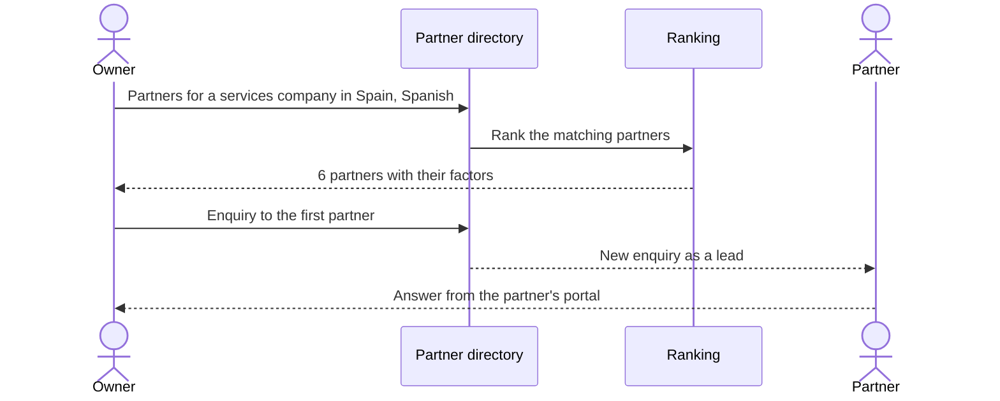

🏠 [Specs](../../../../README.md) › 🧩 [Functional capabilities](../../../README.md) ›
🧰 [F14 Plugin store](../../README.md) › 📝 [Use cases](../README.md) ›
📝 [Use cases: FL-F14-08 Trials, test instances, partners and themes](README.md) ›
📝 UC-F14-31 Find an implementation partner

# 📝 UC-F14-31 Find an implementation partner

**Status:** 🔄 waiting for the owner

## Summary

A company looks for a partner to set up, configure or extend simple-ERP: the directory lists implementation partners by
country, language, sector and certification, with the projects they delivered and a ranking whose every factor is shown.
Partners apply, keep their listing and receive the enquiries.

## Personas

- [U13 Owner](../../../../01-users/personas/u13-owner.md)
- [U51 Reseller partner](../../../../01-users/personas/u51-reseller-partner.md)

## Goal

The owner finds a partner who fits their sector and place without an outside search, and understands why one partner is
listed above another.

## Trigger

The owner or an administrator needs help to set up or extend simple-ERP (during onboarding, a plugin install, a
migration); a partner wants to be found.

## Frequency

A few searches a year per company; one listing per partner kept up to date every quarter.

## Preconditions

- Partners have a store account of the kind Reseller partner
  ([U51 Reseller partner](../../../../01-users/personas/u51-reseller-partner.md)).
- Each listing has its country, languages, sectors and the services offered.

## Postconditions

- **Succeeded:** the owner has contacted one or more partners; each enquiry is a lead of the partner
  [UC-F6-27](../../../f06-customers-and-sales/use-cases/10-partners-contracts-and-warranties/uc-f06-27-run-a-partner-programme.md);
  the partner's listing shows its enquiries and its ranking factors.
- **Failed:** no enquiry is sent; the owner's filters stay for the next visit.

## Main flow

1. The owner opens the partner directory
   ([S-F14-29](../../screens/08-trials-instances-and-partners/s-f14-29-partner-directory.md)) and filters by country,
   language, sector and service.
2. simple-ERP lists the matching partners with their ranking, each showing the factors that make it
   ([BR-F14-26](../../business-rules/br-f14-26-partner-rankings-are-transparent.md)).
3. The owner opens a partner's listing: services, projects delivered, certifications, languages and ratings of the
   partner's customers.
4. The owner sends an enquiry with a short description of the need; the partner receives it as a lead.
5. The partner answers from their own portal; the owner can rate the partner after the work.
6. The partner keeps their listing up to date and sees their ranking factors, their enquiries and how they compare.

## Alternative flows

- 1a. The AI assistant is asked "find me a partner for a construction company in Lyon": it filters the directory and
  shows the list; it never contacts a partner on its own.
- 4a. The owner compares three partners side by side.
- 6a. A partner wants to appear in another country: they add the country and its evidence, and the maintainer team
  confirms.

## Error flows

- 3e. A partner's listing is suspended: it is shown as unavailable with no enquiry button.
- 4e. An enquiry cannot be delivered: the partner's address bounces; the owner sees it and picks another.
- 6e. A partner claims a certification without evidence: the claim stays unverified and is not counted.
- Any step: a service does not answer; the call is retried first
  ([BR-F3-32](../../../f03-assistant/business-rules/br-f03-32-retry-before-an-error.md)), then the message follows the
  error pattern ([D122](../../../../06-decisions/ux/d122-error-message-standard.md)) and what the user typed stays on
  the screen.

## Business rules

- [BR-F14-26](../../business-rules/br-f14-26-partner-rankings-are-transparent.md)
- [BR-F14-10 Ranking explained](../../business-rules/br-f14-10-ranking-explained.md)
- [BR-F14-09 Traders verified](../../business-rules/br-f14-09-traders-verified.md)

## Entities

- [E-F14-24 Partner listing](../../data/e-f14-24-partner-listing.md): created, changed
- [E-F6-23 Partner](../../../f06-customers-and-sales/data/e-f06-23-partner.md): read, the partner's record in the
  partner programme
- [E-F6-20 Lead](../../../f06-customers-and-sales/data/e-f06-20-lead.md): created, an enquiry as a lead of the partner

## Permissions

Owner and administrators search and send enquiries. The partner edits their own listing and reads their enquiries.
The maintainer team confirms a listing and suspends one.

## Notifications

The partner, in their portal and by email: a new enquiry, a rating, a listing to renew. The owner: the partner answered.

## Audit events

Each listing created, changed, confirmed, suspended and withdrawn; each enquiry; each rating; each change of the ranking
formula, with its date.

## AI involvement

No AI step of its own. The AI assistant may open the screen and prefill it from the user's words; the user checks and
confirms ([BR-F3-07](../../../f03-assistant/business-rules/br-f03-07-no-deletes-no-irreversible-acts.md)).

## API, MCP and A2A exposure

T5 operations of the capability for the personas above: create, read, update and list. The MCP tool of the
capability may read and propose, never confirm alone. No A2A skill.

## Screens

- [S-F14-29](../../screens/08-trials-instances-and-partners/s-f14-29-partner-directory.md)

## Flowchart

See
[FL-F14-08 Trials, test instances, partners and themes](../../flows/fl-f14-08-trials-instances-and-partners.md#flowchart).

## Sequence diagram

## Acceptance criteria

1. **Given** a filter on Spain and Spanish **when** the owner searches **then** only partners that cover both are
   listed.
2. **Given** a ranked list **when** the owner opens a ranking **then** the factors and their weights are shown.
3. **Given** a partner whose certification is unverified **when** the ranking is computed **then** the certification
   does not count.
4. **Given** a suspended partner **when** the directory is searched **then** it appears without an enquiry button.

## Non-functional notes

The screen answers within 2 seconds for 10,000 records; every change is audited.

## Regulatory references

The directory ranks businesses on a platform, so it must tell them the main ranking criteria:
[CR-FR-189](../../../../10-country-packs/france/digital/cr-fr-189-p2b-platform-terms.md). (Proposed) A paid placement is
always labelled as such; the France-pack rule is written later.

## Related use cases

- [UC-F14-30 Try a paid plugin free](uc-f14-30-try-a-paid-plugin-free.md)
- [UC-F14-32 Install a website theme](uc-f14-32-install-a-website-theme.md)
- [UC-F14-30 Try a paid plugin free](uc-f14-30-try-a-paid-plugin-free.md)
- [UC-F14-32 Install a website theme](uc-f14-32-install-a-website-theme.md)
- [UC-F14-19](../05-store-operations/uc-f14-19-moderate-the-store-with-transparent-ranking.md)
- [UC-F6-27](../../../f06-customers-and-sales/use-cases/10-partners-contracts-and-warranties/uc-f06-27-run-a-partner-programme.md)

## Open questions

None.

---

⬅️ [UC-F14-30 Try a paid plugin free](uc-f14-30-try-a-paid-plugin-free.md) · ⬆️ [Up](README.md) ·
➡️ [UC-F14-32 Install a website theme](uc-f14-32-install-a-website-theme.md)
