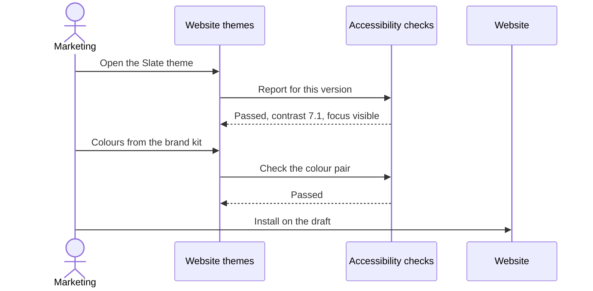

🏠 [Specs](../../../../README.md) › 🧩 [Functional capabilities](../../../README.md) ›
🧰 [F14 Plugin store](../../README.md) › 📝 [Use cases](../README.md) ›
📝 [Use cases: FL-F14-08 Trials, test instances, partners and themes](README.md) › 📝 UC-F14-32 Install a website theme

# 📝 UC-F14-32 Install a website theme

**Status:** 🔄 waiting for the owner

## Summary

Marketing installs a website theme from the store: a set of colours, fonts, layouts and page styles that the hosted
website or the online shop wears. Every theme in the store has passed the accessibility checks; the theme can be
previewed on the company's own pages and rolled back.

## Personas

- [U12 Marketing and communication](../../../../01-users/personas/u12-marketing.md)
- [U46 Plugin publisher](../../../../01-users/personas/u46-plugin-publisher.md)

## Goal

The company changes its site's look in minutes, with a theme that stays readable and usable by everyone.

## Trigger

Marketing wants a new look for the website, see
[UC-F11-01](../../../f11-online-shop/use-cases/01-build-the-shop/uc-f11-01-build-and-design-the-website.md) and
[UC-F18-02](../../../f18-hosted-websites-and-domains/use-cases/01-build-the-site/uc-f18-02-apply-the-visual-identity.md),
or a publisher submits a theme.

## Frequency

A few theme changes a year per company; a few theme submissions a year per publisher.

## Preconditions

- The company has a website ([E-F11-01 Website](../../../f11-online-shop/data/e-f11-01-website.md)).
- The theme is published in the store and its accessibility report is current
  ([E-F14-07 Plugin check report](../../data/e-f14-07-plugin-check-report.md)).

## Postconditions

- **Succeeded:** the theme is installed ([E-F14-25 Theme](../../data/e-f14-25-theme.md)) on the website with the
  company's own colours and logo, the accessibility report is shown, and the previous theme can be restored.
- **Failed:** the site keeps its theme; the refused theme and the failed checks are listed.

## Main flow

1. Marketing opens the website themes screen
   ([S-F14-30](../../screens/08-trials-instances-and-partners/s-f14-30-website-themes.md)) and browses the themes by
   sector and style.
2. Marketing opens a theme: preview on the company's own pages, its accessibility result, price and publisher.
3. Marketing chooses the colours and fonts within the theme's tokens, and the logo; the preview updates.
4. simple-ERP checks the chosen colours against the contrast limits and warns of a pair that fails.
5. Marketing installs the theme on a draft of the site and then publishes it
   [UC-F18-15](../../../f18-hosted-websites-and-domains/use-cases/04-test-and-publish/uc-f18-15-approve-publish-and-roll-back.md).
6. The previous theme is kept as a restore point; marketing can go back at any time.

## Alternative flows

- 2a. The theme is paid: marketing buys it first
  ([UC-F14-05](../02-buy-and-licence/uc-f14-05-buy-a-paid-plugin-or-subscription.md)); the preview works before.
- 3a. The company has an identity in the brand kit: its colours and fonts fill the tokens in one click, as in
  [UC-F18-02](../../../f18-hosted-websites-and-domains/use-cases/01-build-the-site/uc-f18-02-apply-the-visual-identity.md).
- 6a. A publisher submits a new theme: it goes through the automated checks, including accessibility, before review
  ([UC-F14-09](../03-publish/uc-f14-09-pass-automated-checks.md)).

## Error flows

- 4e. A colour pair fails the contrast limit: the choice is refused and the nearest passing pair is offered.
- 5e. The theme's accessibility report is older than the current checks: the theme is shown as Needs a new check and
  cannot be installed until it passes.
- 6e. Publication fails: the site keeps the previous theme.
- Any step: a service does not answer; the call is retried first
  ([BR-F3-32](../../../f03-assistant/business-rules/br-f03-32-retry-before-an-error.md)), then the message follows the
  error pattern ([D122](../../../../06-decisions/ux/d122-error-message-standard.md)) and what the user typed stays on
  the screen.

## Business rules

- [BR-F14-27](../../business-rules/br-f14-27-themes-pass-the-accessibility-checks.md)
- [BR-F14-06](../../business-rules/br-f14-06-automated-checks-before-review.md)
- [BR-F14-21](../../business-rules/br-f14-21-listings-and-plugins-in-the-users-language.md)

## Entities

- [E-F14-25 Theme](../../data/e-f14-25-theme.md): created, changed
- [E-F11-01 Website](../../../f11-online-shop/data/e-f11-01-website.md): changed, the theme of the website
- [E-F14-07 Plugin check report](../../data/e-f14-07-plugin-check-report.md): read, the check report
- [E-F14-01 Store listing](../../data/e-f14-01-store-listing.md): read, the listing

## Permissions

Marketing installs and customises. The publisher submits and updates their themes. The administrator may
restore a previous theme.

## Notifications

Marketing, in the app: the theme is installed, a theme's update is available, a theme was withdrawn for failing a check.
The publisher: their theme passed or failed.

## Audit events

Each theme submitted, checked, published, installed, customised, restored and withdrawn; each failed check with its
measure.

## AI involvement

No AI step of its own. The AI assistant may open the screen and prefill it from the user's words; the user checks and
confirms ([BR-F3-07](../../../f03-assistant/business-rules/br-f03-07-no-deletes-no-irreversible-acts.md)).

## API, MCP and A2A exposure

T5 operations of the capability for the personas above: create, read, update and list. The MCP tool of the
capability may read and propose, never confirm alone. No A2A skill.

## Screens

- [S-F14-30](../../screens/08-trials-instances-and-partners/s-f14-30-website-themes.md)

## Flowchart

See
[FL-F14-08 Trials, test instances, partners and themes](../../flows/fl-f14-08-trials-instances-and-partners.md#flowchart).

## Sequence diagram

## Acceptance criteria

1. **Given** a theme with a current passing report **when** marketing installs it **then** the draft site wears the
   theme and the previous theme is kept.
2. **Given** a chosen text colour with a contrast of 3 to 1 **when** marketing saves **then** the choice is refused with
   a passing suggestion.
3. **Given** a theme whose report predates the current checks **when** marketing opens it **then** it shows Needs a new
   check and cannot be installed.
4. **Given** a published site **when** marketing restores the previous theme **then** the site wears it again.

## Non-functional notes

The screen answers within 2 seconds for 10,000 records; every change is audited.

## Regulatory references

Online shops and public sites must be accessible:
[CR-FR-072](../../../../10-country-packs/france/consumer/cr-fr-072-web-accessibility-eaa.md). The checks follow the
accessibility standard the country pack names; (Proposed) the France-pack rule on the site's accessibility statement is
written later.

## Related use cases

- [UC-F14-31 Find an implementation partner](uc-f14-31-find-an-implementation-partner.md)
- [UC-F14-31 Find an implementation partner](uc-f14-31-find-an-implementation-partner.md)
- [UC-F11-01](../../../f11-online-shop/use-cases/01-build-the-shop/uc-f11-01-build-and-design-the-website.md)
- [UC-F18-02](../../../f18-hosted-websites-and-domains/use-cases/01-build-the-site/uc-f18-02-apply-the-visual-identity.md)
- [UC-F18-25](../../../f18-hosted-websites-and-domains/use-cases/06-content-and-search/uc-f18-25-use-a-sector-page-template.md)

## Open questions

None.

---

⬅️ [UC-F14-31 Find an implementation partner](uc-f14-31-find-an-implementation-partner.md) · ⬆️ [Up](README.md)
