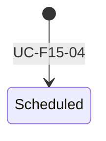

🏠 [Specs](../../../README.md) › 🧩 [Functional capabilities](../../README.md) › ⚖️ [F15 Legal assistant](../README.md) ›
🗃️ [Data](README.md) › 🗃️ E-F15-01 Law pack

# 🗃️ E-F15-01 Law pack

**Status:** ✅ specified

## Purpose

A country's law pack for the legal assistant: the country's legal corpora of
[T11 Legal corpora](../../../03-technical/t11-legal-corpora/README.md), whose official sources are ingested, pulled on a schedule and versioned by
date there ([REQ-T11-03](../../../03-technical/t11-legal-corpora/requirements/req-t11-03-law-ingestion.md),
[E-T11-03 Article version](../../../03-technical/t11-legal-corpora/data/e-t11-03-article-version.md)), plus the pack's warnings and referral
contacts (D199, D205). The pack keeps no source list of its own: T11 owns the sources, their licences and their
schedule.

## Fields

| Name | Type | Required | Validation | Default | Example | Personal data | Custom fields |
|---|---|---|---|---|---|---|---|
| name | text | yes | - | - | France | no | no |
| country | country | yes | one pack per country | - | FR | no | no |
| corpora | link | yes | the country's corpora in T11 (REQ-T11-03); sources, licences and schedule are T11's | - | the French corpora of T11 | no | no |
| warnings | list | no | - | - | Daily rest, CSE threshold | no | no |
| referral contacts | list | yes | - | - | Labour inspectorate offices | no | no |
| publisher | SimpleERP or partner | yes | no review: content pulled from official sources (D205) | SimpleERP | SimpleERP | no | no |

## Relations

Used by UC-F15-01. Reads the sources of its T11 corpora, shown in F15 as
[E-F15-12 Legal source](e-f15-12-legal-source.md).

## Lifecycle

Installed, refreshed by each scheduled pull (BR-F15-09), removed.

## Indexes and search

By kind, record and date.

## Retention

13 months, law packs while installed.

## Audit

See UC-F15-01's audit events.

## Import and export

Law packs from the store (F14).

## Used by

- [UC-F15-01](../use-cases/01-ask-a-legal-question/uc-f15-01-use-the-legal-assistant.md)
- [UC-F15-04](../use-cases/04-set-up-the-legal-assistant/uc-f15-04-set-up-the-legal-assistant.md)
- [UC-F15-05](../use-cases/04-set-up-the-legal-assistant/uc-f15-05-follow-the-law-packs-refresh.md)
- [UC-F15-07 Keep the compliance calendar](../use-cases/05-duties-and-records/uc-f15-07-keep-the-compliance-calendar.md)
- [UC-F15-13 Answer a client's tax question with their data](../use-cases/01-ask-a-legal-question/uc-f15-13-answer-a-clients-tax-question-with-their-data.md)

## Open questions

None.

---

⬆️ [Up](README.md) · ➡️ [E-F15-02 Legal warning](e-f15-02-legal-warning.md)
