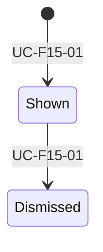

🏠 [Specs](../../../README.md) › 🧩 [Functional capabilities](../../README.md) › ⚖️ [F15 Legal assistant](../README.md) ›
🗃️ [Data](README.md) › 🗃️ E-F15-02 Legal warning

# 🗃️ E-F15-02 Legal warning

**Status:** ✅ specified

## Purpose

A warning shown on an action (BR-F15-07).

## Fields

| Name | Type | Required | Validation | Default | Example | Personal data | Custom fields |
|---|---|---|---|---|---|---|---|
| kind | list | yes | per law pack | - | Daily rest | no | no |
| record | any record | yes | - | - | Schedule week 46 | no | no |
| rule | article, version, date | yes | - | - | L3131-1 | no | no |
| shown to | users | yes | - | - | Marc Durand, HR | yes | no |
| status | shown, dismissed | yes | - | shown | dismissed | no | no |
| reason | text | if dismissed | - | - | Emergency call-out | no | no |

## Relations

Used by UC-F15-01.

## Lifecycle

Shown, then dismissed with a reason or left.

## Indexes and search

By kind, record and date.

## Retention

13 months, law packs while installed.

## Audit

See UC-F15-01's audit events.

## Import and export

Law packs from the store (F14).

## Used by

- [UC-F15-01](../use-cases/01-ask-a-legal-question/uc-f15-01-use-the-legal-assistant.md)
- [UC-F15-02](../use-cases/02-receive-a-legal-warning/uc-f15-02-receive-a-legal-warning.md)

## Open questions

None.

---

⬅️ [E-F15-01 Law pack](e-f15-01-law-pack.md) · ⬆️ [Up](README.md) ·
➡️ [E-F15-03 Document check](e-f15-03-document-check.md)
