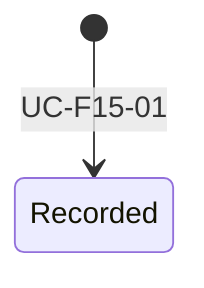

🏠 [Specs](../../../README.md) › 🧩 [Functional capabilities](../../README.md) › ⚖️ [F15 Legal assistant](../README.md) ›
🗃️ [Data](README.md) › 🗃️ E-F15-03 Document check

# 🗃️ E-F15-03 Document check

**Status:** ✅ specified

## Purpose

The result of checking a document against the law (BR-F15-08).

## Fields

| Name | Type | Required | Validation | Default | Example | Personal data | Custom fields |
|---|---|---|---|---|---|---|---|
| document | template, contract or file | yes | - | - | Fixed-term contract template | maybe | no |
| law pack | law pack | yes | - | the company's | France | no | no |
| found | list of clauses | no | - | - | Trial period | no | no |
| missing | list of clauses with articles | no | - | - | Reason for recourse, L1242-12 | no | no |
| at risk | list of clauses with articles | no | - | - | Renewal clause | no | no |
| checked at | date and time | yes | - | now | 2026-11-10 16:20 | no | no |

## Relations

Used by UC-F15-01.

## Lifecycle

Written once per check.

## Indexes and search

By kind, record and date.

## Retention

13 months, law packs while installed.

## Audit

See UC-F15-01's audit events.

## Import and export

Law packs from the store (F14).

## Used by

- [UC-F15-01](../use-cases/01-ask-a-legal-question/uc-f15-01-use-the-legal-assistant.md)
- [UC-F15-03](../use-cases/03-check-a-document-against-the-law/uc-f15-03-check-a-document-against-the-law.md)

## Open questions

None.

---

⬅️ [E-F15-02 Legal warning](e-f15-02-legal-warning.md) · ⬆️ [Up](README.md) ·
➡️ [E-F15-04 Standard register entry](e-f15-04-standard-register-entry.md)
