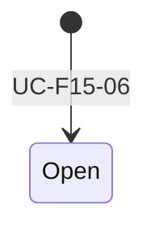

🏠 [Specs](../../../README.md) › 🧩 [Functional capabilities](../../README.md) › ⚖️ [F15 Legal assistant](../README.md) ›
🗃️ [Data](README.md) › 🗃️ E-F15-04 Standard register entry

# 🗃️ E-F15-04 Standard register entry

**Status:** ✅ specified

## Purpose

One copyrighted standard in the register (D207), never its text.

## Fields

| Name | Type | Required | Validation | Default | Example | Personal data | Custom fields |
|---|---|---|---|---|---|---|---|
| reference | text | yes | - | - | NF DTU 31.2 | no | no |
| title | text | yes | - | - | Timber frame construction | no | no |
| edition and status | text | yes | - | - | 2019, current | no | no |
| cited by | legal texts | no | from the law corpus | - | - | no | no |
| sectors | sectors | no | SC01 to SC16 | - | SC01 | no | no |
| where to obtain | text | yes | - | - | AFNOR, CSTB Reef, Qualibat members | no | no |
| note | text | no | in SimpleERP's own words | - | Rules of the art for timber frames | no | no |
| source | ISO Open Data, legal text, curated | yes | - | - | curated | no | no |

## Relations

Linked to the articles that cite it, and to sectors.

## Lifecycle

Pulled daily from ISO Open Data and legal texts (D205); curated entries reviewed monthly.

Never the standard's text: the pulls read open sources only
([D448](../../../06-decisions/f15-legal-assistant/d448-law-texts-and-signed-rule-packs.md)).

## Indexes and search

By reference, title, sector.

## Retention

While current; withdrawn standards kept with their dates, like article versions.

## Audit

Pulls logged (BR-F15-09).

## Import and export

None.

## Used by

- [UC-F15-01](../use-cases/01-ask-a-legal-question/uc-f15-01-use-the-legal-assistant.md)
- [UC-F15-06](../use-cases/04-set-up-the-legal-assistant/uc-f15-06-keep-the-standards-register.md)

## Open questions

None.

---

⬅️ [E-F15-03 Document check](e-f15-03-document-check.md) · ⬆️ [Up](README.md) ·
➡️ [E-F15-05 Compliance duty](e-f15-05-compliance-duty.md)
