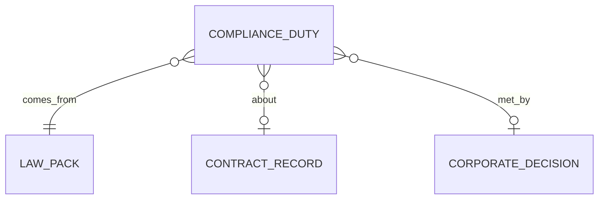
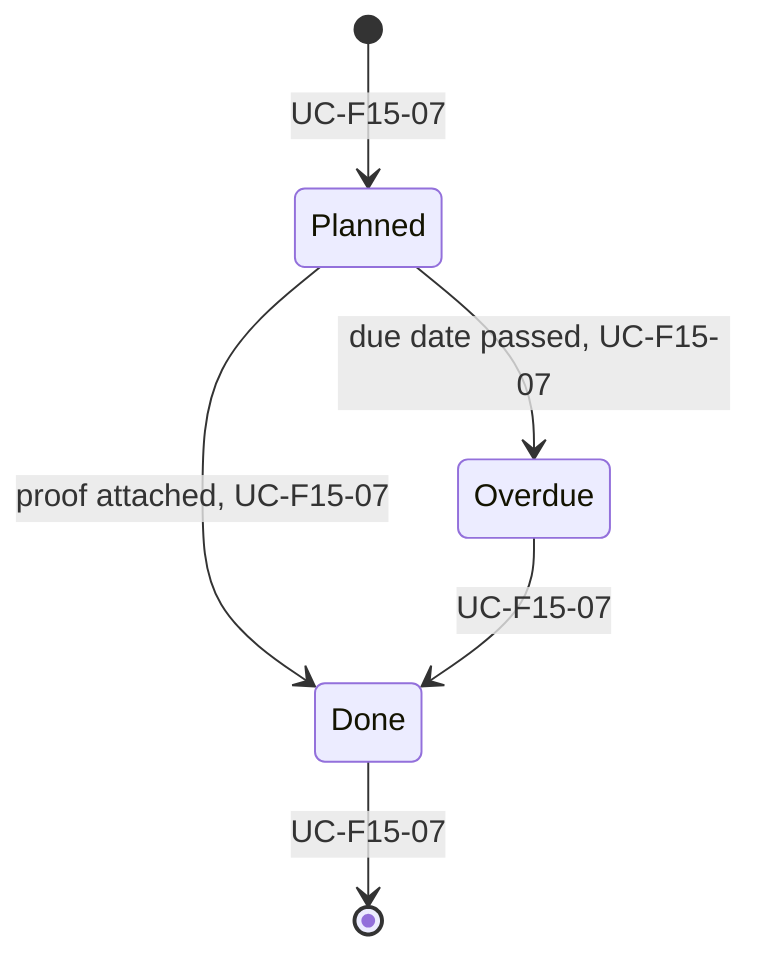

🏠 [Specs](../../../README.md) › 🧩 [Functional capabilities](../../README.md) › ⚖️ [F15 Legal assistant](../README.md) ›
🗃️ [Data](README.md) › 🗃️ E-F15-05 Compliance duty

# 🗃️ E-F15-05 Compliance duty

**Status:** ✅ specified

## Purpose

A dated legal duty of the company: what to do, by when, by whom, from which rule, and its proof.

## Fields

| Name | Type | Required | Validation | Default | Example | Personal data | Custom fields |
|---|---|---|---|---|---|---|---|
| title | text | yes | - | from the rule | Approve the 2026 accounts | no | no |
| source | link | yes | a country-pack rule or an article | - | CR-FR-221 Shareholders' general meetings | no | no |
| due date | date | yes | - | computed | 2027-06-30 | no | no |
| recurrence | choice | yes | once, monthly, yearly | from the rule | yearly | no | no |
| owner | link | yes | a user | the owner of the company | the owner | yes | no |
| status | choice | yes | planned, done, overdue | planned | done | no | no |
| proof | file | no | PDF or image | - | minutes.pdf | no | no |

## Relations

## Lifecycle

## Indexes and search

By due date, owner, status and source; calendar and list views.

## Retention

10 years after done, with its proof.

## Audit

Every creation and change, with who, when, the old and the new value.

## Import and export

Calendar export (iCalendar) per owner; CSV export.

## Used by

- [UC-F15-07 Keep the compliance calendar](../use-cases/05-duties-and-records/uc-f15-07-keep-the-compliance-calendar.md)
- [UC-F15-08 Track contract renewal and notice dates](../use-cases/05-duties-and-records/uc-f15-08-track-contract-renewal-and-notice-dates.md)
- [UC-F15-09 Approve the accounts and keep the company registers](../use-cases/05-duties-and-records/uc-f15-09-approve-the-accounts-and-keep-the-company-registers.md)

## Open questions

None.

---

⬅️ [E-F15-04 Standard register entry](e-f15-04-standard-register-entry.md) · ⬆️ [Up](README.md) ·
➡️ [E-F15-06 Contract record](e-f15-06-contract-record.md)
