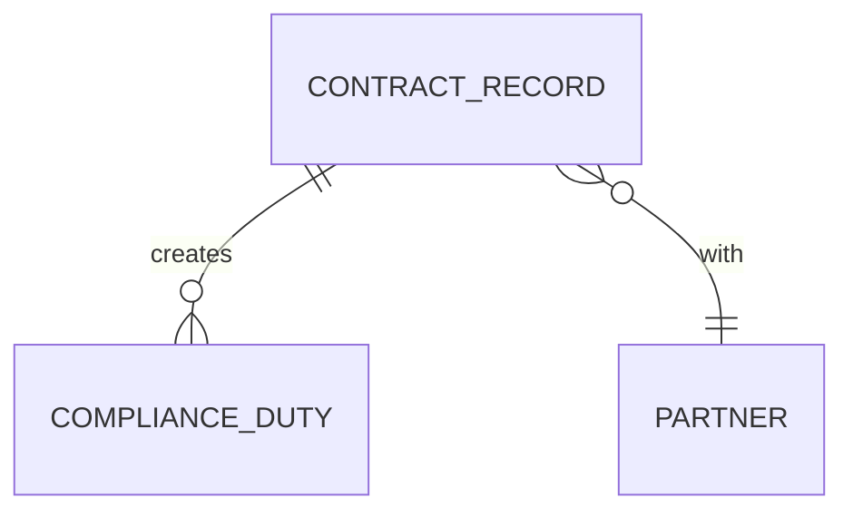
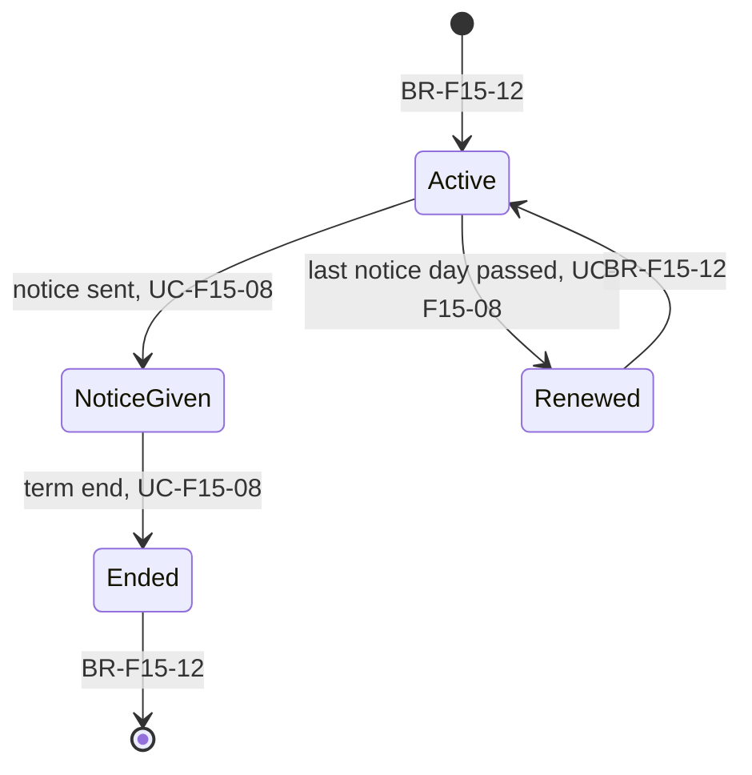

🏠 [Specs](../../../README.md) › 🧩 [Functional capabilities](../../README.md) › ⚖️ [F15 Legal assistant](../README.md) ›
🗃️ [Data](README.md) › 🗃️ E-F15-06 Contract record

# 🗃️ E-F15-06 Contract record

**Status:** ✅ specified, ⚖️ lawyer review before launch (D574)

## Purpose

A contract the company signed (lease, insurance, supplier, maintenance) with its term, renewal kind and notice period.

## Fields

| Name | Type | Required | Validation | Default | Example | Personal data | Custom fields |
|---|---|---|---|---|---|---|---|
| title, party | text, link | yes | - | - | Kitchen equipment maintenance, Froid Service | no | no |
| kind | choice | yes | lease, insurance, supplier, maintenance, other | - | maintenance | no | no |
| start, term end | dates | yes | end after start | - | 2025-01-01, 2026-12-31 | no | no |
| renewal | choice | yes | tacit, explicit, none | tacit | tacit | no | no |
| notice period | duration | no | - | - | 3 months | no | no |
| last notice day | date | computed | BR-F15-12 | computed | 2026-09-30 | no | no |
| document | file | yes | PDF | - | contract.pdf | no | no |

## Relations

## Lifecycle

## Indexes and search

By party, kind, term end and last notice day.

## Retention

5 years after the end (⚖️ lawyer review before launch, D574: Code de commerce L110-4 and Code civil 2224, the limitation
periods).

## Audit

Every creation and change, with who, when, the old and the new value.

## Import and export

CSV import of existing contracts; export.

## Used by

- [UC-F15-08 Track contract renewal and notice dates](../use-cases/05-duties-and-records/uc-f15-08-track-contract-renewal-and-notice-dates.md)

## Open questions

None.

---

⬅️ [E-F15-05 Compliance duty](e-f15-05-compliance-duty.md) · ⬆️ [Up](README.md) ·
➡️ [E-F15-07 Corporate decision](e-f15-07-corporate-decision.md)
