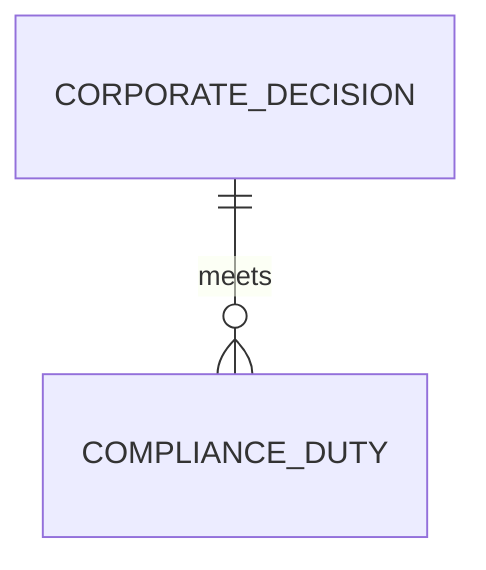
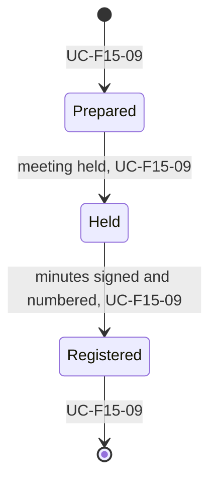

🏠 [Specs](../../../README.md) › 🧩 [Functional capabilities](../../README.md) › ⚖️ [F15 Legal assistant](../README.md) ›
🗃️ [Data](README.md) › 🗃️ E-F15-07 Corporate decision

# 🗃️ E-F15-07 Corporate decision

**Status:** ✅ specified, ⚖️ lawyer review before launch (D574)

## Purpose

A decision of the company's bodies (general meeting, board, sole shareholder) with its minutes, and its entry in the
decisions register.

## Fields

| Name | Type | Required | Validation | Default | Example | Personal data | Custom fields |
|---|---|---|---|---|---|---|---|
| body | choice | yes | general meeting, board, sole shareholder | - | general meeting | no | no |
| date | date | yes | - | - | 2027-06-20 | no | no |
| agenda, resolutions | text | yes | - | - | approval of the 2026 accounts, allocation of profit | no | no |
| minutes | file | yes | signed PDF | - | minutes-2027-06-20.pdf | yes | no |
| register number | number | yes | continuous | next | 14 | no | no |
| filings | list | no | - | - | accounts filed 2027-07-10 | no | no |

## Relations

## Lifecycle

## Indexes and search

By date, body and register number.

## Retention

For the company's life (⚖️ lawyer review before launch, D574: Code de commerce R223-24 and R225-106, the registers of minutes).

## Audit

Every creation and change, with who, when, the old and the new value.

## Import and export

Export of the register as PDF.

## Used by

- [UC-F15-09 Approve the accounts and keep the company registers](../use-cases/05-duties-and-records/uc-f15-09-approve-the-accounts-and-keep-the-company-registers.md)

## Open questions

None.

---

⬅️ [E-F15-06 Contract record](e-f15-06-contract-record.md) · ⬆️ [Up](README.md) ·
➡️ [E-F15-08 Data-subject request](e-f15-08-data-subject-request.md)
