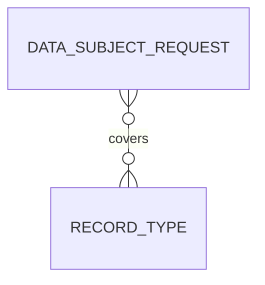
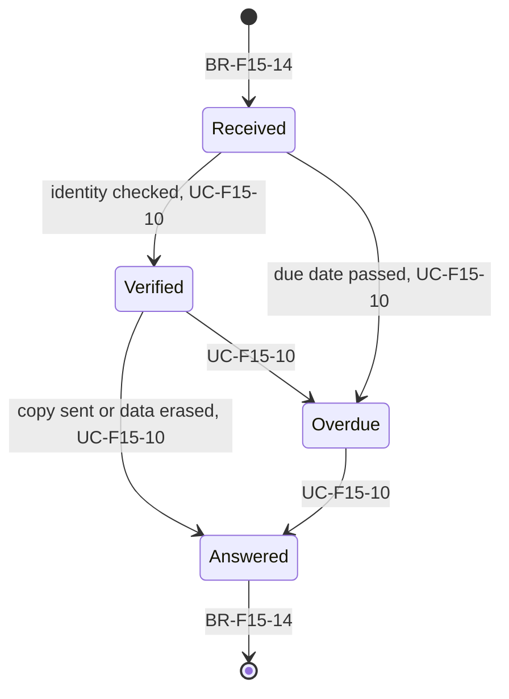

🏠 [Specs](../../../README.md) › 🧩 [Functional capabilities](../../README.md) › ⚖️ [F15 Legal assistant](../README.md) ›
🗃️ [Data](README.md) › 🗃️ E-F15-08 Data-subject request

# 🗃️ E-F15-08 Data-subject request

**Status:** 🔄 waiting for the owner

## Purpose

A person's request for access to or erasure of their personal data, with the identity check and the answer.

## Fields

| Name | Type | Required | Validation | Default | Example | Personal data | Custom fields |
|---|---|---|---|---|---|---|---|
| person | text | yes | name and contact | - | Sophie Bernard | yes | no |
| kind | choice | yes | access, erasure, correction, objection | - | access | no | no |
| received, due | dates | yes | due is one month later (BR-F15-14) | computed | 2026-11-12, 2026-12-12 | no | no |
| identity checked | yes or no | yes | - | no | yes | no | no |
| found | list | computed | record types holding data | - | 14 record types | yes | no |
| answer | file | when done | - | - | copy.zip | yes | no |

## Relations

## Lifecycle

## Indexes and search

By person, kind, due date and status.

## Retention

(Proposed) 5 years after the answer, without the copy itself.

## Audit

Every step, with who and when; the copy itself is not kept in the audit.

## Import and export

CSV and JSON export through the API (T5); no bulk import.

## Used by

- [UC-F15-10 Answer a data-subject request](../use-cases/06-privacy-and-ai-duties/uc-f15-10-answer-a-data-subject-request.md)

## Open questions

None.

---

⬅️ [E-F15-07 Corporate decision](e-f15-07-corporate-decision.md) · ⬆️ [Up](README.md) ·
➡️ [E-F15-09 AI use](e-f15-09-ai-use.md)
