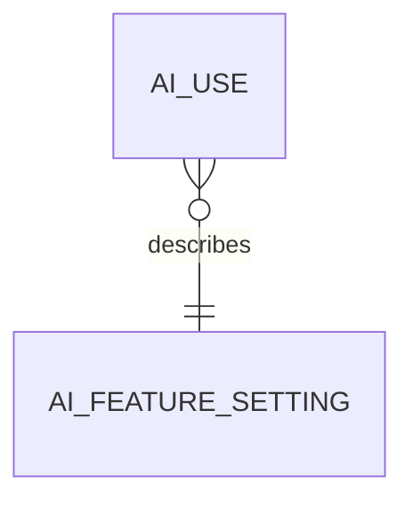
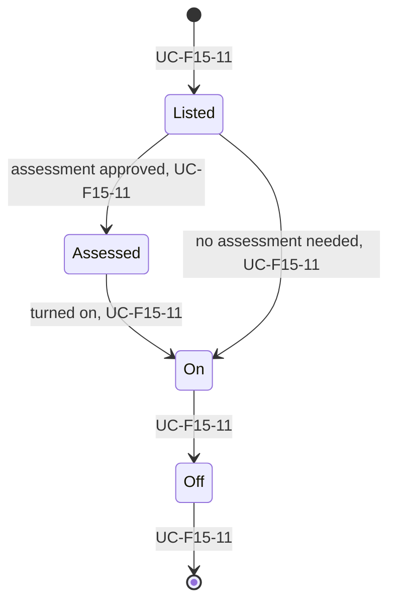

🏠 [Specs](../../../README.md) › 🧩 [Functional capabilities](../../README.md) › ⚖️ [F15 Legal assistant](../README.md) ›
🗃️ [Data](README.md) › 🗃️ E-F15-09 AI use

# 🗃️ E-F15-09 AI use

**Status:** ✅ specified

## Purpose

One AI use of the company in the inventory: feature, purpose, provider, data, risk class and impact assessment.

## Fields

| Name | Type | Required | Validation | Default | Example | Personal data | Custom fields |
|---|---|---|---|---|---|---|---|
| feature | link | yes | an AI feature setting (E-F1-09) | - | Candidate scoring | no | no |
| purpose | text | yes | - | from the feature | rank applications | no | no |
| provider | text | yes | - | from the setting | local model | no | no |
| data used | list | yes | categories | - | applications, CVs | no | no |
| risk class | choice | yes | minimal, limited, high | from the feature | high | no | no |
| assessment | file | if high or needed | approved PDF | - | dpia-scoring.pdf | no | no |
| status | choice | yes | off, on | off | off | no | no |

## Relations

## Lifecycle

## Indexes and search

By feature, risk class and status.

## Retention

As long as the feature exists, then 5 years.

## Audit

Every creation and change, with who, when, the old and the new value.

## Import and export

CSV and JSON export through the API (T5); no bulk import.

## Used by

- [UC-F15-11 Keep the AI uses inventory and impact assessments](../use-cases/06-privacy-and-ai-duties/uc-f15-11-keep-the-ai-uses-inventory-and-impact-assessments.md)

## Open questions

None.

---

⬅️ [E-F15-08 Data-subject request](e-f15-08-data-subject-request.md) · ⬆️ [Up](README.md) ·
➡️ [E-F15-10 Lawyer hand-off](e-f15-10-lawyer-hand-off.md)
