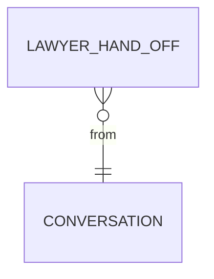
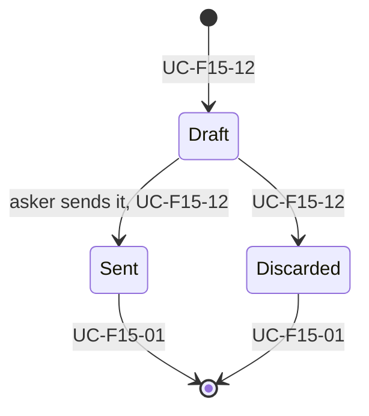

🏠 [Specs](../../../README.md) › 🧩 [Functional capabilities](../../README.md) › ⚖️ [F15 Legal assistant](../README.md) ›
🗃️ [Data](README.md) › 🗃️ E-F15-10 Lawyer hand-off

# 🗃️ E-F15-10 Lawyer hand-off

**Status:** ✅ specified

## Purpose

A package handed to a lawyer: the question, the facts used, the answer with its sources and confidence, and the
documents chosen by the asker.

## Fields

| Name | Type | Required | Validation | Default | Example | Personal data | Custom fields |
|---|---|---|---|---|---|---|---|
| question | text | yes | - | from the conversation | Can I dismiss for repeated lateness? | yes | no |
| facts | list | yes | those the asker may see | from the answer | contract, 3 warnings | yes | no |
| answer, sources, confidence | text | yes | - | from the answer | low | no | no |
| documents | files | no | chosen by the asker | - | warning letters | yes | no |
| lawyer | text | yes | name and email | - | Maître Dupont | yes | no |
| sent | date | when sent | - | - | 2026-11-12 | no | no |

## Relations

## Lifecycle

## Indexes and search

By the asker only (BR-F15-03).

## Retention

As the conversation (BR-F15-03); the asker may delete it.

## Audit

Every creation and change, with who, when, the old and the new value.

## Import and export

CSV and JSON export through the API (T5); no bulk import.

## Used by

- [UC-F15-12 Hand a question over to a lawyer](../use-cases/01-ask-a-legal-question/uc-f15-12-hand-a-question-over-to-a-lawyer.md)
- [UC-F15-01 Use the legal assistant](../use-cases/01-ask-a-legal-question/uc-f15-01-use-the-legal-assistant.md)

## Open questions

None.

---

⬅️ [E-F15-09 AI use](e-f15-09-ai-use.md) · ⬆️ [Up](README.md) ·
➡️ [E-F15-11 Warning trigger](e-f15-11-warning-trigger.md)
