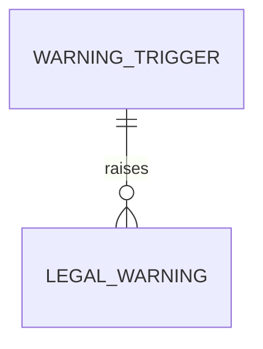
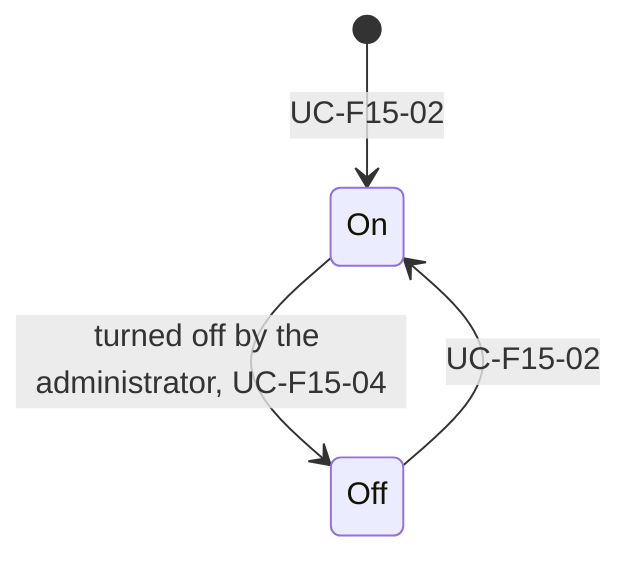

🏠 [Specs](../../../README.md) › 🧩 [Functional capabilities](../../README.md) › ⚖️ [F15 Legal assistant](../README.md) ›
🗃️ [Data](README.md) › 🗃️ E-F15-11 Warning trigger

# 🗃️ E-F15-11 Warning trigger

**Status:** ✅ specified

## Purpose

One kind of action that raises a legal warning, with its block, family, country-pack rule and whether it is on.

## Fields

| Name | Type | Required | Validation | Default | Example | Personal data | Custom fields |
|---|---|---|---|---|---|---|---|
| block | choice | yes | F5, F6, F9, F10, F13 | - | F9 | no | no |
| family | choice | yes | the four of D202 or the block's | - | working and rest times | no | no |
| condition | text | yes | - | - | daily rest under 11 hours | no | no |
| rule | link | yes | a country-pack rule | - | CR-FR-042 | no | no |
| on | yes or no | yes | - | yes | yes | no | no |

## Relations

## Lifecycle

## Indexes and search

By block, family and rule.

## Retention

Shipped with the law pack.

## Audit

Every creation and change, with who, when, the old and the new value.

## Import and export

Delivered by the law pack (T11).

## Used by

- [UC-F15-02 Receive a legal warning](../use-cases/02-receive-a-legal-warning/uc-f15-02-receive-a-legal-warning.md)
- [UC-F15-04 Set up the legal assistant](../use-cases/04-set-up-the-legal-assistant/uc-f15-04-set-up-the-legal-assistant.md)

## Open questions

None.

---

⬅️ [E-F15-10 Lawyer hand-off](e-f15-10-lawyer-hand-off.md) · ⬆️ [Up](README.md) ·
➡️ [E-F15-12 Legal source](e-f15-12-legal-source.md)
