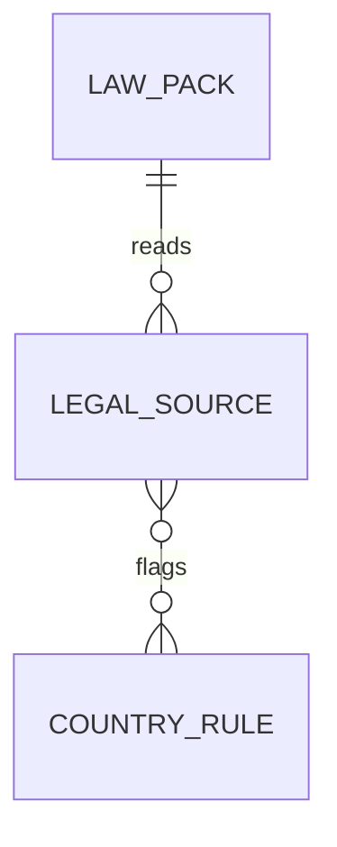
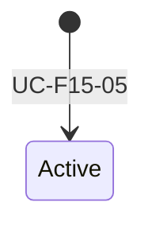

🏠 [Specs](../../../README.md) › 🧩 [Functional capabilities](../../README.md) › ⚖️ [F15 Legal assistant](../README.md) ›
🗃️ [Data](README.md) › 🗃️ E-F15-12 Legal source

# 🗃️ E-F15-12 Legal source

**Status:** ✅ specified

## Purpose

The legal source the flow charts name with the words "Source", "source"
([FL-F15-04](../flows/fl-f15-04-set-up-the-legal-assistant.md)). The owner decided to create it
([D516](../../../06-decisions/foundations/d516-naming-rules-and-the-seven-classes-of-names.md)); its fields are derived
from the specifications and confirmed by the owner (D572). A legal source is a source of the country's corpora in
[T11 Legal corpora](../../../03-technical/t11-legal-corpora/README.md), which ingests and versions it
([REQ-T11-03](../../../03-technical/t11-legal-corpora/requirements/req-t11-03-law-ingestion.md)); this record is how F15
shows it and its pulls, not a second list.

## Fields

| Name | Type | Required | Validation | Default | Example | Personal data | Custom fields |
|---|---|---|---|---|---|---|---|
| name | text | yes | - | - | Légifrance codes | no | no |
| law pack | link | yes | an installed law pack | - | France | no | no |
| kind | choice | yes | national law, EU regulation, official guidance, case law, sector technical rules | - | national law | no | no |
| access | choice | yes | API, official download | - | API (PISTE) | no | no |
| licence | text | yes | the source's licence (T11) | - | open licence | no | no |
| pull schedule | choice | yes | daily, weekly (BR-F15-09) | daily for codes and EU texts, weekly for the rest | daily | no | no |
| last pull | date and time | no | set by each pull | - | 2026-11-12 03:00 | no | no |
| pull result | choice | no | ok, unreachable | - | unreachable 1 day | no | no |
| changes | number and list | no | the article versions changed by the last pull | computed | 4: L3141-3 new version | no | no |
| rules flagged | list | no | the country-pack rules a change touches (D294) | computed | CR-FR-044 | no | no |
| state | choice | yes | active | active | active | no | no |

One official source of the T11 corpora an installed law pack reads, pulled on its schedule with no human validation
([UC-F15-05](../use-cases/04-set-up-the-legal-assistant/uc-f15-05-follow-the-law-packs-refresh.md),
[BR-F15-09](../business-rules/br-f15-09-law-packs-pull-official-sources-on-their-own.md)): new article versions enter
the corpus and old ones are kept with their dates
([BR-F15-01](../business-rules/br-f15-01-every-statement-cites-the-law-in-force.md)), a change that touches a
country-pack rule flags it, and a source unreachable for a day keeps its last copy and tells the administrators. The
name and the state are the columns of [S-F15-L12 Legal sources](../screens/00-lists/s-f15-l12-legal-sources.md); the
schedule, the last pull, the changes and the rules flagged are what
[S-F15-05 Law packs refresh](../screens/04-set-up-the-legal-assistant/s-f15-05-law-packs-refresh.md) shows.

## Relations

- [E-F15-01 Law pack](e-f15-01-law-pack.md), which reads these sources through its T11 corpora
- The country-pack rules a change flags, in [10-country-packs](../../../10-country-packs/README.md)

## Lifecycle

## Indexes and search

By name, law pack, kind, pull schedule and pull result; the sources unreachable since the last pull.

## Retention

As the other records of its capability.

## Audit

Every change, as the other records of its capability.

## Import and export

Comes with its law pack from the store (F14); CSV or XLSX export of the fields the user may see; no import.

## Used by

- [UC-F15-05 Follow the law packs' refresh](../use-cases/04-set-up-the-legal-assistant/uc-f15-05-follow-the-law-packs-refresh.md)

## Open questions

None.

---

⬅️ [E-F15-11 Warning trigger](e-f15-11-warning-trigger.md) · ⬆️ [Up](README.md) ·
➡️ [E-F15-13 Data protection impact assessment](e-f15-13-data-protection-impact-assessment.md)
