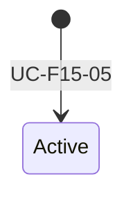

🏠 [Specs](../../../README.md) › 🧩 [Functional capabilities](../../README.md) › ⚖️ [F15 Legal assistant](../README.md) ›
🗃️ [Data](README.md) › 🗃️ E-F15-12 Legal source

# 🗃️ E-F15-12 Legal source

**Status:** 🔄 waiting for the owner

## Purpose

(Proposed) The legal source the flow charts name with the words "Source", "source"
([FL-F15-04](../flows/fl-f15-04-set-up-the-legal-assistant.md)). The owner decided to create it
([D516](../../../06-decisions/foundations/d516-naming-rules-and-the-seven-classes-of-names.md)); what it holds waits for
the owner's confirmation.

## Fields

(Proposed) To define with the owner: the flow charts name the record, not its fields.

## Relations

(Proposed) To define with the owner, from the use cases below.

## Lifecycle

## Indexes and search

(Proposed) To define with the owner.

## Retention

(Proposed) As the other records of its capability, to confirm with the owner.

## Audit

(Proposed) Every change, as the other records of its capability.

## Import and export

(Proposed) To define with the owner.

## Used by

- [UC-F15-05 Follow the law packs' refresh](../use-cases/04-set-up-the-legal-assistant/uc-f15-05-follow-the-law-packs-refresh.md)

## Open questions

(Proposed) Its fields, relations and states wait for the owner (waiting list, step 36e).

---

⬅️ [E-F15-11 Warning trigger](e-f15-11-warning-trigger.md) · ⬆️ [Up](README.md) ·
➡️ [E-F15-13 Data protection impact assessment](e-f15-13-data-protection-impact-assessment.md)
