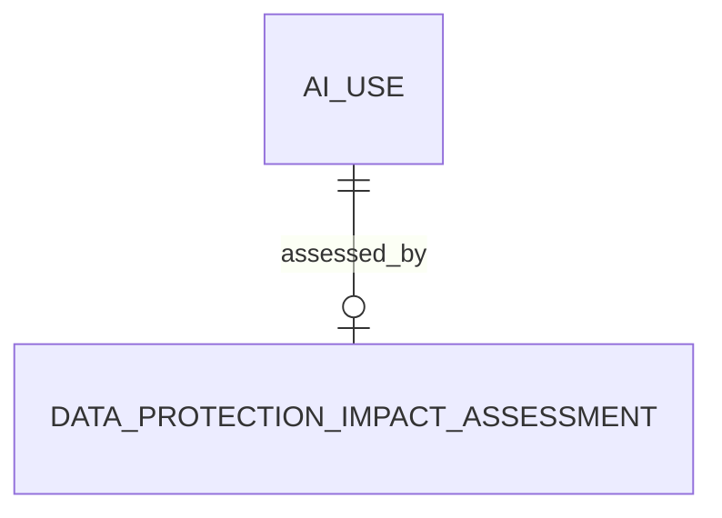
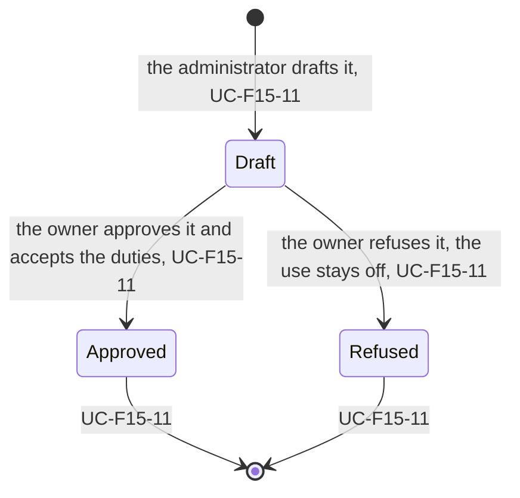

🏠 [Specs](../../../README.md) › 🧩 [Functional capabilities](../../README.md) › ⚖️ [F15 Legal assistant](../README.md) ›
🗃️ [Data](README.md) › 🗃️ E-F15-13 Data protection impact assessment

# 🗃️ E-F15-13 Data protection impact assessment

**Status:** ✅ specified

## Purpose

The data protection impact assessment the flow charts name with the words "DPIA", "Impact assessment"
([FL-F15-06](../flows/fl-f15-06-privacy-and-ai-duties.md)). The owner decided to create it
([D516](../../../06-decisions/foundations/d516-naming-rules-and-the-seven-classes-of-names.md)); its fields are derived
from the specifications and confirmed by the owner (D572).

## Fields

| Name | Type | Required | Validation | Default | Example | Personal data | Custom fields |
|---|---|---|---|---|---|---|---|
| title | text | yes | - | - | DPIA Candidate scoring | no | no |
| AI use | link | for an AI use | an AI use of the inventory (E-F15-09) | - | Candidate scoring | no | no |
| assessment | file | yes | PDF | - | dpia-scoring.pdf | no | no |
| drafted by | user | yes | an administrator | - | the administrator | yes | no |
| deployer duties accepted | yes or no | for a high-risk AI use | CR-FR-058 | no | yes | no | no |
| approved by, approved on | user, date | when approved | the owner of the company | - | the owner, 2026-11-20 | yes | no |
| next review | date | no | the yearly review of UC-F15-11 | - | 2027-11-20 | no | no |
| state | choice | yes | draft, approved, refused | draft | approved | no | no |

The impact assessment a high-risk AI use needs before it is turned on
([UC-F15-11](../use-cases/06-privacy-and-ai-duties/uc-f15-11-keep-the-ai-uses-inventory-and-impact-assessments.md),
[BR-F15-15](../business-rules/br-f15-15-every-ai-use-inventoried-with-its-risk-class.md)): the administrator drafts it
with the AI assistant's help, the owner approves it and accepts the deployer duties
([CR-FR-058](../../../10-country-packs/france/ai-and-recording/cr-fr-058-high-risk-ai-in-employment.md)), and only
then is the use turned on; a refusal keeps the use off. The inventory shows each use with its assessment
([E-F15-09 AI use](e-f15-09-ai-use.md)). The title and the state are the columns of
[S-F15-L13 Data protection impact assessments](../screens/00-lists/s-f15-l13-data-protection-impact-assessments.md),
whose rows also name processing that is not an AI use; the assessment of each AI use is what
[S-F15-10 Privacy and AI register](../screens/06-privacy-and-ai-duties/s-f15-10-privacy-and-ai-register.md) shows.

## Relations

- [E-F15-09 AI use](e-f15-09-ai-use.md)

## Lifecycle

## Indexes and search

By title, AI use and state; the assessments waiting for the owner's approval.

## Retention

As the other records of its capability.

## Audit

Every change, as the other records of its capability.

## Import and export

CSV and JSON export through the API (T5); no bulk import.

## Used by

- [UC-F15-11 Keep the AI uses inventory and impact assessments](../use-cases/06-privacy-and-ai-duties/uc-f15-11-keep-the-ai-uses-inventory-and-impact-assessments.md)

## Open questions

None.

---

⬅️ [E-F15-12 Legal source](e-f15-12-legal-source.md) · ⬆️ [Up](README.md) ·
➡️ [E-F15-14 Corporate filing](e-f15-14-corporate-filing.md)
