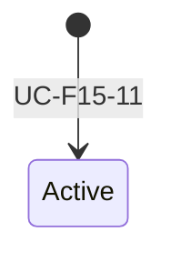

🏠 [Specs](../../../README.md) › 🧩 [Functional capabilities](../../README.md) › ⚖️ [F15 Legal assistant](../README.md) ›
🗃️ [Data](README.md) › 🗃️ E-F15-13 Data protection impact assessment

# 🗃️ E-F15-13 Data protection impact assessment

**Status:** 🔄 waiting for the owner

## Purpose

(Proposed) The data protection impact assessment the flow charts name with the words "DPIA", "Impact assessment"
([FL-F15-06](../flows/fl-f15-06-privacy-and-ai-duties.md)). The owner decided to create it
([D516](../../../06-decisions/foundations/d516-naming-rules-and-the-seven-classes-of-names.md)); what it holds waits for
the owner's confirmation.

## Fields

(Proposed) To define with the owner: the flow charts name the record, not its fields.

## Relations

(Proposed) To define with the owner, from the use cases below.

## Lifecycle

## Indexes and search

(Proposed) To define with the owner.

## Retention

(Proposed) As the other records of its capability, to confirm with the owner.

## Audit

(Proposed) Every change, as the other records of its capability.

## Import and export

(Proposed) To define with the owner.

## Used by

- [UC-F15-11 Keep the AI uses inventory and impact assessments](../use-cases/06-privacy-and-ai-duties/uc-f15-11-keep-the-ai-uses-inventory-and-impact-assessments.md)

## Open questions

(Proposed) Its fields, relations and states wait for the owner (waiting list, step 36e).

---

⬅️ [E-F15-12 Legal source](e-f15-12-legal-source.md) · ⬆️ [Up](README.md) ·
➡️ [E-F15-14 Corporate filing](e-f15-14-corporate-filing.md)
