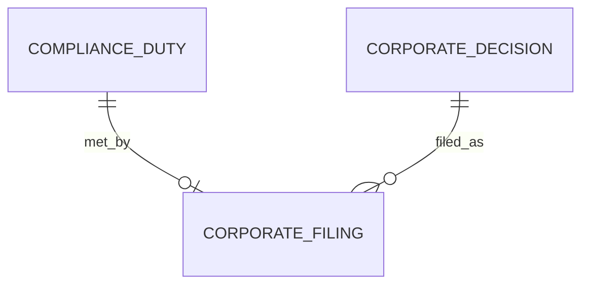
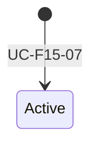

🏠 [Specs](../../../README.md) › 🧩 [Functional capabilities](../../README.md) › ⚖️ [F15 Legal assistant](../README.md) ›
🗃️ [Data](README.md) › 🗃️ E-F15-14 Corporate filing

# 🗃️ E-F15-14 Corporate filing

**Status:** ✅ specified

## Purpose

The corporate filing the flow charts name with the words "filings"
([FL-F15-05](../flows/fl-f15-05-duties-and-records.md)). The owner decided to create it
([D516](../../../06-decisions/foundations/d516-naming-rules-and-the-seven-classes-of-names.md)); its fields are derived
from the specifications and confirmed by the owner (D572).

## Fields

| Name | Type | Required | Validation | Default | Example | Personal data | Custom fields |
|---|---|---|---|---|---|---|---|
| title | text | yes | - | - | Accounts 2026 filing | no | no |
| duty | link | no | the filing duty of the compliance calendar (E-F15-05) | - | File the 2026 accounts | no | no |
| decision | link | no | the corporate decision filed (E-F15-07) | - | register entry 14 | no | no |
| filed by | user | no | the owner of the duty | - | the external accountant | yes | no |
| filed on | date | no | - | - | 2027-07-10 | no | no |
| receipt | file | when filed | PDF or image | - | receipt-2027-07-10.pdf | no | no |
| state | choice | yes | active | active | active | no | no |

A filing the company must make, such as its approved accounts or a change of beneficial owner, kept with its receipt
([UC-F15-07](../use-cases/05-duties-and-records/uc-f15-07-keep-the-compliance-calendar.md),
[UC-F15-09](../use-cases/05-duties-and-records/uc-f15-09-approve-the-accounts-and-keep-the-company-registers.md)): the
decision is numbered in the register and SimpleERP creates the filing duty, then the accountant files and attaches the
receipt, and the duty is marked done with it as proof
([BR-F15-11](../business-rules/br-f15-11-every-dated-duty-has-an-owner-and-reminders.md)). The title and the state are
the columns of [S-F15-L14 Corporate filings](../screens/00-lists/s-f15-l14-corporate-filings.md); the duty, its owner
and its proof are what [S-F15-07 Compliance calendar](../screens/05-duties-and-records/s-f15-07-compliance-calendar.md)
shows.

## Relations

- [E-F15-05 Compliance duty](e-f15-05-compliance-duty.md)
- [E-F15-07 Corporate decision](e-f15-07-corporate-decision.md)

## Lifecycle

## Indexes and search

By title, decision, filing date and state.

## Retention

As the other records of its capability.

## Audit

Every change, as the other records of its capability.

## Import and export

CSV and JSON export through the API (T5); no bulk import.

## Used by

- [UC-F15-07 Keep the compliance calendar](../use-cases/05-duties-and-records/uc-f15-07-keep-the-compliance-calendar.md)

## Open questions

None.

---

⬅️ [E-F15-13 Data protection impact assessment](e-f15-13-data-protection-impact-assessment.md) · ⬆️ [Up](README.md) ·
➡️ [E-F15-15 Shareholding](e-f15-15-shareholding.md)
