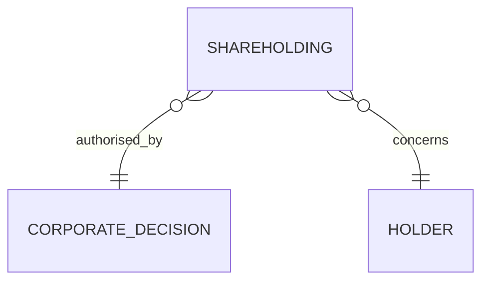
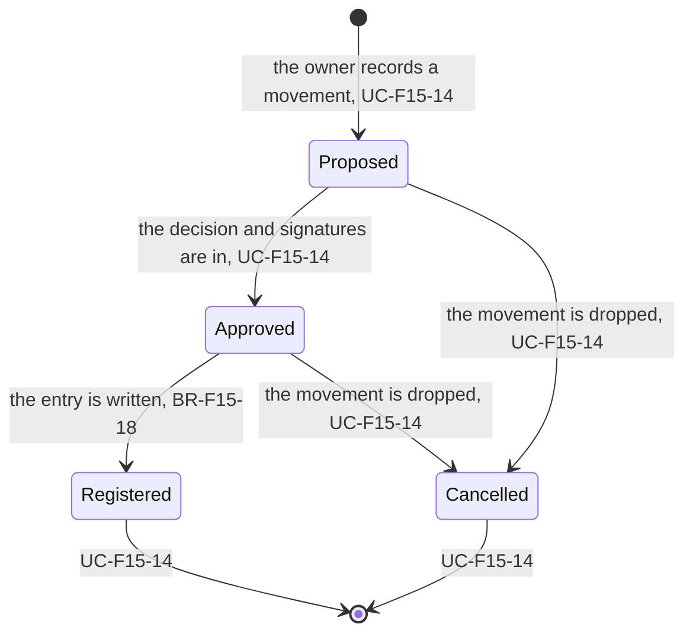

🏠 [Specs](../../../README.md) › 🧩 [Functional capabilities](../../README.md) › ⚖️ [F15 Legal assistant](../README.md) ›
🗃️ [Data](README.md) › 🗃️ E-F15-15 Shareholding

# 🗃️ E-F15-15 Shareholding

**Status:** ✅ specified

## Purpose

One line of the share-movement register: a holder's shares of a class that change by an issue, a transfer or a
cancellation ([D534](../../../06-decisions/f15-legal-assistant/d534-benchmark-gaps-f15-legal-assistant.md)).

## Fields

| Name | Type | Required | Validation | Default | Example | Personal data | Custom fields |
|---|---|---|---|---|---|---|---|
| holder | customer record (E-F6-01) | yes | a person or a company | - | Marc Leroy | yes | no |
| class | text | yes | a share class of the company | ordinary | Ordinary | no | no |
| movement | issue, transfer, cancellation | yes | one of the three | - | transfer | no | no |
| quantity | number | yes | above 0, within the balance | - | 200 | no | no |
| price per share | amount | no | 0 or more | - | 12.50 EUR | no | no |
| counterparty | customer record (E-F6-01) | no | required for a transfer | - | Anne Verdier | yes | no |
| authorising decision | corporate decision (E-F15-07) | no | required to be Approved | - | 2026-11-02 board | no | no |
| entry number | text | no | given on registering | - | 2026-014 | no | no |
| registered on | date | no | set on registering | - | 2026-11-10 | no | no |
| state | Proposed, Approved, Registered, Cancelled | yes | the lifecycle below | Proposed | Approved | no | no |
| owner | user | yes | a user of the company | the creator | Claire P. | yes | no |

## Relations

- [E-F15-07 Corporate decision](e-f15-07-corporate-decision.md)
- [E-F15-14 Corporate filing](e-f15-14-corporate-filing.md)
- [E-F6-01 Customer record](../../f06-customers-and-sales/data/e-f06-01-customer-record.md)

## Lifecycle

## Indexes and search

By holder, class, movement, entry number and date.

## Retention

The register is kept for the life of the company and a long period after; no line is deleted.

## Audit

Every proposal, approval, signature and registration, with who, when and the entry number.

## Import and export

The register is exported as a file for the filing or an audit; no import of a register.

## Used by

- [UC-F15-14](../use-cases/07-equity-contracts-and-disputes/uc-f15-14-keep-the-cap-table-and-share-movements.md)

## Open questions

None.

---

⬅️ [E-F15-14 Corporate filing](e-f15-14-corporate-filing.md) · ⬆️ [Up](README.md) ·
➡️ [E-F15-16 Equity grant](e-f15-16-equity-grant.md)
