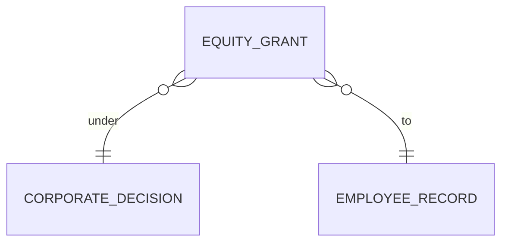
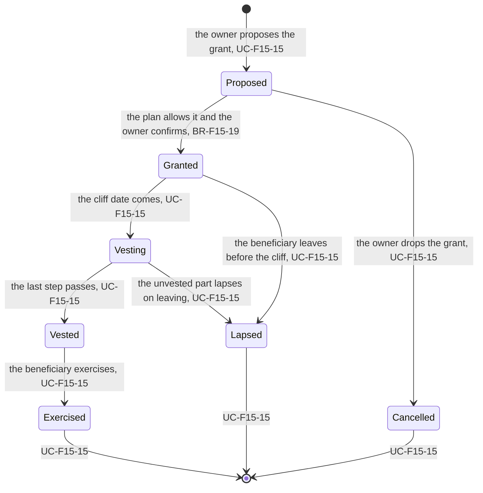

🏠 [Specs](../../../README.md) › 🧩 [Functional capabilities](../../README.md) › ⚖️ [F15 Legal assistant](../README.md) ›
🗃️ [Data](README.md) › 🗃️ E-F15-16 Equity grant

# 🗃️ E-F15-16 Equity grant

**Status:** ✅ specified

## Purpose

A grant of equity to a beneficiary under an approved plan, with its vesting and exercise
([D534](../../../06-decisions/f15-legal-assistant/d534-benchmark-gaps-f15-legal-assistant.md)).

## Fields

| Name | Type | Required | Validation | Default | Example | Personal data | Custom fields |
|---|---|---|---|---|---|---|---|
| beneficiary | employee record (E-F9-01) | yes | an employee or an officer | - | Lea M. | yes | no |
| plan | corporate decision (E-F15-07) | yes | an approved plan | - | 2026 plan | no | no |
| instrument | warrant, free share, option | yes | one the plan allows | - | warrant | no | no |
| quantity | number | yes | within the pool | - | 2,000 | no | no |
| strike price | amount | no | 0 or more | - | 3.00 EUR | no | no |
| granted on | date | yes | within the plan's period | today | 2026-11-14 | no | no |
| cliff | date | yes | after the grant date | 12 months | 2027-11-14 | no | no |
| vesting months | number | yes | 1 or more | 48 | 48 | no | no |
| vested | number | yes | 0 to the quantity | 0 | 0 | no | no |
| exercised | number | yes | 0 to the vested | 0 | 0 | no | no |
| state | Proposed, Granted, Vesting, Vested, Exercised, Lapsed, Cancelled | yes | the lifecycle below | Proposed | Granted | no | no |
| owner | user | yes | a user of the company | the creator | Claire P. | yes | no |

## Relations

- [E-F15-07 Corporate decision](e-f15-07-corporate-decision.md)
- [E-F9-01 Employee record](../../f09-hr-and-projects/data/e-f09-01-employee-record.md)
- [E-F13-26 Employee benefit](../../f13-payroll/data/e-f13-26-employee-benefit.md)

## Lifecycle

## Indexes and search

By beneficiary, plan, instrument, state and next vesting date.

## Retention

Kept for the life of the company and a long period after, with the register.

## Audit

Every proposal, grant, vesting step, exercise, lapse and cancellation, with who and when.

## Import and export

No import. The grants of a plan are exported as a CSV for the shareholders.

## Used by

- [UC-F15-15](../use-cases/07-equity-contracts-and-disputes/uc-f15-15-grant-and-vest-employee-equity.md)

## Open questions

None.

---

⬅️ [E-F15-15 Shareholding](e-f15-15-shareholding.md) · ⬆️ [Up](README.md) ·
➡️ [E-F15-17 Funding round](e-f15-17-funding-round.md)
