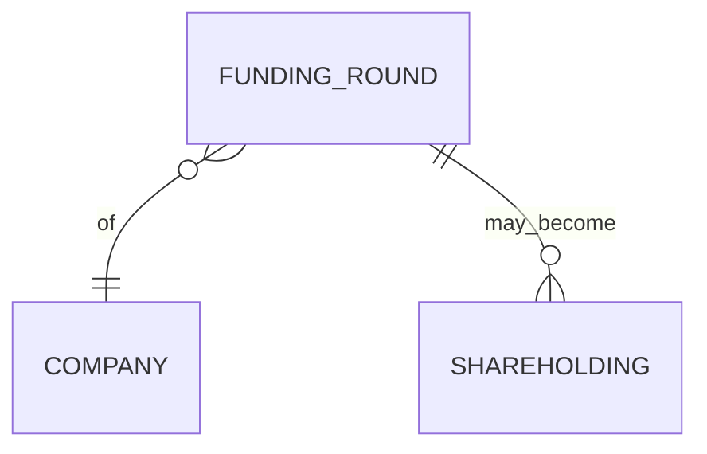
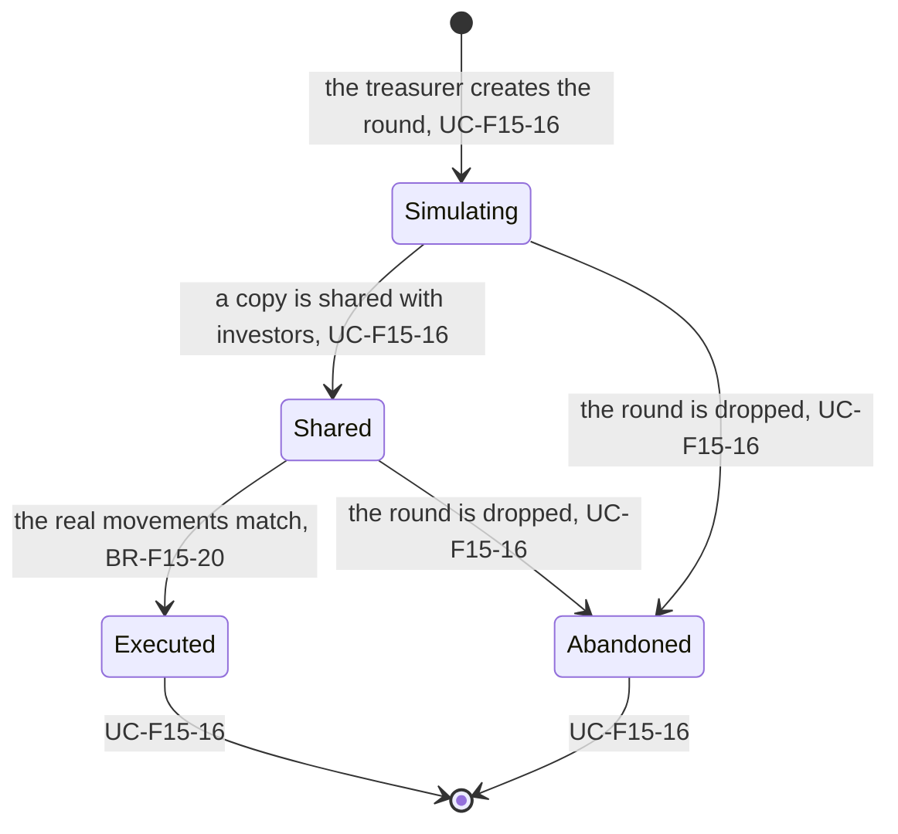

🏠 [Specs](../../../README.md) › 🧩 [Functional capabilities](../../README.md) › ⚖️ [F15 Legal assistant](../README.md) ›
🗃️ [Data](README.md) › 🗃️ E-F15-17 Funding round

# 🗃️ E-F15-17 Funding round

**Status:** ✅ specified

## Purpose

A fundraising round simulated before it happens: its terms, its scenarios and the table after
([D534](../../../06-decisions/f15-legal-assistant/d534-benchmark-gaps-f15-legal-assistant.md)).

## Fields

| Name | Type | Required | Validation | Default | Example | Personal data | Custom fields |
|---|---|---|---|---|---|---|---|
| name | text | yes | unique per company | - | Series A | no | no |
| round date | date | no | - | - | 2027-03-01 | no | no |
| amount raised | amount | yes | above 0 | - | 800,000 EUR | no | no |
| pre-money valuation | amount | yes | above 0 | - | 3,200,000 EUR | no | no |
| price per new share | amount | yes | computed | - | 320.00 EUR | no | no |
| new shares | number | yes | computed | - | 2,500 | no | no |
| pool top-up | percentage | no | 0 to 100 | 0 | 5 | no | no |
| investors | list with amounts | no | total at most the amount raised | - | Fund A 800,000 | no | no |
| state | Simulating, Shared, Executed, Abandoned | yes | the lifecycle below | Simulating | Shared | no | no |
| owner | user | yes | a user of the company | the creator | Claire P. | yes | no |

## Relations

- [E-F15-15 Shareholding](e-f15-15-shareholding.md)
- [E-F15-16 Equity grant](e-f15-16-equity-grant.md)

## Lifecycle

## Indexes and search

By name, date, state and amount.

## Retention

A simulation is kept as long as the round it belongs to, and 5 years after execution.

## Audit

Every creation, change of terms, sharing and execution, with who and when.

## Import and export

No import. A scenario is exported as a file without private holders' personal data.

## Used by

- [UC-F15-16](../use-cases/07-equity-contracts-and-disputes/uc-f15-16-simulate-a-fundraising-dilution.md)

## Open questions

None.

---

⬅️ [E-F15-16 Equity grant](e-f15-16-equity-grant.md) · ⬆️ [Up](README.md) · ➡️ [E-F15-18 Clause](e-f15-18-clause.md)
