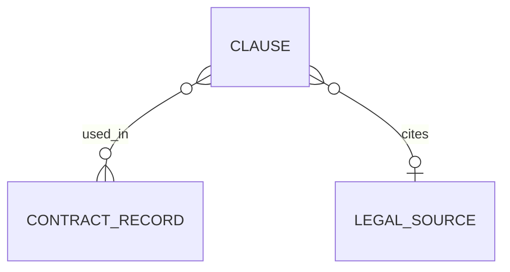
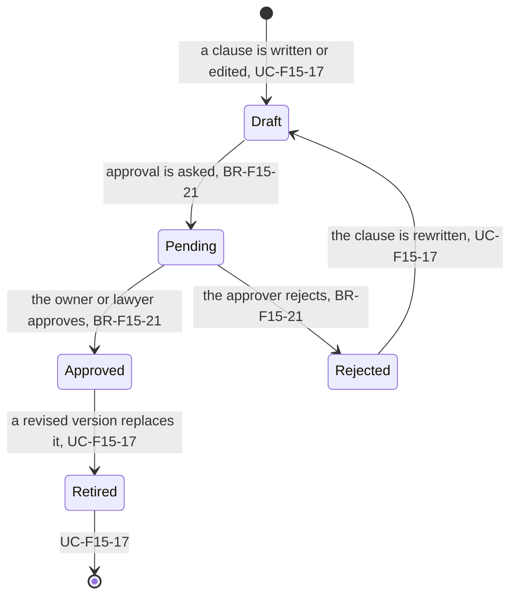

🏠 [Specs](../../../README.md) › 🧩 [Functional capabilities](../../README.md) › ⚖️ [F15 Legal assistant](../README.md) ›
🗃️ [Data](README.md) › 🗃️ E-F15-18 Clause

# 🗃️ E-F15-18 Clause

**Status:** ✅ specified

## Purpose

A clause of the company's library: its approved wording, its variants and where it may be used
([D534](../../../06-decisions/f15-legal-assistant/d534-benchmark-gaps-f15-legal-assistant.md)).

## Fields

| Name | Type | Required | Validation | Default | Example | Personal data | Custom fields |
|---|---|---|---|---|---|---|---|
| title | text | yes | unique per library and language | - | Liability | no | no |
| text | text | yes | the approved wording | - | The supplier's liability is limited to ... | no | no |
| language | language | yes | one of the company's | French | French | no | no |
| contract kinds | list | yes | 1 or more | - | Service agreement | no | no |
| variant of | clause | no | another clause of the library | - | Liability | no | no |
| law source | legal source (E-F15-12) | no | a source of the law packs | - | Code civil | no | no |
| version | number | yes | 1 or more | 1 | 3 | no | no |
| approved by | user (E-F1-03) | no | an approver | - | Claire P. | yes | no |
| state | Draft, Pending, Approved, Rejected, Retired | yes | the lifecycle below | Draft | Pending | no | no |
| owner | user | yes | a user of the company | the creator | Claire P. | yes | no |

## Relations

- [E-F15-06 Contract record](e-f15-06-contract-record.md)
- [E-F15-12 Legal source](e-f15-12-legal-source.md)

## Lifecycle

## Indexes and search

By title, contract kind, language, state and law source.

## Retention

Every approved version is kept as long as any signed contract uses it.

## Audit

Every edit, approval request, approval, rejection and retirement, with who, when and the wording.

## Import and export

The library is imported and exported as a file; imported clauses start in Draft.

## Used by

- [UC-F15-17](../use-cases/07-equity-contracts-and-disputes/uc-f15-17-draft-a-contract-from-the-clause-library.md)

## Open questions

None.

---

⬅️ [E-F15-17 Funding round](e-f15-17-funding-round.md) · ⬆️ [Up](README.md) ·
➡️ [E-F15-19 General meeting](e-f15-19-general-meeting.md)
