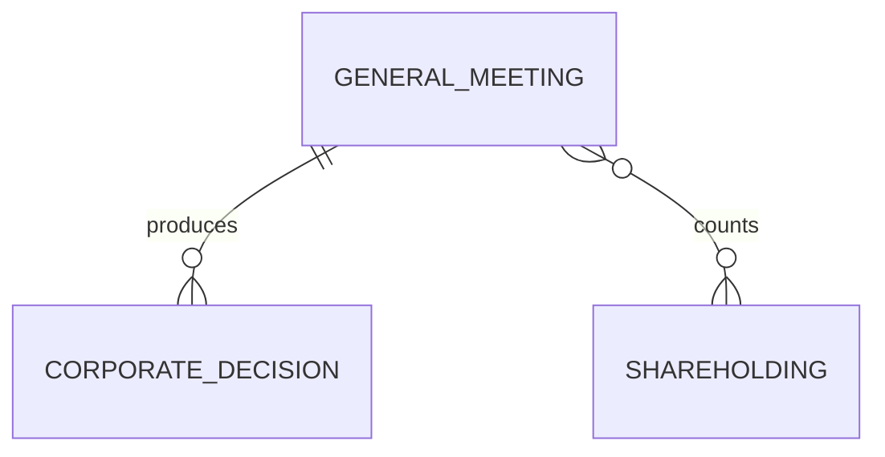
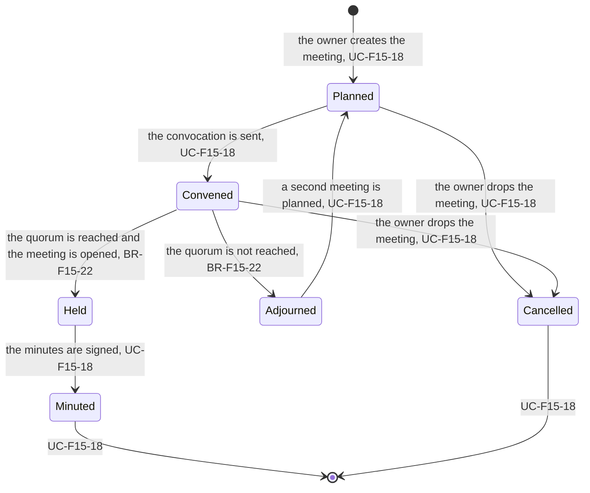

🏠 [Specs](../../../README.md) › 🧩 [Functional capabilities](../../README.md) › ⚖️ [F15 Legal assistant](../README.md) ›
🗃️ [Data](README.md) › 🗃️ E-F15-19 General meeting

# 🗃️ E-F15-19 General meeting

**Status:** ✅ specified

## Purpose

A shareholders' general meeting: its convocation, its quorum, its resolutions and votes, and its minutes
([D534](../../../06-decisions/f15-legal-assistant/d534-benchmark-gaps-f15-legal-assistant.md)).

## Fields

| Name | Type | Required | Validation | Default | Example | Personal data | Custom fields |
|---|---|---|---|---|---|---|---|
| kind | ordinary, extraordinary, written consultation | yes | one of the three | - | ordinary | no | no |
| meeting date | date and time | yes | after the notice period | - | 2026-12-15 10:00 | no | no |
| convocation sent | date | no | before the latest allowed date | - | 2026-11-24 | no | no |
| notice days | number | yes | from the statutes or the pack | 15 | 15 | no | no |
| quorum required | percentage | yes | 0 to 100 | - | 25 | no | no |
| present and represented | percentage | no | computed at the opening | - | 78 | no | no |
| resolutions | list with majority and votes | yes | 1 or more | - | 3 resolutions | no | no |
| minutes | document | no | signed by the chair | - | minutes-2026-12-15.pdf | no | no |
| state | Planned, Convened, Held, Adjourned, Minuted, Cancelled | yes | the lifecycle below | Planned | Convened | no | no |
| owner | user | yes | a user of the company | the creator | Claire P. | yes | no |

## Relations

- [E-F15-07 Corporate decision](e-f15-07-corporate-decision.md)
- [E-F15-14 Corporate filing](e-f15-14-corporate-filing.md)
- [E-F15-15 Shareholding](e-f15-15-shareholding.md)

## Lifecycle

## Indexes and search

By kind, date, state and resolution.

## Retention

Minutes and votes are kept for the life of the company and a long period after.

## Audit

Every convocation, document, vote, change of vote, proxy, quorum check, result and signature, with who and when.

## Import and export

No import. The minutes and the vote record are exported as files.

## Used by

- [UC-F15-18](../use-cases/07-equity-contracts-and-disputes/uc-f15-18-run-a-shareholders-general-meeting.md)

## Open questions

None.

---

⬅️ [E-F15-18 Clause](e-f15-18-clause.md) · ⬆️ [Up](README.md) · ➡️ [E-F15-20 IP right](e-f15-20-ip-right.md)
