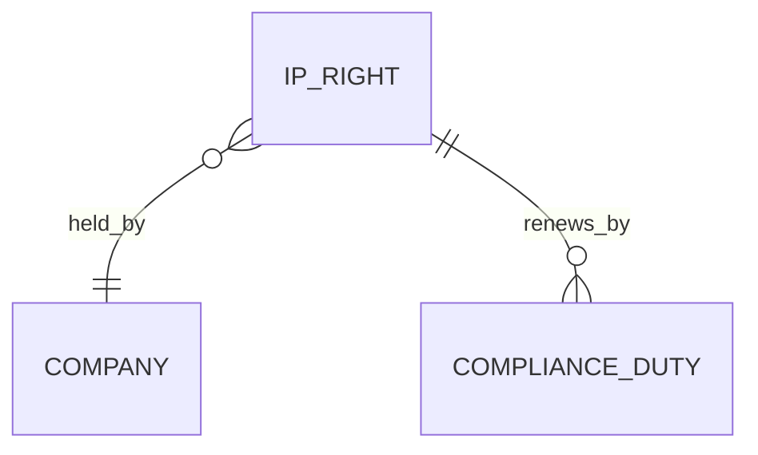
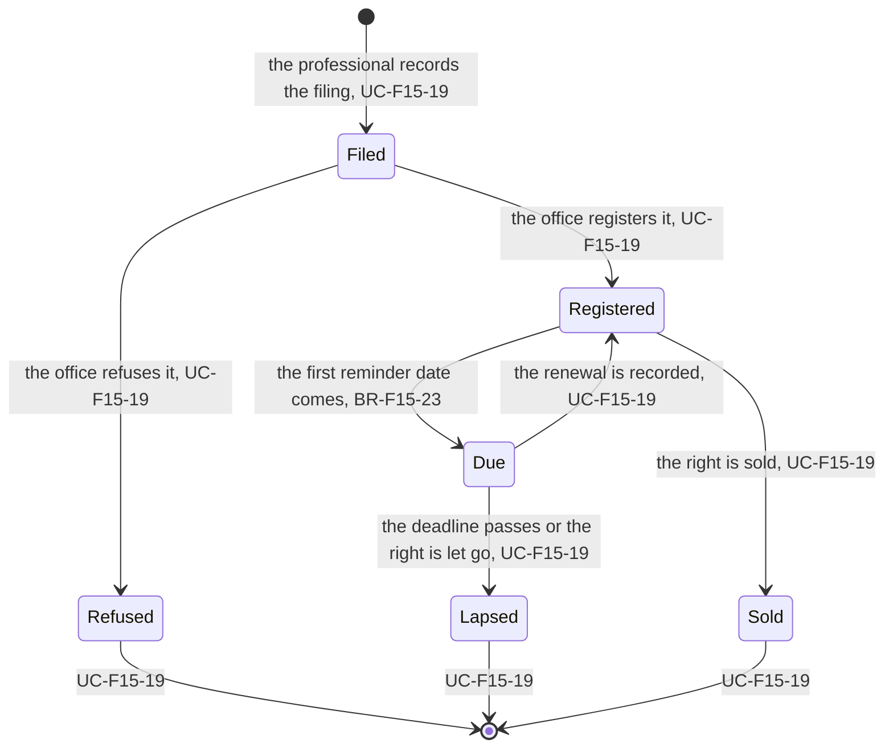

🏠 [Specs](../../../README.md) › 🧩 [Functional capabilities](../../README.md) › ⚖️ [F15 Legal assistant](../README.md) ›
🗃️ [Data](README.md) › 🗃️ E-F15-20 IP right

# 🗃️ E-F15-20 IP right

**Status:** ✅ specified

## Purpose

A right of the company's own intellectual property, with its dates and its state
([D534](../../../06-decisions/f15-legal-assistant/d534-benchmark-gaps-f15-legal-assistant.md)).

## Fields

| Name | Type | Required | Validation | Default | Example | Personal data | Custom fields |
|---|---|---|---|---|---|---|---|
| name | text | yes | - | - | Verdier | no | no |
| type | trademark, patent, design, domain, copyright registration | yes | one of the five | - | trademark | no | no |
| countries | list of countries | yes | 1 or more | - | France, Spain | no | no |
| filing number | text | no | - | - | FR 16 4 123 456 | no | no |
| filed on | date | yes | - | - | 2016-03-10 | no | no |
| registered on | date | no | after the filing | - | 2016-09-01 | no | no |
| renewal date | date | no | after the registration | - | 2026-03-10 | no | no |
| renewal fee | amount | no | 0 or more | - | 250 EUR | no | no |
| holder | company (E-F1-01) | yes | an entity of the group | the company | Atelier Verdier | no | no |
| state | Filed, Registered, Refused, Due, Lapsed, Sold | yes | the lifecycle below | Filed | Registered | no | no |
| owner | user | yes | a user of the company | the creator | Claire P. | yes | no |

## Relations

- [E-F15-05 Compliance duty](e-f15-05-compliance-duty.md)
- [E-F1-01 Company](../../f01-administration/data/e-f01-01-company.md)

## Lifecycle

## Indexes and search

By name, type, country, state and renewal date.

## Retention

Kept for the life of the right and 10 years after.

## Audit

Every filing, registration, renewal, lapse, sale and licence, with who, when and the dates.

## Import and export

The portfolio is exported as a CSV; a first import of the rights is allowed from a file.

## Used by

- [UC-F15-19](../use-cases/07-equity-contracts-and-disputes/uc-f15-19-keep-the-companys-ip-portfolio.md)

## Open questions

None.

---

⬅️ [E-F15-19 General meeting](e-f15-19-general-meeting.md) · ⬆️ [Up](README.md) ·
➡️ [E-F15-21 Dispute](e-f15-21-dispute.md)
