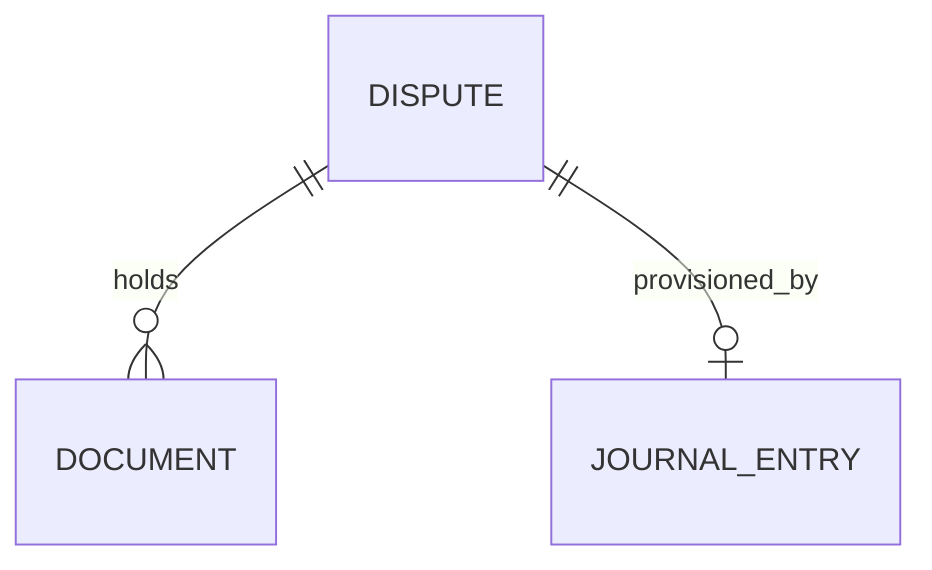
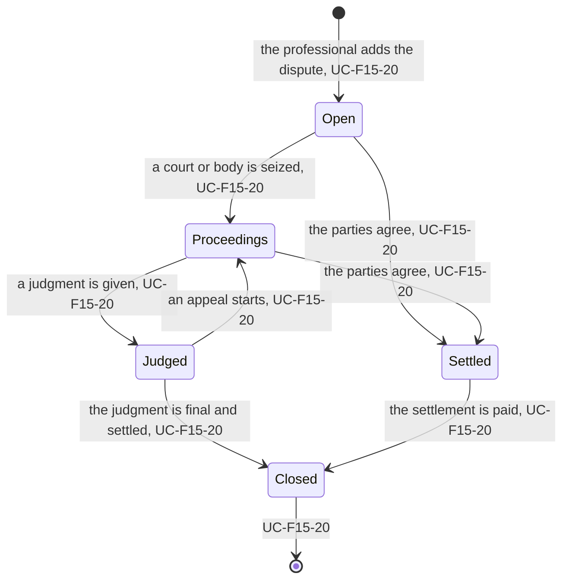

🏠 [Specs](../../../README.md) › 🧩 [Functional capabilities](../../README.md) › ⚖️ [F15 Legal assistant](../README.md) ›
🗃️ [Data](README.md) › 🗃️ E-F15-21 Dispute

# 🗃️ E-F15-21 Dispute

**Status:** ✅ specified

## Purpose

A dispute the company is in: parties, court, amounts, risk, hearings and outcome
([D534](../../../06-decisions/f15-legal-assistant/d534-benchmark-gaps-f15-legal-assistant.md)).

## Fields

| Name | Type | Required | Validation | Default | Example | Personal data | Custom fields |
|---|---|---|---|---|---|---|---|
| counterparty | text | yes | - | - | Supplier Roth | yes | no |
| subject | text | yes | - | - | Unpaid deliveries | no | no |
| court or body | text | yes | - | - | Commercial court | no | no |
| lawyer | text | no | - | - | Maitre Dubois | yes | no |
| amount claimed | amount | yes | 0 or more | - | 48,000 EUR | no | no |
| risk | remote, possible, probable | yes | one of the three | possible | probable | no | no |
| estimated loss | amount | no | required when probable | - | 30,000 EUR | no | no |
| next hearing | date | no | - | - | 2026-12-02 | no | no |
| provision | amount | no | approved by accounting | 0 | 30,000 EUR | no | no |
| state | Open, Proceedings, Settled, Judged, Closed | yes | the lifecycle below | Open | Proceedings | no | no |
| owner | user | yes | a user of the company | the creator | Claire P. | yes | no |

## Relations

- [E-F8-03 Journal entry](../../f08-accounting/data/e-f08-03-journal-entry.md)
- [E-F15-05 Compliance duty](e-f15-05-compliance-duty.md)

## Lifecycle

## Indexes and search

By counterparty, court, risk, state and next hearing.

## Retention

Kept 10 years after the case closes, like the accounting records
([CR-FR-002](../../../10-country-packs/france/accounting/cr-fr-002-accounting-records-kept-ten-years.md)).

## Audit

Every dispute, hearing, risk change, estimate, proposal and closing, with who, when and the reason.

## Import and export

No import. The register is exported as a CSV for the auditor.

## Used by

- [UC-F15-20](../use-cases/07-equity-contracts-and-disputes/uc-f15-20-keep-the-litigation-register.md)

## Open questions

None.

---

⬅️ [E-F15-20 IP right](e-f15-20-ip-right.md) · ⬆️ [Up](README.md)
