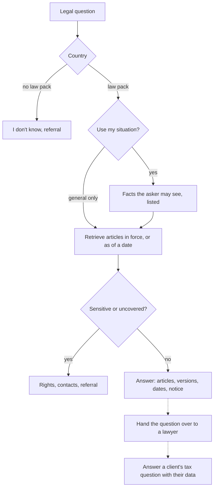

🏠 [Specs](../../../README.md) › 🧩 [Functional capabilities](../../README.md) › ⚖️ [F15 Legal assistant](../README.md) ›
🔀 [Flows](README.md) › 🔀 FL-F15-01 Ask a legal question

# 🔀 FL-F15-01 Ask a legal question

**Status:** ✅ specified

## Summary

From a question to a cited, dated answer for the person's situation.

## Personas

- [U01 Employee](../../../01-users/personas/u01-employee.md)
- [U14 Field worker](../../../01-users/personas/u14-field-worker.md)
- [U02 Manager](../../../01-users/personas/u02-manager.md)
- [U06 HR](../../../01-users/personas/u06-hr.md)
- [U13 Owner](../../../01-users/personas/u13-owner.md)
- [U05 Accounting](../../../01-users/personas/u05-accounting.md)
- [U08 External accountant](../../../01-users/personas/u08-external-accountant.md)
- [U07 Administrator](../../../01-users/personas/u07-administrator.md)

## Flowchart

## Sequence diagram

See [UC-F15-01](../use-cases/01-ask-a-legal-question/uc-f15-01-use-the-legal-assistant.md#sequence-diagram).

## Steps

| Step | Persona | Screen | Use case | What happens |
|---|---|---|---|---|
| 1 | U01, U14, U02, U06, U13, U05, U08 | [S-F15-01](../screens/01-ask-a-legal-question/s-f15-01-legal-answer.md) | [UC-F15-01](../use-cases/01-ask-a-legal-question/uc-f15-01-use-the-legal-assistant.md) | Ask, facts used listed |
| 2 | U01, U14, U02, U06, U13, U05, U08 | [S-F15-01](../screens/01-ask-a-legal-question/s-f15-01-legal-answer.md) | [UC-F15-01](../use-cases/01-ask-a-legal-question/uc-f15-01-use-the-legal-assistant.md) | Cited answer, original and translation |
| 3 | U01, U14 | [S-F15-01](../screens/01-ask-a-legal-question/s-f15-01-legal-answer.md) | [UC-F15-01](../use-cases/01-ask-a-legal-question/uc-f15-01-use-the-legal-assistant.md) | As of a past date |
| 4 | U13, U06, U01 | [S-F15-11](../screens/01-ask-a-legal-question/s-f15-11-lawyer-hand-off.md) | [UC-F15-12](../use-cases/01-ask-a-legal-question/uc-f15-12-hand-a-question-over-to-a-lawyer.md) | Hand the question over to a lawyer |
| 5 | U08, U05 | [S-F15-01](../screens/01-ask-a-legal-question/s-f15-01-legal-answer.md) | [UC-F15-13](../use-cases/01-ask-a-legal-question/uc-f15-13-answer-a-clients-tax-question-with-their-data.md) | Answer a client's tax question with their data |

### Entities and screens

| Entity | States in this flow | Shown at step and screen | Aggregated view |
|---|---|---|---|
| [E-F3-01 Conversation](../../f03-assistant/data/e-f03-01-conversation.md) | Private, Shared, Deleted | 1, 2, 3, 5 [S-F15-01](../screens/01-ask-a-legal-question/s-f15-01-legal-answer.md); 4 [S-F15-11](../screens/01-ask-a-legal-question/s-f15-11-lawyer-hand-off.md) | Conversations |
| [E-F15-10 Lawyer hand-off](../data/e-f15-10-lawyer-hand-off.md) | Draft, Sent, Discarded | 1, 2, 3, 5 [S-F15-01](../screens/01-ask-a-legal-question/s-f15-01-legal-answer.md); 4 [S-F15-11](../screens/01-ask-a-legal-question/s-f15-11-lawyer-hand-off.md) | Lawyer hand-offs |
| [E-F15-01 Law pack](../data/e-f15-01-law-pack.md) | Scheduled | 1, 2, 3, 5 [S-F15-01](../screens/01-ask-a-legal-question/s-f15-01-legal-answer.md); 4 [S-F15-11](../screens/01-ask-a-legal-question/s-f15-11-lawyer-hand-off.md) | Law packs |
| [E-F1-03 User](../../f01-administration/data/e-f01-03-user.md) | Invited, Active, Deactivated | Shown elsewhere: [S-F1-03 Users](../../f01-administration/screens/03-user-lifecycle/s-f01-03-users.md) | Users |
| [E-T11-03 Article version](../../../03-technical/t11-legal-corpora/data/e-t11-03-article-version.md) | Recorded | Shown elsewhere: [S-T11-03 Article version](../../../03-technical/t11-legal-corpora/screens/s-t11-03-article-version.md), from the admin list [S-T11-L03](../../../03-technical/t11-legal-corpora/screens/00-lists/s-t11-l03-article-versions.md) | Article versions |
| [E-F3-02 Assistant answer](../../f03-assistant/data/e-f03-02-assistant-answer.md) | Recorded | Shown elsewhere: [S-F3-01 Assistant panel](../../f03-assistant/screens/01-ask-the-assistant/s-f03-01-assistant-panel.md) | Assistant answers |
| [E-F1-01 Company](../../f01-administration/data/e-f01-01-company.md) | In setup, Active | Shown elsewhere: [S-F1-10 Client companies](../../f01-administration/screens/08-provider-and-client-companies/s-f01-10-client-companies.md) | Companies |

## Errors

No law pack; not covered; model or corpus unavailable.

## Images

Every step and error, for each persona taking part, in light and dark mode (D120). Steps are numbered as in the Steps
table; E rows are the error cases.

| Step | Persona | Device | Light | Dark |
|---|---|---|---|---|
| 1 | U01 | desktop | [light](../images/01-ask-a-legal-question/u01-employee/1-ask-with-facts-desktop-light.png) | [dark](../images/01-ask-a-legal-question/u01-employee/1-ask-with-facts-desktop-dark.png) |
| 1 | U01 | phone | [light](../images/01-ask-a-legal-question/u01-employee/1-ask-with-facts-phone-light.png) | [dark](../images/01-ask-a-legal-question/u01-employee/1-ask-with-facts-phone-dark.png) |
| 1 | U14 | phone | [light](../images/01-ask-a-legal-question/u14-field-worker/1-ask-with-facts-phone-light.png) | [dark](../images/01-ask-a-legal-question/u14-field-worker/1-ask-with-facts-phone-dark.png) |
| 1 | U06 | desktop | [light](../images/01-ask-a-legal-question/u06-hr/1-ask-with-facts-desktop-light.png) | [dark](../images/01-ask-a-legal-question/u06-hr/1-ask-with-facts-desktop-dark.png) |
| 1 | U02 | desktop | [light](../images/01-ask-a-legal-question/u02-manager/1-ask-with-facts-desktop-light.png) | [dark](../images/01-ask-a-legal-question/u02-manager/1-ask-with-facts-desktop-dark.png) |
| 1 | U02 | phone | [light](../images/01-ask-a-legal-question/u02-manager/1-ask-with-facts-phone-light.png) | [dark](../images/01-ask-a-legal-question/u02-manager/1-ask-with-facts-phone-dark.png) |
| 1 | U05 | desktop | [light](../images/01-ask-a-legal-question/u05-accounting/1-ask-with-facts-desktop-light.png) | [dark](../images/01-ask-a-legal-question/u05-accounting/1-ask-with-facts-desktop-dark.png) |
| 1 | U08 | desktop | [light](../images/01-ask-a-legal-question/u08-external-accountant/1-ask-with-facts-desktop-light.png) | [dark](../images/01-ask-a-legal-question/u08-external-accountant/1-ask-with-facts-desktop-dark.png) |
| 1 | U13 | desktop | [light](../images/01-ask-a-legal-question/u13-owner/1-ask-with-facts-desktop-light.png) | [dark](../images/01-ask-a-legal-question/u13-owner/1-ask-with-facts-desktop-dark.png) |
| 1 | U13 | phone | [light](../images/01-ask-a-legal-question/u13-owner/1-ask-with-facts-phone-light.png) | [dark](../images/01-ask-a-legal-question/u13-owner/1-ask-with-facts-phone-dark.png) |
| 2 | U01 | desktop | [light](../images/01-ask-a-legal-question/u01-employee/2-cited-answer-translated-desktop-light.png) | [dark](../images/01-ask-a-legal-question/u01-employee/2-cited-answer-translated-desktop-dark.png) |
| 2 | U01 | phone | [light](../images/01-ask-a-legal-question/u01-employee/2-cited-answer-translated-phone-light.png) | [dark](../images/01-ask-a-legal-question/u01-employee/2-cited-answer-translated-phone-dark.png) |
| 2 | U13 | desktop | [light](../images/01-ask-a-legal-question/u13-owner/2-cited-answer-translated-desktop-light.png) | [dark](../images/01-ask-a-legal-question/u13-owner/2-cited-answer-translated-desktop-dark.png) |
| 2 | U13 | phone | [light](../images/01-ask-a-legal-question/u13-owner/2-cited-answer-translated-phone-light.png) | [dark](../images/01-ask-a-legal-question/u13-owner/2-cited-answer-translated-phone-dark.png) |
| 2 | U02 | desktop | [light](../images/01-ask-a-legal-question/u02-manager/2-cited-answer-translated-desktop-light.png) | [dark](../images/01-ask-a-legal-question/u02-manager/2-cited-answer-translated-desktop-dark.png) |
| 2 | U02 | phone | [light](../images/01-ask-a-legal-question/u02-manager/2-cited-answer-translated-phone-light.png) | [dark](../images/01-ask-a-legal-question/u02-manager/2-cited-answer-translated-phone-dark.png) |
| 2 | U05 | desktop | [light](../images/01-ask-a-legal-question/u05-accounting/2-cited-answer-translated-desktop-light.png) | [dark](../images/01-ask-a-legal-question/u05-accounting/2-cited-answer-translated-desktop-dark.png) |
| 2 | U06 | desktop | [light](../images/01-ask-a-legal-question/u06-hr/2-cited-answer-translated-desktop-light.png) | [dark](../images/01-ask-a-legal-question/u06-hr/2-cited-answer-translated-desktop-dark.png) |
| 2 | U08 | desktop | [light](../images/01-ask-a-legal-question/u08-external-accountant/2-cited-answer-translated-desktop-light.png) | [dark](../images/01-ask-a-legal-question/u08-external-accountant/2-cited-answer-translated-desktop-dark.png) |
| 2 | U14 | phone | [light](../images/01-ask-a-legal-question/u14-field-worker/2-cited-answer-translated-phone-light.png) | [dark](../images/01-ask-a-legal-question/u14-field-worker/2-cited-answer-translated-phone-dark.png) |
| 3 | U01 | desktop | [light](../images/01-ask-a-legal-question/u01-employee/3-as-of-a-past-date-desktop-light.png) | [dark](../images/01-ask-a-legal-question/u01-employee/3-as-of-a-past-date-desktop-dark.png) |
| 3 | U01 | phone | [light](../images/01-ask-a-legal-question/u01-employee/3-as-of-a-past-date-phone-light.png) | [dark](../images/01-ask-a-legal-question/u01-employee/3-as-of-a-past-date-phone-dark.png) |
| 3 | U14 | phone | [light](../images/01-ask-a-legal-question/u14-field-worker/3-as-of-a-past-date-phone-light.png) | [dark](../images/01-ask-a-legal-question/u14-field-worker/3-as-of-a-past-date-phone-dark.png) |
| E1 | U01 | desktop | [light](../images/01-ask-a-legal-question/u01-employee/e1-no-law-pack-desktop-light.png) | [dark](../images/01-ask-a-legal-question/u01-employee/e1-no-law-pack-desktop-dark.png) |
| E1 | U01 | phone | [light](../images/01-ask-a-legal-question/u01-employee/e1-no-law-pack-phone-light.png) | [dark](../images/01-ask-a-legal-question/u01-employee/e1-no-law-pack-phone-dark.png) |
| E2 | U01 | phone | [light](../images/01-ask-a-legal-question/u01-employee/e2-sensitive-referral-phone-light.png) | [dark](../images/01-ask-a-legal-question/u01-employee/e2-sensitive-referral-phone-dark.png) |
| E2 | U01 | desktop | [light](../images/01-ask-a-legal-question/u01-employee/e2-sensitive-referral-desktop-light.png) | [dark](../images/01-ask-a-legal-question/u01-employee/e2-sensitive-referral-desktop-dark.png) |
| E3 | U06 | desktop | [light](../images/01-ask-a-legal-question/u06-hr/e3-unavailable-desktop-light.png) | [dark](../images/01-ask-a-legal-question/u06-hr/e3-unavailable-desktop-dark.png) |
| 4 | U13 | desktop | [light](../images/01-ask-a-legal-question/u13-owner/4-lawyer-hand-off-desktop-light.png) | [dark](../images/01-ask-a-legal-question/u13-owner/4-lawyer-hand-off-desktop-dark.png) |
| 4 | U13 | phone | [light](../images/01-ask-a-legal-question/u13-owner/4-lawyer-hand-off-phone-light.png) | [dark](../images/01-ask-a-legal-question/u13-owner/4-lawyer-hand-off-phone-dark.png) |
| 4 | U01 | desktop | [light](../images/01-ask-a-legal-question/u01-employee/4-lawyer-hand-off-desktop-light.png) | [dark](../images/01-ask-a-legal-question/u01-employee/4-lawyer-hand-off-desktop-dark.png) |
| 4 | U01 | phone | [light](../images/01-ask-a-legal-question/u01-employee/4-lawyer-hand-off-phone-light.png) | [dark](../images/01-ask-a-legal-question/u01-employee/4-lawyer-hand-off-phone-dark.png) |
| 4 | U06 | desktop | [light](../images/01-ask-a-legal-question/u06-hr/4-lawyer-hand-off-desktop-light.png) | [dark](../images/01-ask-a-legal-question/u06-hr/4-lawyer-hand-off-desktop-dark.png) |
| 5 | U08 | desktop | [light](../images/01-ask-a-legal-question/u08-external-accountant/5-legal-answer-desktop-light.png) | [dark](../images/01-ask-a-legal-question/u08-external-accountant/5-legal-answer-desktop-dark.png) |
| 5 | U05 | desktop | [light](../images/01-ask-a-legal-question/u05-accounting/5-legal-answer-desktop-light.png) | [dark](../images/01-ask-a-legal-question/u05-accounting/5-legal-answer-desktop-dark.png) |

## Open questions

None.

---

⬆️ [Up](README.md) · ➡️ [FL-F15-02 Receive a legal warning](fl-f15-02-receive-a-legal-warning.md)
