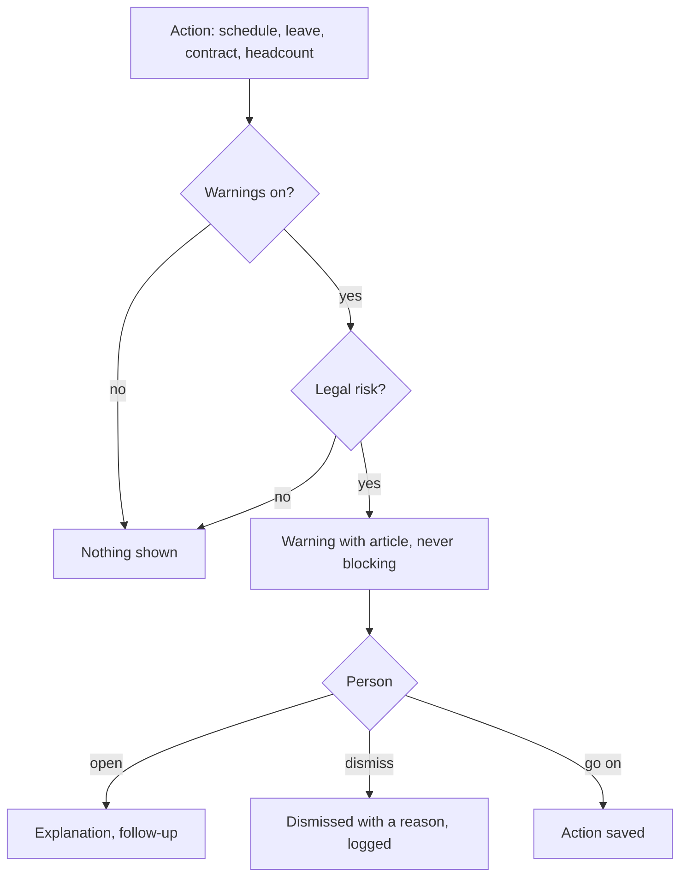

🏠 [Specs](../../../README.md) › 🧩 [Functional capabilities](../../README.md) › ⚖️ [F15 Legal assistant](../README.md) ›
🔀 [Flows](README.md) › 🔀 FL-F15-02 Receive a legal warning

# 🔀 FL-F15-02 Receive a legal warning

**Status:** ✅ specified

## Summary

Covers UC-F15-02 (UC-F15-01 before the review of 2026-11-12).

## Personas

- [U01 Employee](../../../01-users/personas/u01-employee.md)
- [U14 Field worker](../../../01-users/personas/u14-field-worker.md)
- [U02 Manager](../../../01-users/personas/u02-manager.md)
- [U06 HR](../../../01-users/personas/u06-hr.md)
- [U13 Owner](../../../01-users/personas/u13-owner.md)
- [U05 Accounting](../../../01-users/personas/u05-accounting.md)
- [U08 External accountant](../../../01-users/personas/u08-external-accountant.md)
- [U07 Administrator](../../../01-users/personas/u07-administrator.md)

## Flowchart

## Sequence diagram

See [UC-F15-01](../use-cases/01-ask-a-legal-question/uc-f15-01-use-the-legal-assistant.md#sequence-diagram).

## Steps

| Step | Persona | Screen | Use case | What happens |
|---|---|---|---|---|
| 1 | U02, U06 | [S-F15-02](../screens/02-receive-a-legal-warning/s-f15-02-legal-warning.md) | [UC-F15-02](../use-cases/02-receive-a-legal-warning/uc-f15-02-receive-a-legal-warning.md) | Warning on a schedule |
| 2 | U06, U13 | [S-F15-02](../screens/02-receive-a-legal-warning/s-f15-02-legal-warning.md) | [UC-F15-02](../use-cases/02-receive-a-legal-warning/uc-f15-02-receive-a-legal-warning.md) | Threshold crossed |
| 3 | U01 | [S-F15-02](../screens/02-receive-a-legal-warning/s-f15-02-legal-warning.md) | [UC-F15-02](../use-cases/02-receive-a-legal-warning/uc-f15-02-receive-a-legal-warning.md) | Warning on one's own leave request |

### Entities and screens

| Entity | States in this flow | Shown at step and screen | Aggregated view |
|---|---|---|---|
| [E-F15-11 Warning trigger](../data/e-f15-11-warning-trigger.md) | On, Off | 1, 2, 3 [S-F15-02](../screens/02-receive-a-legal-warning/s-f15-02-legal-warning.md) | Warning triggers |
| [E-F9-16 Shift](../../f09-hr-and-projects/data/e-f09-16-shift.md) | Draft, Published | Shown elsewhere: [S-F9-30 Scheduling board](../../f09-hr-and-projects/screens/12-schedule-customer-requests/s-f09-30-scheduling-board.md) | Shifts |
| [E-F9-09 Time-off request](../../f09-hr-and-projects/data/e-f09-09-time-off-request.md) | To approve, Approved, Refused, Cancelled | Shown elsewhere: [S-F9-09 Time off](../../f09-hr-and-projects/screens/03-time/s-f09-09-time-off.md) | Time-off requests |
| [E-F9-02 Contract](../../f09-hr-and-projects/data/e-f09-02-contract.md) | Draft, Running, Expired | Shown elsewhere: [S-F9-35 Employee qualifications](../../f09-hr-and-projects/screens/13-keep-qualifications/s-f09-35-employee-qualifications.md) | Contracts |
| [E-F15-02 Legal warning](../data/e-f15-02-legal-warning.md) | Shown, Dismissed | 1, 2, 3 [S-F15-02](../screens/02-receive-a-legal-warning/s-f15-02-legal-warning.md) | Legal warnings |
| [E-T11-03 Article version](../../../03-technical/t11-legal-corpora/data/e-t11-03-article-version.md) | Recorded | Shown elsewhere: [S-T11-03 Article version](../../../03-technical/t11-legal-corpora/screens/s-t11-03-article-version.md), from the admin list [S-T11-L03](../../../03-technical/t11-legal-corpora/screens/00-lists/s-t11-l03-article-versions.md) | Article versions |
| [E-F1-03 User](../../f01-administration/data/e-f01-03-user.md) | Invited, Active, Deactivated | Shown elsewhere: [S-F1-03 Users](../../f01-administration/screens/03-user-lifecycle/s-f01-03-users.md) | Users |

## Errors

None.

## Images

Every step and error, for each persona taking part, in light and dark mode (D120). Steps are numbered as in the Steps
table; E rows are the error cases.

| Step | Persona | Device | Light | Dark |
|---|---|---|---|---|
| 1 | U02 | desktop | [light](../images/02-receive-a-legal-warning/u02-manager/1-warning-on-a-schedule-desktop-light.png) | [dark](../images/02-receive-a-legal-warning/u02-manager/1-warning-on-a-schedule-desktop-dark.png) |
| 1 | U02 | phone | [light](../images/02-receive-a-legal-warning/u02-manager/1-warning-on-a-schedule-phone-light.png) | [dark](../images/02-receive-a-legal-warning/u02-manager/1-warning-on-a-schedule-phone-dark.png) |
| 1 | U06 | desktop | [light](../images/02-receive-a-legal-warning/u06-hr/1-warning-on-a-schedule-desktop-light.png) | [dark](../images/02-receive-a-legal-warning/u06-hr/1-warning-on-a-schedule-desktop-dark.png) |
| 2 | U06 | desktop | [light](../images/02-receive-a-legal-warning/u06-hr/2-threshold-crossed-desktop-light.png) | [dark](../images/02-receive-a-legal-warning/u06-hr/2-threshold-crossed-desktop-dark.png) |
| 2 | U13 | desktop | [light](../images/02-receive-a-legal-warning/u13-owner/2-threshold-crossed-desktop-light.png) | [dark](../images/02-receive-a-legal-warning/u13-owner/2-threshold-crossed-desktop-dark.png) |
| 2 | U13 | phone | [light](../images/02-receive-a-legal-warning/u13-owner/2-threshold-crossed-phone-light.png) | [dark](../images/02-receive-a-legal-warning/u13-owner/2-threshold-crossed-phone-dark.png) |
| 3 | U01 | phone | [light](../images/02-receive-a-legal-warning/u01-employee/3-own-leave-request-phone-light.png) | [dark](../images/02-receive-a-legal-warning/u01-employee/3-own-leave-request-phone-dark.png) |
| 3 | U01 | desktop | [light](../images/02-receive-a-legal-warning/u01-employee/3-own-leave-request-desktop-light.png) | [dark](../images/02-receive-a-legal-warning/u01-employee/3-own-leave-request-desktop-dark.png) |

## Open questions

None.

---

⬅️ [FL-F15-01 Ask a legal question](fl-f15-01-ask-a-legal-question.md) · ⬆️ [Up](README.md) ·
➡️ [FL-F15-03 Check a document against the law](fl-f15-03-check-a-document-against-the-law.md)
