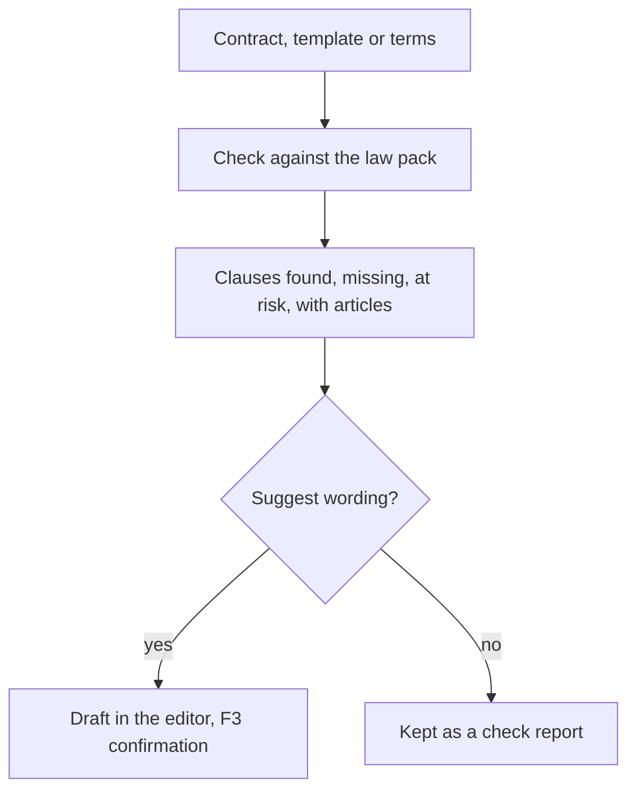

🏠 [Specs](../../../README.md) › 🧩 [Functional capabilities](../../README.md) › ⚖️ [F15 Legal assistant](../README.md) ›
🔀 [Flows](README.md) › 🔀 FL-F15-03 Check a document against the law

# 🔀 FL-F15-03 Check a document against the law

**Status:** ✅ specified

## Summary

Covers UC-F15-03 (UC-F15-01 before the review of 2026-11-12).

## Personas

- [U01 Employee](../../../01-users/personas/u01-employee.md)
- [U14 Field worker](../../../01-users/personas/u14-field-worker.md)
- [U02 Manager](../../../01-users/personas/u02-manager.md)
- [U06 HR](../../../01-users/personas/u06-hr.md)
- [U13 Owner](../../../01-users/personas/u13-owner.md)
- [U05 Accounting](../../../01-users/personas/u05-accounting.md)
- [U08 External accountant](../../../01-users/personas/u08-external-accountant.md)
- [U07 Administrator](../../../01-users/personas/u07-administrator.md)

## Flowchart

## Sequence diagram

See [UC-F15-01](../use-cases/01-ask-a-legal-question/uc-f15-01-use-the-legal-assistant.md#sequence-diagram).

## Steps

| Step | Persona | Screen | Use case | What happens |
|---|---|---|---|---|
| 1 | U06, U13 | [S-F15-03](../screens/03-check-a-document-against-the-law/s-f15-03-document-check.md) | [UC-F15-03](../use-cases/03-check-a-document-against-the-law/uc-f15-03-check-a-document-against-the-law.md) | Check a contract template |
| 2 | U06, U13 | [S-F15-03](../screens/03-check-a-document-against-the-law/s-f15-03-document-check.md) | [UC-F15-03](../use-cases/03-check-a-document-against-the-law/uc-f15-03-check-a-document-against-the-law.md) | Missing clauses listed |

### Entities and screens

| Entity | States in this flow | Shown at step and screen | Aggregated view |
|---|---|---|---|
| [E-F15-06 Contract record](../data/e-f15-06-contract-record.md) | Active, Notice given, Renewed, Ended | Shown elsewhere: [S-F15-08 Contracts](../screens/05-duties-and-records/s-f15-08-contracts.md) | Contract records |
| [E-F2-06 Document template](../../f02-no-code-configuration/data/e-f02-06-document-template.md) | Draft | Shown elsewhere: [S-F2-06 Document template editor](../../f02-no-code-configuration/screens/02-customise-documents-and-emails/s-f02-06-document-template-editor.md) | Document templates |
| [E-F11-14 Legal page](../../f11-online-shop/data/e-f11-14-legal-page.md) | Active | Shown elsewhere: [S-F11-19 Legal pages](../../f11-online-shop/screens/06-channels-and-legal/s-f11-19-legal-pages.md) | Legal pages |
| [E-F15-01 Law pack](../data/e-f15-01-law-pack.md) | Scheduled | 1, 2 [S-F15-03](../screens/03-check-a-document-against-the-law/s-f15-03-document-check.md) | Law packs |
| [E-F15-03 Document check](../data/e-f15-03-document-check.md) | Recorded | 1, 2 [S-F15-03](../screens/03-check-a-document-against-the-law/s-f15-03-document-check.md) | Document checks |
| [E-T11-03 Article version](../../../03-technical/t11-legal-corpora/data/e-t11-03-article-version.md) | Recorded | Shown elsewhere: [S-T11-03 Article version](../../../03-technical/t11-legal-corpora/screens/s-t11-03-article-version.md), from the admin list [S-T11-L03](../../../03-technical/t11-legal-corpora/screens/00-lists/s-t11-l03-article-versions.md) | Article versions |
| [E-F2-13 Document](../../f02-no-code-configuration/data/e-f02-13-document.md) | To sort, To validate, Done | Shown elsewhere: [S-F2-13 Documents workspace](../../f02-no-code-configuration/screens/07-benchmark-additions/s-f02-13-documents-workspace.md) | Documents |
| [E-F3-04 Assistant change batch](../../f03-assistant/data/e-f03-04-assistant-change-batch.md) | Proposed, Cancelled, Done, Partly done, Undone | Shown elsewhere: [S-F3-01 Assistant panel](../../f03-assistant/screens/01-ask-the-assistant/s-f03-01-assistant-panel.md) | Assistant change batches |
| [E-F9-19 Contract template](../../f09-hr-and-projects/data/e-f09-19-contract-template.md) | Draft | Shown elsewhere: [S-F9-19 Contract editor](../../f09-hr-and-projects/screens/01-people/s-f09-19-contract-editor.md) | Contract templates |

## Errors

A document that cannot be read.

## Images

Every step and error, for each persona taking part, in light and dark mode (D120). Steps are numbered as in the Steps
table; E rows are the error cases.

| Step | Persona | Device | Light | Dark |
|---|---|---|---|---|
| 1 | U06 | desktop | [light](../images/03-check-a-document-against-the-law/u06-hr/1-check-a-template-desktop-light.png) | [dark](../images/03-check-a-document-against-the-law/u06-hr/1-check-a-template-desktop-dark.png) |
| 1 | U13 | desktop | [light](../images/03-check-a-document-against-the-law/u13-owner/1-check-a-template-desktop-light.png) | [dark](../images/03-check-a-document-against-the-law/u13-owner/1-check-a-template-desktop-dark.png) |
| 1 | U13 | phone | [light](../images/03-check-a-document-against-the-law/u13-owner/1-check-a-template-phone-light.png) | [dark](../images/03-check-a-document-against-the-law/u13-owner/1-check-a-template-phone-dark.png) |
| 2 | U06 | desktop | [light](../images/03-check-a-document-against-the-law/u06-hr/2-missing-clauses-desktop-light.png) | [dark](../images/03-check-a-document-against-the-law/u06-hr/2-missing-clauses-desktop-dark.png) |
| 2 | U13 | desktop | [light](../images/03-check-a-document-against-the-law/u13-owner/2-missing-clauses-desktop-light.png) | [dark](../images/03-check-a-document-against-the-law/u13-owner/2-missing-clauses-desktop-dark.png) |
| 2 | U13 | phone | [light](../images/03-check-a-document-against-the-law/u13-owner/2-missing-clauses-phone-light.png) | [dark](../images/03-check-a-document-against-the-law/u13-owner/2-missing-clauses-phone-dark.png) |
| E1 | U06 | desktop | [light](../images/03-check-a-document-against-the-law/u06-hr/e1-unreadable-document-desktop-light.png) | [dark](../images/03-check-a-document-against-the-law/u06-hr/e1-unreadable-document-desktop-dark.png) |

## Open questions

None.

---

⬅️ [FL-F15-02 Receive a legal warning](fl-f15-02-receive-a-legal-warning.md) · ⬆️ [Up](README.md) ·
➡️ [FL-F15-04 Set up the legal assistant](fl-f15-04-set-up-the-legal-assistant.md)
