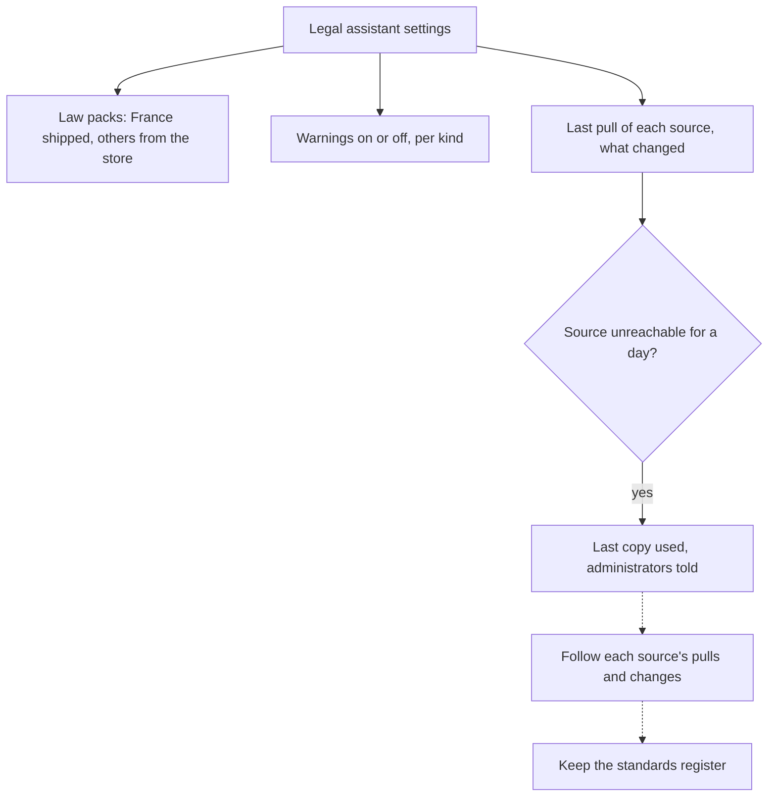

🏠 [Specs](../../../README.md) › 🧩 [Functional capabilities](../../README.md) › ⚖️ [F15 Legal assistant](../README.md) ›
🔀 [Flows](README.md) › 🔀 FL-F15-04 Set up the legal assistant

# 🔀 FL-F15-04 Set up the legal assistant

**Status:** ✅ specified

## Summary

Covers UC-F15-04, UC-F15-05, UC-F15-06 (UC-F15-01 before the review of 2026-11-12).

## Personas

- [U01 Employee](../../../01-users/personas/u01-employee.md)
- [U14 Field worker](../../../01-users/personas/u14-field-worker.md)
- [U02 Manager](../../../01-users/personas/u02-manager.md)
- [U06 HR](../../../01-users/personas/u06-hr.md)
- [U13 Owner](../../../01-users/personas/u13-owner.md)
- [U05 Accounting](../../../01-users/personas/u05-accounting.md)
- [U08 External accountant](../../../01-users/personas/u08-external-accountant.md)
- [U07 Administrator](../../../01-users/personas/u07-administrator.md)

## Flowchart

## Sequence diagram

See [UC-F15-01](../use-cases/01-ask-a-legal-question/uc-f15-01-use-the-legal-assistant.md#sequence-diagram).

## Steps

| Step | Persona | Screen | Use case | What happens |
|---|---|---|---|---|
| 1 | U07 | [S-F15-04](../screens/04-set-up-the-legal-assistant/s-f15-04-legal-assistant-settings.md) | [UC-F15-04](../use-cases/04-set-up-the-legal-assistant/uc-f15-04-set-up-the-legal-assistant.md), [UC-F15-06](../use-cases/04-set-up-the-legal-assistant/uc-f15-06-keep-the-standards-register.md) | Law packs and warnings |
| 2 | U07 | [S-F15-04](../screens/04-set-up-the-legal-assistant/s-f15-04-legal-assistant-settings.md) | [UC-F15-05](../use-cases/04-set-up-the-legal-assistant/uc-f15-05-follow-the-law-packs-refresh.md) | Each source's last pull and what changed |
| 3 | U07 | [S-F15-05](../screens/04-set-up-the-legal-assistant/s-f15-05-law-packs-refresh.md) | [UC-F15-05](../use-cases/04-set-up-the-legal-assistant/uc-f15-05-follow-the-law-packs-refresh.md) | Follow each source's pulls and changes |
| 4 | U07, U13 | [S-F15-06](../screens/04-set-up-the-legal-assistant/s-f15-06-standards-register.md) | [UC-F15-06](../use-cases/04-set-up-the-legal-assistant/uc-f15-06-keep-the-standards-register.md) | Keep the standards register |

### Entities and screens

| Entity | States in this flow | Shown at step and screen | Aggregated view |
|---|---|---|---|
| [E-F1-09 AI feature setting](../../f01-administration/data/e-f01-09-ai-feature-setting.md) | Active | Shown elsewhere: [S-F1-08 AI settings](../../f01-administration/screens/06-choose-an-ai-provider/s-f01-08-ai-settings.md) | AI feature settings |
| [E-F15-01 Law pack](../data/e-f15-01-law-pack.md) | Scheduled | 1, 2 [S-F15-04](../screens/04-set-up-the-legal-assistant/s-f15-04-legal-assistant-settings.md); 3 [S-F15-05](../screens/04-set-up-the-legal-assistant/s-f15-05-law-packs-refresh.md) | Law packs |
| [E-F15-11 Warning trigger](../data/e-f15-11-warning-trigger.md) | On, Off | 1, 2 [S-F15-04](../screens/04-set-up-the-legal-assistant/s-f15-04-legal-assistant-settings.md) | Warning triggers |
| [E-F15-12 Legal source](../data/e-f15-12-legal-source.md) | Active | 1, 2 [S-F15-04](../screens/04-set-up-the-legal-assistant/s-f15-04-legal-assistant-settings.md); 3 [S-F15-05](../screens/04-set-up-the-legal-assistant/s-f15-05-law-packs-refresh.md) | Legal sources |
| [E-T11-03 Article version](../../../03-technical/t11-legal-corpora/data/e-t11-03-article-version.md) | Recorded | Shown elsewhere: [S-T11-03 Article version](../../../03-technical/t11-legal-corpora/screens/s-t11-03-article-version.md), from the admin list [S-T11-L03](../../../03-technical/t11-legal-corpora/screens/00-lists/s-t11-l03-article-versions.md) | Article versions |
| [E-F15-04 Standard register entry](../data/e-f15-04-standard-register-entry.md) | Open | 1, 2 [S-F15-04](../screens/04-set-up-the-legal-assistant/s-f15-04-legal-assistant-settings.md); 4 [S-F15-06](../screens/04-set-up-the-legal-assistant/s-f15-06-standards-register.md) | Standard register entries |

## Errors

An official source unreachable for a day.

## Images

Every step and error, for each persona taking part, in light and dark mode (D120). Steps are numbered as in the Steps
table; E rows are the error cases.

| Step | Persona | Device | Light | Dark |
|---|---|---|---|---|
| 1 | U07 | desktop | [light](../images/04-set-up-the-legal-assistant/u07-administrator/1-law-packs-and-warnings-desktop-light.png) | [dark](../images/04-set-up-the-legal-assistant/u07-administrator/1-law-packs-and-warnings-desktop-dark.png) |
| 2 | U07 | desktop | [light](../images/04-set-up-the-legal-assistant/u07-administrator/2-last-pulls-desktop-light.png) | [dark](../images/04-set-up-the-legal-assistant/u07-administrator/2-last-pulls-desktop-dark.png) |
| E1 | U07 | desktop | [light](../images/04-set-up-the-legal-assistant/u07-administrator/e1-source-unreachable-desktop-light.png) | [dark](../images/04-set-up-the-legal-assistant/u07-administrator/e1-source-unreachable-desktop-dark.png) |
| 3 | U07 | desktop | [light](../images/04-set-up-the-legal-assistant/u07-administrator/3-law-packs-refresh-desktop-light.png) | [dark](../images/04-set-up-the-legal-assistant/u07-administrator/3-law-packs-refresh-desktop-dark.png) |
| 4 | U07 | desktop | [light](../images/04-set-up-the-legal-assistant/u07-administrator/4-standards-register-desktop-light.png) | [dark](../images/04-set-up-the-legal-assistant/u07-administrator/4-standards-register-desktop-dark.png) |
| 4 | U13 | desktop | [light](../images/04-set-up-the-legal-assistant/u13-owner/4-standards-register-desktop-light.png) | [dark](../images/04-set-up-the-legal-assistant/u13-owner/4-standards-register-desktop-dark.png) |
| 4 | U13 | phone | [light](../images/04-set-up-the-legal-assistant/u13-owner/4-standards-register-phone-light.png) | [dark](../images/04-set-up-the-legal-assistant/u13-owner/4-standards-register-phone-dark.png) |

## Open questions

None.

---

⬅️ [FL-F15-03 Check a document against the law](fl-f15-03-check-a-document-against-the-law.md) · ⬆️ [Up](README.md) ·
➡️ [FL-F15-05 Duties and records](fl-f15-05-duties-and-records.md)
