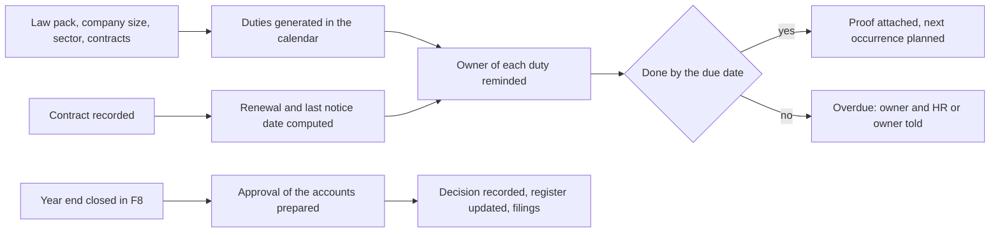
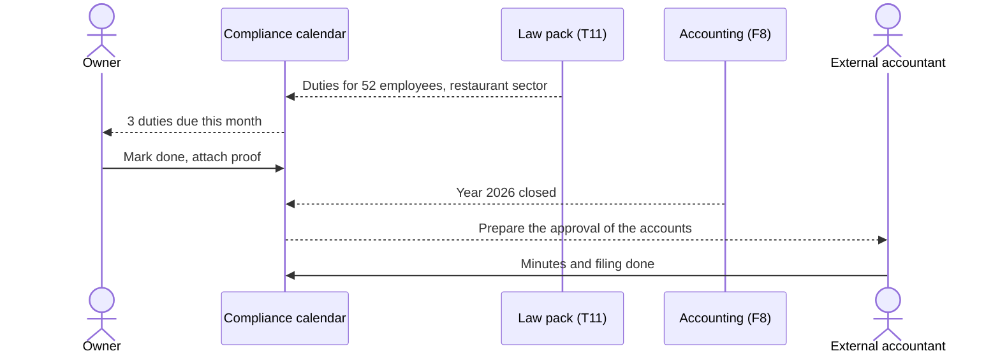

🏠 [Specs](../../../README.md) › 🧩 [Functional capabilities](../../README.md) › ⚖️ [F15 Legal assistant](../README.md) ›
🔀 [Flows](README.md) › 🔀 FL-F15-05 Duties and records

# 🔀 FL-F15-05 Duties and records

**Status:** ✅ specified

## Summary

The company's dated legal duties, its contracts' renewal and notice dates and its company-law housekeeping in one
calendar: each duty has an owner and reminders, and the AI assistant explains each with its source (D472).

## Personas

- [U13 Owner](../../../01-users/personas/u13-owner.md)
- [U06 Human resources](../../../01-users/personas/u06-hr.md)
- [U05 Accounting](../../../01-users/personas/u05-accounting.md)
- [U08 External accountant](../../../01-users/personas/u08-external-accountant.md)
- [U04 Purchasing and stock](../../../01-users/personas/u04-purchasing.md)

## Flowchart

## Sequence diagram

## Steps

| Step | Persona | Screen | Use case | What happens |
|---|---|---|---|---|
| 1 | U13, U06, U05 | [S-F15-07](../screens/05-duties-and-records/s-f15-07-compliance-calendar.md) | [UC-F15-07](../use-cases/05-duties-and-records/uc-f15-07-keep-the-compliance-calendar.md) | Keep the compliance calendar |
| 2 | U13, U04 | [S-F15-08](../screens/05-duties-and-records/s-f15-08-contracts.md) | [UC-F15-08](../use-cases/05-duties-and-records/uc-f15-08-track-contract-renewal-and-notice-dates.md) | Track contract renewal and notice dates |
| 3 | U13, U08 | [S-F15-09](../screens/05-duties-and-records/s-f15-09-company-records.md) | [UC-F15-09](../use-cases/05-duties-and-records/uc-f15-09-approve-the-accounts-and-keep-the-company-registers.md) | Approve the accounts and keep the company registers |

### Entities and screens

| Entity | States in this flow | Shown at step and screen | Aggregated view |
|---|---|---|---|
| [E-F15-01 Law pack](../data/e-f15-01-law-pack.md) | Scheduled | 1 [S-F15-07](../screens/05-duties-and-records/s-f15-07-compliance-calendar.md) | Law packs |
| [E-F15-06 Contract record](../data/e-f15-06-contract-record.md) | Active, Notice given, Renewed, Ended | 2 [S-F15-08](../screens/05-duties-and-records/s-f15-08-contracts.md) | Contract records |
| [E-F15-05 Compliance duty](../data/e-f15-05-compliance-duty.md) | Planned, Done, Overdue | 1 [S-F15-07](../screens/05-duties-and-records/s-f15-07-compliance-calendar.md); 2 [S-F15-08](../screens/05-duties-and-records/s-f15-08-contracts.md); 3 [S-F15-09](../screens/05-duties-and-records/s-f15-09-company-records.md) | Compliance duties |
| [E-F1-03 User](../../f01-administration/data/e-f01-03-user.md) | Invited, Active, Deactivated | Shown elsewhere: [S-F1-03 Users](../../f01-administration/screens/03-user-lifecycle/s-f01-03-users.md) | Users |
| [E-F2-13 Document](../../f02-no-code-configuration/data/e-f02-13-document.md) | Done | Shown elsewhere: [S-F2-13 Documents workspace](../../f02-no-code-configuration/screens/07-benchmark-additions/s-f02-13-documents-workspace.md) | Documents |
| [E-F8-10 Fiscal period](../../f08-accounting/data/e-f08-10-fiscal-period.md) | Active | Shown elsewhere: [S-F8-01 Books setup](../../f08-accounting/screens/01-set-up-and-post/s-f08-01-books-setup.md) | Fiscal periods |
| [E-F15-07 Corporate decision](../data/e-f15-07-corporate-decision.md) | Prepared | 3 [S-F15-09](../screens/05-duties-and-records/s-f15-09-company-records.md) | Corporate decisions |
| [E-F8-22 Annual accounts file](../../f08-accounting/data/e-f08-22-annual-accounts-file.md) | Draft, Approved, Filed | Shown elsewhere: [S-F8-25 Annual accounts](../../f08-accounting/screens/08-year-end-duties/s-f08-25-annual-accounts.md) | Annual accounts files |
| [E-F15-14 Corporate filing](../data/e-f15-14-corporate-filing.md) | Active | 1 [S-F15-07](../screens/05-duties-and-records/s-f15-07-compliance-calendar.md) | Corporate filings |

## Errors

E1: a duty's due date passes undone: it turns overdue and the owner is told; the flow resumes at step 1 once done. E2:
the last notice date of a contract passes: the contract renews by itself and the calendar shows the new term (step 2).
E3: the accounts are not closed in F8 in time: the approval is flagged and the extension the court may grant is suggested
([CR-FR-221](../../../10-country-packs/france/company/cr-fr-221-general-meetings.md), step 3).

## Images

Every step and error, for each persona taking part, in light and dark mode (D120). Steps are numbered as in the Steps
table; E rows are the error cases.

| Step | Persona | Device | Light | Dark |
|---|---|---|---|---|
| 1 | U13 | desktop | [light](../images/05-duties-and-records/u13-owner/1-compliance-calendar-desktop-light.png) | [dark](../images/05-duties-and-records/u13-owner/1-compliance-calendar-desktop-dark.png) |
| 1 | U13 | phone | [light](../images/05-duties-and-records/u13-owner/1-compliance-calendar-phone-light.png) | [dark](../images/05-duties-and-records/u13-owner/1-compliance-calendar-phone-dark.png) |
| 1 | U05 | desktop | [light](../images/05-duties-and-records/u05-accounting/1-compliance-calendar-desktop-light.png) | [dark](../images/05-duties-and-records/u05-accounting/1-compliance-calendar-desktop-dark.png) |
| 1 | U06 | desktop | [light](../images/05-duties-and-records/u06-hr/1-compliance-calendar-desktop-light.png) | [dark](../images/05-duties-and-records/u06-hr/1-compliance-calendar-desktop-dark.png) |
| 2 | U13 | desktop | [light](../images/05-duties-and-records/u13-owner/2-contracts-desktop-light.png) | [dark](../images/05-duties-and-records/u13-owner/2-contracts-desktop-dark.png) |
| 2 | U13 | phone | [light](../images/05-duties-and-records/u13-owner/2-contracts-phone-light.png) | [dark](../images/05-duties-and-records/u13-owner/2-contracts-phone-dark.png) |
| 2 | U04 | desktop | [light](../images/05-duties-and-records/u04-purchasing/2-contracts-desktop-light.png) | [dark](../images/05-duties-and-records/u04-purchasing/2-contracts-desktop-dark.png) |
| 3 | U13 | desktop | [light](../images/05-duties-and-records/u13-owner/3-company-records-desktop-light.png) | [dark](../images/05-duties-and-records/u13-owner/3-company-records-desktop-dark.png) |
| 3 | U13 | phone | [light](../images/05-duties-and-records/u13-owner/3-company-records-phone-light.png) | [dark](../images/05-duties-and-records/u13-owner/3-company-records-phone-dark.png) |
| 3 | U08 | desktop | [light](../images/05-duties-and-records/u08-external-accountant/3-company-records-desktop-light.png) | [dark](../images/05-duties-and-records/u08-external-accountant/3-company-records-desktop-dark.png) |
| E1 | U13 | desktop | [light](../images/05-duties-and-records/u13-owner/e1-compliance-calendar-refused-desktop-light.png) | [dark](../images/05-duties-and-records/u13-owner/e1-compliance-calendar-refused-desktop-dark.png) |
| E1 | U13 | phone | [light](../images/05-duties-and-records/u13-owner/e1-compliance-calendar-refused-phone-light.png) | [dark](../images/05-duties-and-records/u13-owner/e1-compliance-calendar-refused-phone-dark.png) |

## Open questions

None.

---

⬅️ [FL-F15-04 Set up the legal assistant](fl-f15-04-set-up-the-legal-assistant.md) · ⬆️ [Up](README.md) ·
➡️ [FL-F15-06 Privacy and AI duties](fl-f15-06-privacy-and-ai-duties.md)
