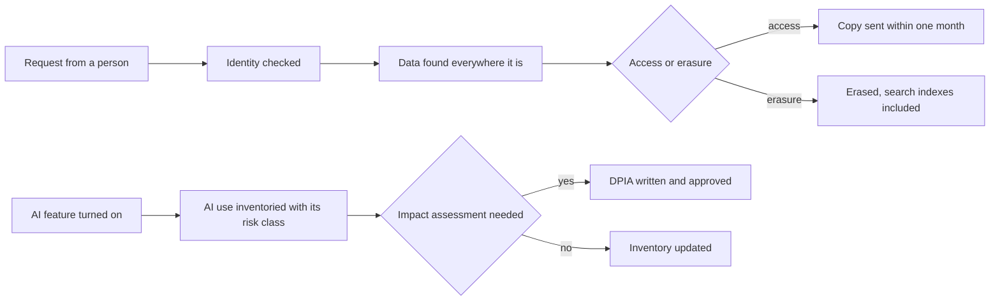
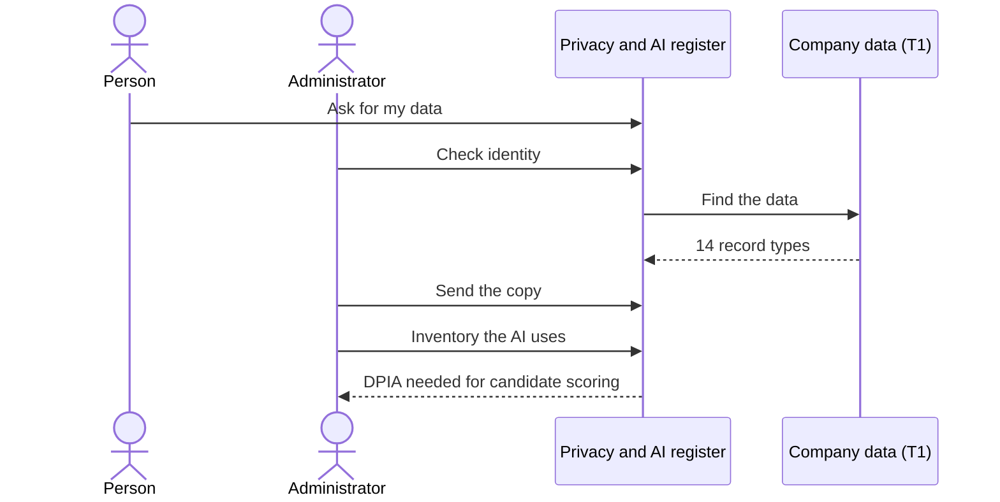

🏠 [Specs](../../../README.md) › 🧩 [Functional capabilities](../../README.md) › ⚖️ [F15 Legal assistant](../README.md) ›
🔀 [Flows](README.md) › 🔀 FL-F15-06 Privacy and AI duties

# 🔀 FL-F15-06 Privacy and AI duties

**Status:** ✅ specified

## Summary

The company answers people who ask for their data or its erasure within the legal month, and keeps the inventory of its
AI uses with their risk class and the impact assessments they need (D472).

## Personas

- [U07 Administrator](../../../01-users/personas/u07-administrator.md)
- [U06 Human resources](../../../01-users/personas/u06-hr.md)
- [U13 Owner](../../../01-users/personas/u13-owner.md)
- [U01 Employee](../../../01-users/personas/u01-employee.md)
- [U09 Customer](../../../01-users/personas/u09-customer.md)

## Flowchart

## Sequence diagram

## Steps

| Step | Persona | Screen | Use case | What happens |
|---|---|---|---|---|
| 1 | U07, U06, U01, U09 | [S-F15-10](../screens/06-privacy-and-ai-duties/s-f15-10-privacy-and-ai-register.md) | [UC-F15-10](../use-cases/06-privacy-and-ai-duties/uc-f15-10-answer-a-data-subject-request.md) | Answer a data-subject request |
| 2 | U07, U13 | [S-F15-10](../screens/06-privacy-and-ai-duties/s-f15-10-privacy-and-ai-register.md) | [UC-F15-11](../use-cases/06-privacy-and-ai-duties/uc-f15-11-keep-the-ai-uses-inventory-and-impact-assessments.md) | Keep the AI uses inventory and impact assessments |

### Entities and screens

| Entity | States in this flow | Shown at step and screen | Aggregated view |
|---|---|---|---|
| [E-F15-08 Data-subject request](../data/e-f15-08-data-subject-request.md) | Received, Verified, Overdue, Answered | 1, 2 [S-F15-10](../screens/06-privacy-and-ai-duties/s-f15-10-privacy-and-ai-register.md) | Data-subject requests |
| [E-SC14-13 Data export](../../../08-sectors/sc14-it-and-software/data/e-sc14-13-data-export.md) | Active | Shown elsewhere: [S-SC14-14 Data export](../../../08-sectors/sc14-it-and-software/screens/05-security-and-data-compliance/s-sc14-14-data-export.md) | Data exports |
| [E-T08-01 Collection](../../../03-technical/t08-rag-platform/data/e-t08-01-collection.md) | Active | Shown elsewhere: [S-T08-01 Collection](../../../03-technical/t08-rag-platform/screens/s-t08-01-collection.md), from the admin list [S-T08-L01](../../../03-technical/t08-rag-platform/screens/00-lists/s-t08-l01-collections.md) | Collections |
| [E-F1-09 AI feature setting](../../f01-administration/data/e-f01-09-ai-feature-setting.md) | Active | Shown elsewhere: [S-F1-08 AI settings](../../f01-administration/screens/06-choose-an-ai-provider/s-f01-08-ai-settings.md) | AI feature settings |
| [E-F15-09 AI use](../data/e-f15-09-ai-use.md) | Listed, Assessed, On, Off | 1, 2 [S-F15-10](../screens/06-privacy-and-ai-duties/s-f15-10-privacy-and-ai-register.md) | AI uses |
| [E-F15-13 Data protection impact assessment](../data/e-f15-13-data-protection-impact-assessment.md) | Active | 1, 2 [S-F15-10](../screens/06-privacy-and-ai-duties/s-f15-10-privacy-and-ai-register.md) | Data protection impact assessments |

## Errors

E1: the identity cannot be checked: the request waits, the person is asked for proof and the month runs from the proof
(step 1). E2: an AI use with a high-risk class has no impact assessment: it stays off until one is approved (step 2).

## Images

Every step and error, for each persona taking part, in light and dark mode (D120). Steps are numbered as in the Steps
table; E rows are the error cases.

| Step | Persona | Device | Light | Dark |
|---|---|---|---|---|
| 1 | U07 | desktop | [light](../images/06-privacy-and-ai-duties/u07-administrator/1-privacy-and-ai-register-desktop-light.png) | [dark](../images/06-privacy-and-ai-duties/u07-administrator/1-privacy-and-ai-register-desktop-dark.png) |
| 1 | U01 | desktop | [light](../images/06-privacy-and-ai-duties/u01-employee/1-privacy-and-ai-register-desktop-light.png) | [dark](../images/06-privacy-and-ai-duties/u01-employee/1-privacy-and-ai-register-desktop-dark.png) |
| 1 | U01 | phone | [light](../images/06-privacy-and-ai-duties/u01-employee/1-privacy-and-ai-register-phone-light.png) | [dark](../images/06-privacy-and-ai-duties/u01-employee/1-privacy-and-ai-register-phone-dark.png) |
| 1 | U06 | desktop | [light](../images/06-privacy-and-ai-duties/u06-hr/1-privacy-and-ai-register-desktop-light.png) | [dark](../images/06-privacy-and-ai-duties/u06-hr/1-privacy-and-ai-register-desktop-dark.png) |
| 1 | U09 | phone | [light](../images/06-privacy-and-ai-duties/u09-customer/1-privacy-and-ai-register-phone-light.png) | [dark](../images/06-privacy-and-ai-duties/u09-customer/1-privacy-and-ai-register-phone-dark.png) |
| 2 | U07 | desktop | [light](../images/06-privacy-and-ai-duties/u07-administrator/2-privacy-and-ai-register-desktop-light.png) | [dark](../images/06-privacy-and-ai-duties/u07-administrator/2-privacy-and-ai-register-desktop-dark.png) |
| 2 | U13 | desktop | [light](../images/06-privacy-and-ai-duties/u13-owner/2-privacy-and-ai-register-desktop-light.png) | [dark](../images/06-privacy-and-ai-duties/u13-owner/2-privacy-and-ai-register-desktop-dark.png) |
| 2 | U13 | phone | [light](../images/06-privacy-and-ai-duties/u13-owner/2-privacy-and-ai-register-phone-light.png) | [dark](../images/06-privacy-and-ai-duties/u13-owner/2-privacy-and-ai-register-phone-dark.png) |
| E1 | U07 | desktop | [light](../images/06-privacy-and-ai-duties/u07-administrator/e1-privacy-and-ai-register-refused-desktop-light.png) | [dark](../images/06-privacy-and-ai-duties/u07-administrator/e1-privacy-and-ai-register-refused-desktop-dark.png) |

## Open questions

None.

---

⬅️ [FL-F15-05 Duties and records](fl-f15-05-duties-and-records.md) · ⬆️ [Up](README.md) ·
➡️ [FL-F15-07 Equity, contracts, meetings and disputes](fl-f15-07-equity-contracts-and-disputes.md)
