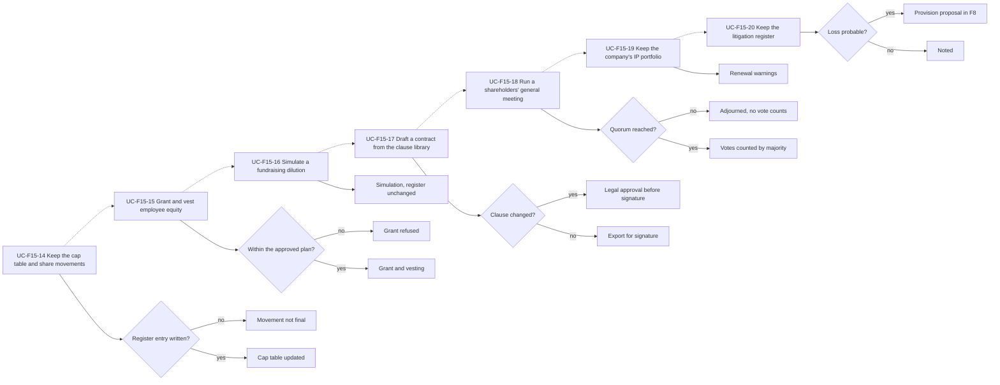
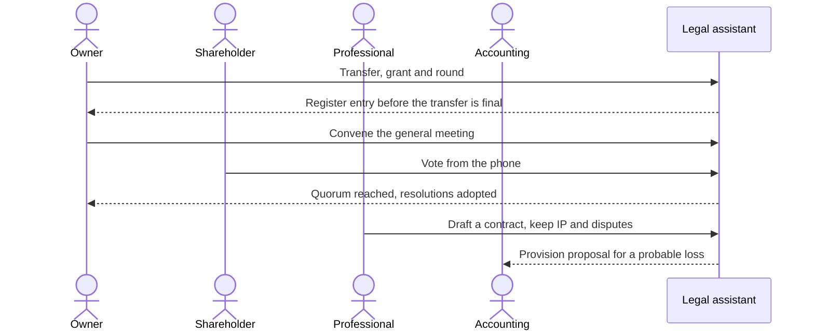

🏠 [Specs](../../../README.md) › 🧩 [Functional capabilities](../../README.md) › ⚖️ [F15 Legal assistant](../README.md) ›
🔀 [Flows](README.md) › 🔀 FL-F15-07 Equity, contracts, meetings and disputes

# 🔀 FL-F15-07 Equity, contracts, meetings and disputes

**Status:** 🔄 waiting for the owner

## Summary

The owner keeps the share register and the cap table, grants employee equity under a plan the shareholders approved,
simulates a fundraising round that changes nothing, drafts contracts from approved clauses, runs the shareholders'
general meeting, and a professional keeps the company's IP portfolio and its litigation register, with a probable loss
sent to accounting as a provision proposal
([D534](../../../06-decisions/f15-legal-assistant/d534-benchmark-gaps-f15-legal-assistant.md)).

## Personas

- [U13 Owner](../../../01-users/personas/u13-owner.md), who keeps the register and runs the meetings
- [U50 Shareholder](../../../01-users/personas/u50-shareholder.md), who sees their holding and votes
- [U01 Employee](../../../01-users/personas/u01-employee.md), who reads their equity grants
- [U31 Treasurer](../../../01-users/personas/u31-treasurer.md), who simulates a round
- [U36 Professional](../../../01-users/personas/u36-professional.md), who drafts, keeps the IP and the disputes
- [U05 Accounting](../../../01-users/personas/u05-accounting.md), who approves the provision

## Flowchart

## Sequence diagram

## Steps

| Step | Persona | Screen | Use case | What happens |
|---|---|---|---|---|
| 1 | [U13](../../../01-users/personas/u13-owner.md) | [S-F15-12](../screens/07-equity-contracts-and-disputes/s-f15-12-cap-table.md) | [UC-F15-14](../use-cases/07-equity-contracts-and-disputes/uc-f15-14-keep-the-cap-table-and-share-movements.md) | The owner records a share movement and the transfer is final once its register entry is written |
| 2 | [U13](../../../01-users/personas/u13-owner.md) | [S-F15-13](../screens/07-equity-contracts-and-disputes/s-f15-13-employee-equity.md) | [UC-F15-15](../use-cases/07-equity-contracts-and-disputes/uc-f15-15-grant-and-vest-employee-equity.md) | The owner grants employee equity under the approved plan and the employee reads it on a phone |
| 3 | [U13](../../../01-users/personas/u13-owner.md) | [S-F15-14](../screens/07-equity-contracts-and-disputes/s-f15-14-dilution.md) | [UC-F15-16](../use-cases/07-equity-contracts-and-disputes/uc-f15-16-simulate-a-fundraising-dilution.md) | The owner and the treasurer simulate a funding round, which changes nothing in the register |
| 4 | [U36](../../../01-users/personas/u36-professional.md) | [S-F15-15](../screens/07-equity-contracts-and-disputes/s-f15-15-contract-drafting.md) | [UC-F15-17](../use-cases/07-equity-contracts-and-disputes/uc-f15-17-draft-a-contract-from-the-clause-library.md) | A professional drafts a contract from approved clauses and a non-standard clause is approved |
| 5 | [U13](../../../01-users/personas/u13-owner.md) | [S-F15-16](../screens/07-equity-contracts-and-disputes/s-f15-16-shareholder-meetings.md) | [UC-F15-18](../use-cases/07-equity-contracts-and-disputes/uc-f15-18-run-a-shareholders-general-meeting.md) | The owner runs the general meeting and the shareholder votes from a phone |
| 6 | [U36](../../../01-users/personas/u36-professional.md) | [S-F15-17](../screens/07-equity-contracts-and-disputes/s-f15-17-ip-portfolio.md) | [UC-F15-19](../use-cases/07-equity-contracts-and-disputes/uc-f15-19-keep-the-companys-ip-portfolio.md) | A professional keeps the IP portfolio and is warned before each renewal |
| 7 | [U36](../../../01-users/personas/u36-professional.md) | [S-F15-18](../screens/07-equity-contracts-and-disputes/s-f15-18-litigation.md) | [UC-F15-20](../use-cases/07-equity-contracts-and-disputes/uc-f15-20-keep-the-litigation-register.md) | A professional keeps the litigation register and sends a probable loss to accounting |

### Entities and screens

| Entity | States in this flow | Shown at step and screen | Aggregated view |
|---|---|---|---|
| [E-F15-15 Shareholding](../data/e-f15-15-shareholding.md) | Proposed, Approved, Registered, Cancelled | 1 [S-F15-12](../screens/07-equity-contracts-and-disputes/s-f15-12-cap-table.md) | Shareholdings |
| [E-F15-16 Equity grant](../data/e-f15-16-equity-grant.md) | Proposed, Granted, Vesting, Vested, Exercised, Lapsed, Cancelled | 2 [S-F15-13](../screens/07-equity-contracts-and-disputes/s-f15-13-employee-equity.md) | Equity grants |
| [E-F15-17 Funding round](../data/e-f15-17-funding-round.md) | Simulating, Shared, Executed, Abandoned | 3 [S-F15-14](../screens/07-equity-contracts-and-disputes/s-f15-14-dilution.md) | Funding rounds |
| [E-F15-18 Clause](../data/e-f15-18-clause.md) | Draft, Pending, Approved, Rejected, Retired | 4 [S-F15-15](../screens/07-equity-contracts-and-disputes/s-f15-15-contract-drafting.md) | Clauses |
| [E-F15-19 General meeting](../data/e-f15-19-general-meeting.md) | Planned, Convened, Held, Adjourned, Minuted, Cancelled | 5 [S-F15-16](../screens/07-equity-contracts-and-disputes/s-f15-16-shareholder-meetings.md) | General meetings |
| [E-F15-20 IP right](../data/e-f15-20-ip-right.md) | Filed, Registered, Refused, Due, Lapsed, Sold | 6 [S-F15-17](../screens/07-equity-contracts-and-disputes/s-f15-17-ip-portfolio.md) | IP rights |
| [E-F15-21 Dispute](../data/e-f15-21-dispute.md) | Open, Proceedings, Settled, Judged, Closed | 7 [S-F15-18](../screens/07-equity-contracts-and-disputes/s-f15-18-litigation.md) | Disputes |

## Errors

- **E1 The quorum is not reached.** The meeting is adjourned and no vote counts
  ([BR-F15-22](../business-rules/br-f15-22-votes-count-only-within-quorum-and-majority.md), step 5).

## Images

Every step and error, for each persona taking part, in light and dark mode (D120). Steps are numbered as in the Steps
table; E rows are the error cases.

| Step | Persona | Device | Light | Dark |
|---|---|---|---|---|
| 1 | U13 | desktop | [light](../images/07-equity-contracts-and-disputes/u13-owner/1-cap-table-desktop-light.png) | [dark](../images/07-equity-contracts-and-disputes/u13-owner/1-cap-table-desktop-dark.png) |
| 1 | U50 | phone | [light](../images/07-equity-contracts-and-disputes/u50-shareholder/1-cap-table-phone-light.png) | [dark](../images/07-equity-contracts-and-disputes/u50-shareholder/1-cap-table-phone-dark.png) |
| 1 | U13 | phone | [light](../images/07-equity-contracts-and-disputes/u13-owner/1-cap-table-phone-light.png) | [dark](../images/07-equity-contracts-and-disputes/u13-owner/1-cap-table-phone-dark.png) |
| 2 | U13 | desktop | [light](../images/07-equity-contracts-and-disputes/u13-owner/2-employee-equity-desktop-light.png) | [dark](../images/07-equity-contracts-and-disputes/u13-owner/2-employee-equity-desktop-dark.png) |
| 2 | U01 | phone | [light](../images/07-equity-contracts-and-disputes/u01-employee/2-employee-equity-phone-light.png) | [dark](../images/07-equity-contracts-and-disputes/u01-employee/2-employee-equity-phone-dark.png) |
| 2 | U13 | phone | [light](../images/07-equity-contracts-and-disputes/u13-owner/2-employee-equity-phone-light.png) | [dark](../images/07-equity-contracts-and-disputes/u13-owner/2-employee-equity-phone-dark.png) |
| 3 | U13 | desktop | [light](../images/07-equity-contracts-and-disputes/u13-owner/3-dilution-desktop-light.png) | [dark](../images/07-equity-contracts-and-disputes/u13-owner/3-dilution-desktop-dark.png) |
| 3 | U31 | desktop | [light](../images/07-equity-contracts-and-disputes/u31-treasurer/3-dilution-desktop-light.png) | [dark](../images/07-equity-contracts-and-disputes/u31-treasurer/3-dilution-desktop-dark.png) |
| 3 | U13 | phone | [light](../images/07-equity-contracts-and-disputes/u13-owner/3-dilution-phone-light.png) | [dark](../images/07-equity-contracts-and-disputes/u13-owner/3-dilution-phone-dark.png) |
| 4 | U36 | desktop | [light](../images/07-equity-contracts-and-disputes/u36-professional/4-contract-drafting-desktop-light.png) | [dark](../images/07-equity-contracts-and-disputes/u36-professional/4-contract-drafting-desktop-dark.png) |
| 4 | U13 | desktop | [light](../images/07-equity-contracts-and-disputes/u13-owner/4-contract-drafting-desktop-light.png) | [dark](../images/07-equity-contracts-and-disputes/u13-owner/4-contract-drafting-desktop-dark.png) |
| 4 | U36 | phone | [light](../images/07-equity-contracts-and-disputes/u36-professional/4-contract-drafting-phone-light.png) | [dark](../images/07-equity-contracts-and-disputes/u36-professional/4-contract-drafting-phone-dark.png) |
| 5 | U13 | desktop | [light](../images/07-equity-contracts-and-disputes/u13-owner/5-shareholder-meetings-desktop-light.png) | [dark](../images/07-equity-contracts-and-disputes/u13-owner/5-shareholder-meetings-desktop-dark.png) |
| 5 | U50 | phone | [light](../images/07-equity-contracts-and-disputes/u50-shareholder/5-shareholder-meetings-phone-light.png) | [dark](../images/07-equity-contracts-and-disputes/u50-shareholder/5-shareholder-meetings-phone-dark.png) |
| 5 | U13 | phone | [light](../images/07-equity-contracts-and-disputes/u13-owner/5-shareholder-meetings-phone-light.png) | [dark](../images/07-equity-contracts-and-disputes/u13-owner/5-shareholder-meetings-phone-dark.png) |
| 6 | U36 | desktop | [light](../images/07-equity-contracts-and-disputes/u36-professional/6-ip-portfolio-desktop-light.png) | [dark](../images/07-equity-contracts-and-disputes/u36-professional/6-ip-portfolio-desktop-dark.png) |
| 6 | U36 | phone | [light](../images/07-equity-contracts-and-disputes/u36-professional/6-ip-portfolio-phone-light.png) | [dark](../images/07-equity-contracts-and-disputes/u36-professional/6-ip-portfolio-phone-dark.png) |
| 7 | U36 | desktop | [light](../images/07-equity-contracts-and-disputes/u36-professional/7-litigation-desktop-light.png) | [dark](../images/07-equity-contracts-and-disputes/u36-professional/7-litigation-desktop-dark.png) |
| 7 | U05 | desktop | [light](../images/07-equity-contracts-and-disputes/u05-accounting/7-litigation-desktop-light.png) | [dark](../images/07-equity-contracts-and-disputes/u05-accounting/7-litigation-desktop-dark.png) |
| 7 | U36 | phone | [light](../images/07-equity-contracts-and-disputes/u36-professional/7-litigation-phone-light.png) | [dark](../images/07-equity-contracts-and-disputes/u36-professional/7-litigation-phone-dark.png) |
| E1 | U13 | desktop | [light](../images/07-equity-contracts-and-disputes/u13-owner/e1-the-quorum-is-not-reached-desktop-light.png) | [dark](../images/07-equity-contracts-and-disputes/u13-owner/e1-the-quorum-is-not-reached-desktop-dark.png) |
| E1 | U13 | phone | [light](../images/07-equity-contracts-and-disputes/u13-owner/e1-the-quorum-is-not-reached-phone-light.png) | [dark](../images/07-equity-contracts-and-disputes/u13-owner/e1-the-quorum-is-not-reached-phone-dark.png) |

## Open questions

None.

---

⬅️ [FL-F15-06 Privacy and AI duties](fl-f15-06-privacy-and-ai-duties.md) · ⬆️ [Up](README.md)
